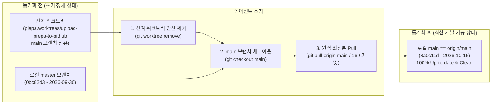

# 🔄 플에파(PLEPA) 동기화 이력 및 시스템 진화 요약서 (AI Handover & Evolution Summary)

> **문서 목적**: 원격 저장소(`https://github.com/LeeKyunHo/plepa.git`) 연동 과정에서 수행된 로컬 환경 정상화 작업과, 초기 아키텍처 대비 현재 최신 시스템의 진화 내역을 다른 AI 에이전트 및 기여자가 한눈에 파악하고 설명할 수 있도록 정리한 단일 진실 요약서(SSOT)입니다.  
> **기준 커밋**: `8a0c11d` (최신 `origin/main` 동기화 완료 시점)  
> **작성 시점**: 2026-10-15  
> **상위 연계 문서**: [`AI_HANDOVER_GUIDE.md`](AI_HANDOVER_GUIDE.md), [`DOCUMENTATION_GUIDE.md`](DOCUMENTATION_GUIDE.md), [`RUNBOOK.md`](RUNBOOK.md), [`개발일지.md`](개발일지.md)

---

## 🛠️ 1. 금번 수행된 Git 동기화 및 환경 정상화 작업

다른 컴퓨터/에이전트 환경에서 로컬 `c:\Users\USER\plepa` 디렉토리에 접근했을 때 발생한 브랜치 불일치 및 잔여 워크트리 문제를 해결하고 최신 개발본으로 동기화한 내역입니다.



### 상세 조치 내역
1. **원격 저장소 확인**:
   - `origin`이 `https://github.com/LeeKyunHo/plepa.git`로 이미 올바르게 등록되어 있음을 확인.
2. **브랜치 점유 워크트리(Worktree) 해제**:
   - 과거 9월 30일 초기 업로드 시 생성되었던 `C:/Users/USER/plepa.worktrees/upload-prepa-to-github` 디렉토리가 로컬 `main` 브랜치를 체크아웃한 채 잠그고 있어, 메인 폴더에서 `main` 브랜치로 전환할 수 없던 상태 확인.
   - `git worktree remove "C:/Users/USER/plepa.worktrees/upload-prepa-to-github"`를 실행하여 안전하게 점유 해제.
3. **최신 브랜치 체크아웃 및 Fast-forward 동기화**:
   - 초기 커밋(`0bc82d3`)에 머물러 있던 로컬 `master` 브랜치에서 실제 활성 브랜치인 **`main`**으로 전환.
   - `git pull origin main`을 통해 누적된 **169개의 커밋**을 Fast-forward로 일괄 반영.
4. **동기화 결과**:
   - 현재 HEAD: `8a0c11d` (`docs: 034번 포즈 성공률 관련 주의사항 추가`)
   - 로컬 브랜치: `main` (원격 `origin/main`과 100% 일치)
   - 작업 트리: 깨끗함 (`working tree clean`)

---

## 🚀 2. 기존(초기) 대비 현재 시스템 진화 비교 (Evolution Matrix)

초기 플에파(`0bc82d3`, 2026-09-30)는 FLUX.1 [dev] GGUF 모델을 ComfyUI로 비동기 호출하는 단순 CLI 스크립트였으나, 현재(`8a0c11d`, 2026-10-15)는 **SDXL/FLUX 듀얼 엔진, NiceGUI 로컬 웹 스튜디오, 80종 포즈 프롬프트 정밀 제어, 다중 프로젝트 로스터, 자동 얼굴 보정 및 검열 후처리**를 총망라하는 완성형 엔터프라이즈 에셋 파이프라인으로 진화했습니다.

| 비교 영역 | 초기 아키텍처 (`0bc82d3`, 2026-09-30) | 최신 아키텍처 (`8a0c11d`, 2026-10-15 현재) | 진화 사유 및 핵심 가치 |
| :--- | :--- | :--- | :--- |
| **생성 백엔드 및 엔진** | - FLUX.1 [dev] GGUF (Q5_K_M/Q6_K) 단일 엔진<br>- T5-XXL 텍스트 인코더 의존 | - **SDXL + FLUX 듀얼 엔진 체계**<br>- 기본 엔진: **SDXL NTR MIX XIII** (`dpmpp_2m karras`, CFG 5.0, 30 steps)<br>- FLUX 12B 고품질 보존 선택 가능 | - 2D 서브컬처 미소녀 및 오토코노코 신체 표현 최적화 (ADR 4, ADR 19)<br>- 장당 생성 속도 70초대 ➔ 34초대로 2배 단축 |
| **사용자 인터페이스 (UI/UX)** | - CLI 스크립트 단독 (`flux_batch_generator.py`)<br>- 터미널 텍스트 로그 출력만 지원 | - **NiceGUI 로컬 웹 스튜디오 (`plepa_gui`)**<br>- 원클릭 실행기 `run_gui.bat` (포트 8080)<br>- 캐릭터/포즈/배경 편집, 백그라운드 큐 생성, 체형별 비교 갤러리(매트릭스 뷰, 무손실 라이트박스) | - 웹 브라우저에서 캐릭터 프로필, 80종 포즈, 생성 큐를 시각적으로 직관 제어 (ADR 18, ADR 25, ADR 26) |
| **코드 구조 및 서비스 레이어** | - 모놀리식 스크립트 구조<br>- 비동기 ComfyUI 클라이언트 직결 | - **SSOT 기반 계층형 서비스 아키텍처 (`plepa_engine/services/`)**<br>- `character_service`, `pose_service`, `background_service`, `asset_service`, `generation_service`<br>- CLI와 GUI가 동일한 서비스 로직 공유 | - CLI와 GUI 간 로직 분기 원천 차단 및 무결성 보장<br>- JSON 저장 시 원자적 교체(`os.replace`) 및 타임스탬프 순환 백업(`.plepa_backup/`) 적용 |
| **포즈 DB 및 프롬프트 체계** | - 단순 영문 자연어 문장 나열<br>- 복합 씬에서 파트너 중복/왜곡 빈발<br>- 긴 한국어 라벨 (`마주안아엉덩이주무름` 등) | - **80종 포즈 표준화 (2~4글자 라벨 + `description` 필드 영구 탑재)**<br>- **000~019 타이트 바스트 샷 표준화** (`bust shot, upper body`)<br>- **파트너 격리 제어**: 화면 밖 손만 나오는 POV(`is_offscreen_partner`), 다중 머리/2boys 방지 억제 네거티브 탑재<br>- **명시적 메타데이터 (`flags`)**: `scene_type`, `nude`, `wet`, `disabled` 도입 | - 포즈 라벨 직관화 및 시각 연출 가이드 확립 (ADR 11, ADR 12, ADR 14, ADR 16)<br>- 모브 남성 다중 생성 및 구도 왜곡 결함 원천 해결 |
| **프로젝트 및 캐릭터 로스터** | - `projects/default` 단일 디렉토리 | - **다중 프로젝트(Multi-Roster) 독립 아키텍처**<br>- `projects/campus/` (캠퍼스 6인: aya, har, kao, mai, shz, yur)<br>- `projects/ykn/` (네쌍둥이 자매 4인 4색: yua, serin, sia, hayul)<br>- `projects/spy/`, `projects/maid/`, `projects/don/` 등 | - 프로젝트별 배경 프리셋, 캐릭터 프로필, 에셋 저장소의 철저한 격리 및 체계적 확장 (ADR 20, ADR 23) |
| **후처리 및 특수 기능** | - 기초 Face Detailer 노드 연동 | - **Face Detailer (Impact Pack YOLOv8m)** 필수 바인딩<br>- **AI 4x 초고화질 업스케일러 (`4x-UltraSharp`)** 연동<br>- **2D 성기 슬림 블랙 바(`bar`) 자동 검열 모듈 (`plepa_engine/censor.py`)**<br>- **IP-Adapter 색상 과포화 방지 (K+V 스케일링, end_at 0.8)** | - 전신 샷에서도 얼굴 뭉개짐 0% 달성<br>- 원본 무검열 보존 및 배포용 검열본(`*_censored.webp`) 동시 산출 (ADR 8, ADR 15) |
| **테스트 및 엔지니어링 표준** | - 수동 육안 검증 | - **4,800개 프롬프트 회귀 방지 스냅샷 (`tests/snapshot_prompts.py`)**<br>- 단위/통합 테스트 스위트 구축<br>- **ADR 1~52 의사결정 체계** 및 **13종 기술 문서화 SOP (`DOCUMENTATION_GUIDE.md`)** | - 리팩터링 및 프롬프트 수정 시 기존 80종 결과물의 일관성 100% 자동 검증 |

---

## 🧠 3. 다른 AI가 작업 인계 시 반드시 알아야 할 핵심 불변식 (Invariants)

다른 AI 에이전트가 새로운 기능을 추가하거나 코드를 수정할 때 **절대 훼손하지 말아야 할 핵심 규칙**입니다.

1. **하드웨어 최적화 불변식**:
   - 사용자 환경: **NVIDIA RTX 4060 Ti (8GB VRAM) + DDR4 48GB RAM + i5-13600KF**.
   - SDXL: `DPM++ 2M Karras`, `CFG 5.0`, `Steps 30`, 해상도 `832x1216` 또는 `1024x1024` 준수.
   - FLUX: GGUF Q6_K 포맷 사용, 무거운 FP16 강제 금지.
2. **프롬프트 격리 원칙**:
   - SDXL 프롬프트: Danbooru 쉼표 태그, BREAK 문법, `strip_sdxl_outfit_tags()`를 통한 탈의 시 의상 제거.
   - FLUX 프롬프트: 서술형 자연어 문장(T5-XXL), Danbooru 쉼표 나열식 지양.
   - 포즈 데이터는 `data/` 디렉토리, 캐릭터 프로필은 `projects/{roster}/characters/`, 엔진 로직은 `plepa_engine/`에 철저히 격리.
3. **서비스 레이어 SSOT**:
   - GUI(`plepa_gui/`)나 CLI(`flux_batch_generator.py`)에 독자적인 파일 조작/프롬프트 생성 로직을 직접 작성하지 않고, 항상 `plepa_engine/services/`를 통해 호출.
4. **Git 커밋 및 문서화 프로토콜 (SOP)**:
   - 커밋 메시지에 성인물, 신체 부위 등 민감한 표현 절대 배제 (`docs/DOCUMENTATION_GUIDE.md` 준수).
   - 작업 완료 시 `docs/개발일지.md`에 당일 4단 표준 템플릿(목표, 수행내역, 산출물, 다음계획)으로 기록.

---

## 🎯 4. 개발 및 실행 즉시 명령어

```bash
# 1. 로컬 웹 GUI 에셋 스튜디오 실행 (권장)
run_gui.bat
# 또는
python plepa_gui/app.py
# 브라우저 접속: http://127.0.0.1:8080

# 2. CLI 배치 생성 (Campus 로스터 캐릭터 aya의 000~019 바스트 샷 생성 예시)
python flux_batch_generator.py --char aya --codes 000-019 --face-detailer

# 3. 프롬프트 무결성 회귀 스냅샷 테스트 검증
python tests/snapshot_prompts.py
```
