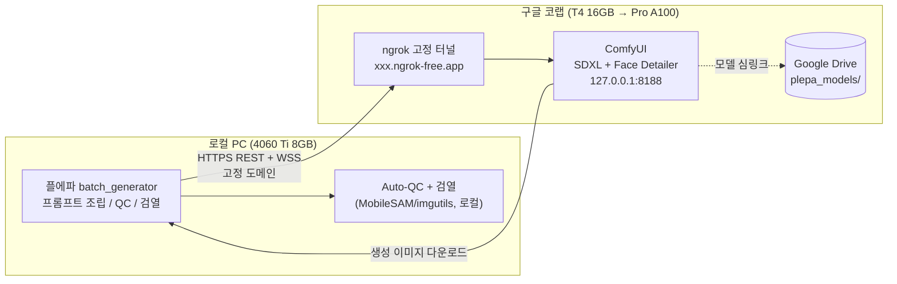

# 플에파 코랩 원격 ComfyUI 연동 구현 설계서

> 공유용 엔지니어링 스펙. 다른 AI/에이전트가 이 문서만으로 구현을 재현할 수 있도록 작성됨.

## 1. 개요

플에파(PLEPA)는 이미지를 직접 생성하지 않고 ComfyUI를 REST + WebSocket 백엔드로 사용하는 클라이언트 파이프라인이다. 현재 로컬 GPU(4060 Ti 8GB)에서 SDXL 배치 생성을 돌리는데 VRAM 한계로 병목이 발생한다. 본 설계는 **이미지 생성(SDXL)만 구글 코랩의 더 큰 GPU로 옮기고, QC·검열 같은 후처리는 로컬에 남겨 코랩 자원 소모를 최소화**하는 구조를 제안한다.

## 2. 목표 / 비목표

**목표**
- 로컬 플에파가 코랩에서 구동되는 ComfyUI에 원격으로 SDXL 생성을 요청
- ngrok 무료 고정 도메인으로 세션마다 주소가 바뀌지 않는 안정 연결
- 구글 드라이브에 모델을 올려 코랩 세션마다 재사용
- 후처리(QC, 실루엣 검열)는 로컬 4060 Ti에서 그대로 동작
- 무료 티어(T4 16GB)로 먼저 검증 후 Pro(A100) 전환 여부 결정

**비목표**
- FLUX 엔진 코랩 이관 (SDXL만 대상)
- 코랩에서 전체 플에파 실행 (로컬 중심 유지)
- 실시간 스트리밍/다중 세션 오케스트레이션

## 3. 요구사항 (수집 결과)

| 항목 | 결정 |
|------|------|
| 코랩 티어 | 무료(T4 16GB) 우선 → 효율 OK 시 Pro(A100) 검토 |
| 분담 | SDXL 생성(ComfyUI) = 코랩 / QC + 검열 = 로컬 |
| 엔진 | SDXL만 |
| 연결 | ngrok 무료 고정 도메인(주소 영구 고정) |
| 모델 배송 | 구글 드라이브 마운트 |
| 드라이브 구조 | 본 설계서 제안 구조 사용 |
| 코랩 경험 | 오래전 ML/DL 사용 경험, 단계별 명확 가이드 필요 |

## 4. 현재 아키텍처 분석 (코드 기반)

### 4.1 ComfyUI 호스트는 이미 분리됨
`plepa_engine/config.py`:
```python
COMFY_HOST = os.environ.get("COMFYUI_HOST", "127.0.0.1:8188")
COMFY_URL = f"http://{COMFY_HOST}"
COMFY_WS_URL = f"ws://{COMFY_HOST}/ws"
```

### 4.2 스킴이 3곳에 하드코딩 (유일한 차단점)
- `plepa_engine/config.py` - 모듈 수준 `http://` / `ws://`
- `plepa_engine/comfy_client.py` - `__init__`에서 `self.base_url = f"http://{host}"`, `self.ws_url = f"ws://{host}/ws"`
- `plepa_engine/services/config_service.py` - `_apply_runtime`에서 `cfg.COMFY_URL = f"http://{host}"`, `cfg.COMFY_WS_URL = f"ws://{host}/ws"`

→ ngrok 고정 도메인은 `https://` / `wss://` 여야 하므로 이 3곳을 수정해야 한다.

### 4.3 호스트 설정 영속화
`config_service.py`:
```python
CONFIG_FILE = ROOT_DIR / ".plepa_state" / "config.json"
DEFAULT_CONFIG = {"comfy_host": "127.0.0.1:8188", ...}
```
`save_config()`로 `comfy_host` 저장 → GUI/스크립트에서 원격 주소로 변경 가능.

### 4.4 생성 흐름
`plepa_engine/services/generation_service.py`:
```python
comfy_host = conf.get("comfy_host", COMFY_HOST)
client = ComfyClient(host=comfy_host)
...
client.generate_image(workflow=current_wf, output_path=out_path)  # ComfyUI 호출
if params.auto_qc:
    validate_generated_image(...)  # 로컬 QC, 불량 시 재생성(ComfyUI 재호출)
censor_file(...)  # 로컬 검열 (MobileSAM/imgutils)
```

### 4.5 Face Detailer / 업스케일은 ComfyUI 워크플로우 노드
`plepa_engine/workflow_templates.py`의 `build_sdxl_workflow`:
- `use_face_detailer` → Face Detailer 노드 (ComfyUI 내 2차 디퓨전)
- `use_upscale` → 4x 업스케일 노드 (옵션, 기본 off)

즉 ComfyUI가 코랩에 있으면 Face Detailer도 코랩에서 돈다. Face Detailer는 품질 핵심이므로 코랩에 두는 것이 타당하고, 업스케일은 옵션이라 비용 영향 없다.

### 4.6 분담 경계 (확정)
| 단계 | 실행 위치 | 코랩 이관 후 |
|------|----------|-------------|
| SDXL KSampler 생성 | ComfyUI 워크플로우 | 코랩 |
| Face Detailer | ComfyUI 워크플로우 | 코랩 (같이 이관) |
| 4x 업스케일 (`--upscale`) | ComfyUI 워크플로우 | 코랩 (옵션, 기본 off) |
| Auto-QC 4대 감지기 | `plepa_engine/qa_validator.py` (로컬) | 로컬 |
| 실루엣 검열 | `plepa_engine/censor.py` (로컬 MobileSAM/imgutils) | 로컬 |

Auto-QC 분석 자체는 로컬에서 공짜지만, 불량 판정 시 재생성(리롤)은 ComfyUI(=코랩)를 재호출한다. `--max-retries`(기본 3)로 조절 가능.

## 5. 제안 아키텍처



## 6. 상세 설계

### 6.1 URL 스킴 해석 헬퍼 (신규 모듈)
새 파일 `plepa_engine/comfy_urls.py`:
```python
def resolve_comfy_urls(host: str) -> tuple[str, str]:
    """host -> (base_url, ws_url). https://면 https/wss, http://면 http/ws,
    스킴 없으면 http/ws(하위호환 기본값, 127.0.0.1:8188 등)."""
    host = (host or "").strip()
    if host.startswith("https://"):
        core = host[len("https://"):]
        return f"https://{core}", f"wss://{core}/ws"
    if host.startswith("http://"):
        core = host[len("http://"):]
        return f"http://{core}", f"ws://{core}/ws"
    return f"http://{host}", f"ws://{host}/ws"
```
사용자는 `comfy_host`에 `https://abc.ngrok-free.app`처럼 스킴 포함 주소를 넣으면 된다. 기존 `127.0.0.1:8188`(스킴 없음)은 자동으로 http/ws로 유지되어 하위호환 보장.

### 6.2 3곳 하드코딩 교체 + ngrok 호환 헤더
- `config.py`, `comfy_client.py`(`__init__`), `config_service.py`(`_apply_runtime`)의 URL 생성을 모두 `resolve_comfy_urls` 호출로 통일.
- `comfy_client.py`의 모든 `urllib` 요청과 WebSocket `connect()`에 헤더 `ngrok-skip-browser-warning: true` 추가. ngrok 무료티어 브라우저 안내 페이지(interstitial) 우회 목적. 로컬 ComfyUI엔 무해(알 수 없는 헤더 무시).
- `websocket-client`의 `connect()`는 `header=["ngrok-skip-browser-warning: true"]` 옵션으로 전달.

### 6.3 ngrok 무료 고정 도메인 설정
1. ngrok.com 무료 가입 → 대시보드에서 authtoken 확보
2. 대시보드 "Domains/Endpoints"에서 무료 고정 서브도메인 1개 클레임 (예: `plepa-comfy.ngrok-free.app`)
3. 코랩 노트북에서 `ngrok http 8188 --domain=plepa-comfy.ngrok-free.app` 백그라운드 실행
4. 출력된 `https://plepa-comfy.ngrok-free.app`를 로컬 `comfy_host`에 설정

> 검증 포인트: ngrok 무료티어 정책 변경 시 고정 도메인 클레임이 불가할 수 있음. 그 경우 폴백으로 cloudflared 빠른 터널(`trycloudflare.com`, 주소는 매 세션 변경) 사용. 구현 Task 5에서 1차 확인.

### 6.4 구글 드라이브 모델 구조
`MyDrive/plepa_models/` 하위:
```
checkpoints/unholyDesireMixSinister_v90.safetensors
ipadapter/ip-adapter-plus_sdxl_vit-h.safetensors
clip_vision/CLIP-ViT-H-14-laion2B-s32B-b79K.safetensors
ultralytics/bbox/face_yolov8m.pt
upscale_models/4x-UltraSharp.pth          (옵션, --upscale 사용 시)
```
코랩 노트북에서 이 경로들을 `ComfyUI/models/{각 하위}/`에 심링크. 세션마다 재다운로드 불필요.

### 6.5 코랩 노트북 구조 (`colab/plepa_colab_sdxl.ipynb`)
셀 순서:
1. Google Drive 마운트
2. ComfyUI git clone + `pip install -r requirements.txt`
3. 커스텀 노드 설치: `ComfyUI-Manager`, `ComfyUI-Impact-Pack`(Face Detailer/Ultralytics), `ComfyUI_IPAdapter_plus`(IP-Adapter 노드)
4. `plepa_models/` → `ComfyUI/models/` 심링크 + 모델 존재 사전 점검
5. ComfyUI 기동: `python main.py --listen 127.0.0.1 --port 8188` (백그라운드)
6. ngrok 설치 + authtoken + `--domain=고정도메인` 실행
7. 고정 https URL 출력

### 6.6 로컬 comfy_host 설정
`config_service.save_config({"comfy_host": "https://plepa-comfy.ngrok-free.app"})` 호출, 또는 환경변수 `COMFYUI_HOST` 설정. GUI에 comfy_host 편집 필드가 있으면 그곳에서 입력.

## 7. 작업 분해 (Task Breakdown)

각 Task는 이전 Task 위에 쌓이며, 코드 변경 후 기존 pytest 스위트(57종)를 돌려 회귀를 확인한다.

**Task 1: ComfyUI URL 스킴 해석 헬퍼 + 단위 테스트**
- 목표: 호스트 문자열에서 올바른 http/https/ws/wss 스킴을 도출하는 헬퍼 구현.
- 구현: 새 모듈 `plepa_engine/comfy_urls.py`에 `resolve_comfy_urls(host) -> (base_url, ws_url)`.
- 테스트: pytest로 `https://`, `http://`, 스킴 없음(`127.0.0.1:8188`), 공백/포트 포함 케이스.
- 데모: `python -c "from plepa_engine.comfy_urls import resolve_comfy_urls as r; print(r('https://abc.ngrok-free.app'), r('127.0.0.1:8188'))"` → `(https..., wss...)`, `(http..., ws...)`.

**Task 2: 헬퍼 3곳 연동 + ngrok 헤더 + 하위호환 테스트**
- 목표: 하드코딩 스킴 교체, ngrok 호환 헤더 추가, 기존 로컬 설정 깨지지 않게.
- 구현: `config.py`·`comfy_client.py`·`config_service.py` URL 생성을 `resolve_comfy_urls`로 통일. `comfy_client.py` 모든 urllib/WS 요청에 `ngrok-skip-browser-warning: true` 헤더.
- 테스트: `https://abc.ngrok-free.app` → https/wss, `127.0.0.1:8188` → http/ws(하위호환), 헤더 포함 여부.
- 데모: 기존 로컬 ComfyUI로 `--dry-run`/`--test` 정상 작동; 가짜 https 호스트 URL 생성 비교.

**Task 3: 로컬 목 ComfyUI 서버 기반 원격 생성 경로 통합 테스트**
- 목표: 코랩 없이 HTTP 목 서버로 `generate_image` 전체 원격 경로(업로드→제출→WS 대기→다운로드) 검증.
- 구현: `tests/`에 간단 목 HTTP 서버(`/system_stats`, `/prompt`, `/upload/image`, `/view`, 가짜 WS `executed`). ComfyClient를 목 서버로 pointing → `generate_image` → WebP 저장 검증.
- 테스트: pytest 통합 테스트. 목 원격 서버에서 이미지 정상 수신·저장.
- 데모: 더미 이미지가 목 원격 서버 경유로 로컬에 저장됨.

**Task 4: 코랩 노트북 환경 구축 (드라이브·ComfyUI·커스텀 노드·모델 심링크)**
- 목표: 코랩에서 SDXL 파이프라인용 ComfyUI 실행 가능 노트북 작성.
- 구현: 새 파일 `colab/plepa_colab_sdxl.ipynb`. Drive 마운트, ComfyUI 설치, 커스텀 노드(Manager·Impact-Pack·IPAdapter_plus), `plepa_models/`→`ComfyUI/models/` 심링크, 모델 존재 점검 셀.
- 테스트: 셀 실행 후 `/system_stats` 200, `/object_info`에 체크포인트·`face_yolov8m` 노출(검증 단계). 누락 모델은 명확 에러.
- 데모: 코랩에서 ComfyUI 기동 후 `127.0.0.1:8188/system_stats` 200.

**Task 5: 코랩 노트북 ngrok 고정 터널 (클레임 검증 + 폴백)**
- 목표: ComfyUI를 ngrok 무료 고정 도메인으로 외부 노출, 주소 고정.
- 구현: ngrok 설치 + authtoken + `ngrok http 8188 --domain=고정도메인` 백그라운드 실행, 고정 https URL 출력. 클레임 불가 시 `trycloudflare` 폴백 안내.
- 테스트: ngrok URL로 `/system_stats` 200, WebSocket 핸드셰이크 성공.
- 데모: 코랩 출력 https URL을 로컬 curl/브라우저로 접근 시 ComfyUI 응답.

**Task 6: 엔드투엔드 연결 - comfy_host를 ngrok URL로 + 실제 생성 검증**
- 목표: 로컬 플에파가 코랩 ComfyUI로 실제 SDXL 생성, QC+검열 로컬 실행 분담 라이브 검증.
- 구현: `comfy_host`를 `https://plepa-comfy.ngrok-free.app`로 저장. 단일 캐릭터/단일 포즈 `batch_generator.py` 실행(--mock 아님). 이미지 로컬 `assets/` 저장, Auto-QC 로컬, `--censor` 시 로컬 검열 확인. T4 장당 시간 측정(Pro 전환 자료).
- 테스트: 라이브 통합. 한 장 코랩→로컬 정상 저장 + QC/검열 통과. 실패 시 트러블슈팅(타임아웃/스킴/헤더).
- 데모: 로컬 탐색기에 코랩 생성 이미지 표시, QC/검열 로그.

**Task 7: 운영 문서 - 셋업 가이드 + 무료→Pro 전환 노트**
- 목표: 재현 가능한 절차 문서화.
- 구현: `docs/COLAB_SETUP_GUIDE.md` - ngrok 가입/authtoken/고정 도메인 클레임, Drive 모델 구조+출처, 노트북 실행 순서, 로컬 `comfy_host` 설정법, 세션 끊김/타임아웃 대응, 장당 시간 비교표(로컬 vs T4 vs A100 예상), Pro 전환 시점.
- 테스트: 체크리스트로 가이드 처음부터 터널 주소까지 도달 가능 검증.
- 데모: 빠른 시작 섹션만 따라도 코랩 터널 주소 확보 완료.

## 8. 기술적 리스크 및 대응

| 리스크 | 대응 |
|--------|------|
| ngrok 무료티어 정책 변경으로 고정 도메인 불가 | Task 5에서 1차 검증, `trycloudflare` 빠른 터널 폴백 |
| ngrok interstitial이 API 응답 가로챔 | `ngrok-skip-browser-warning` 헤더 항상 추가(Task 2) |
| 코랩 세션 12시간/비활성 타임아웃 | 문서에 재연결 절차 + 진행 상황 저장 매뉴얼 기재 |
| WSS 인증서 검증 실패 | urllib·websocket-client 기본 SSL 사용(ngrok는 유효 인증서). 자체 서명 목 서버 테스트 시에만 테스트 한정 SSL 완화 |
| 코랩 모델 누락/경로 불일치 | 노트북에 모델 존재 사전 점검 셀, 명확 에러 메시지 |
| Auto-QC 리롤이 코랩 자원 소모 | `--max-retries`로 조절, 품질-비용 트레이드오프 문서화 |

## 9. 검증 계획
- Task 1~3: pytest 단위/통합 테스트 + 기존 57종 회귀 통과.
- Task 4~6: 코랩 라이브 검증(스크린샷/로그). 단일 이미지가 코랩 생성→로컬 저장→QC/검열 적용까지 전 과정 성공.
- Task 6에서 T4 장당 시간 측정 → 로컬 4060 Ti 대비 비교표로 Pro 전환 의사결정 자료 확보.

## 10. 참고 (수정 대상 파일)
- `plepa_engine/config.py` (스킴 상수)
- `plepa_engine/comfy_client.py` (URL 생성 + 헤더)
- `plepa_engine/services/config_service.py` (`_apply_runtime` 스킴)
- `plepa_engine/services/generation_service.py` (흐름 참고용, 수정 최소)
- `plepa_engine/workflow_templates.py` (Face Detailer/업스케일 노드 참고)
- `plepa_engine/censor.py`, `plepa_engine/qa_validator.py` (로컬 후처리, 수정 없음)
- 신규: `plepa_engine/comfy_urls.py`, `colab/plepa_colab_sdxl.ipynb`, `docs/COLAB_SETUP_GUIDE.md`


---

## 11. 완성도 평가 및 리스크 분석

### 11.1 설계 완성도 (높음)
- **아키텍처 적합성**: 플에파가 이미 ComfyUI 클라이언트 구조라 원격 전환이 자연스럽다. 호스트(`COMFYUI_HOST`/`comfy_host`)도 이미 분리되어 있음.
- **요구사항 명확성**: 코랩 티어, 분담 범위, 연결 방식, 모델 배송까지 구체적으로 결정됨.
- **Task 분해**: 7단계가 점진적이고 각 단계마다 검증(단위/통합/라이브) 가능.

### 11.2 구현 불확실성 (중간)
- **ngrok 정책 의존**: 무료 고정 도메인이 정책 변경으로 막힐 수 있음 (Task 5에서 검증).
- **코랩 환경 안정성**: 12시간 세션 제한, 비활성 끊김은 운영 마찰.
- **네트워크 레이턴시**: 한국↔구글 서버 왕복으로 장당 시간이 늘어날 수 있음 (측정 필요).

### 11.3 미검증 영역 (고위험)
- **실제 성능 개선**: T4가 4060 Ti보다 세대 구형이라 느릴 가능성 있음. Task 6 측정 후 확정.
- **비용 vs 효율**: 무료 T4는 시간 제한, Pro는 월비용. 투입 후 ROI가 안 나오면 롤백 필요.

### 11.4 중요하게 다뤄야 할 부분 (우선순위)

**1. Task 2-3: 로컬 하위호환 보장 (최우선)**
기존 로컬 ComfyUI(`127.0.0.1:8188`) 사용자가 업데이트 후에도 아무 문제 없이 작동해야 함. 스킴 헬퍼가 `http://`/`ws://`를 기본으로 유지하는지, 기존 pytest 57종이 전부 통과하는지가 핵심. 이게 깨지면 플에파 전체가 멈춘다.

**2. Task 5: ngrok 무료 고정 도메인 클레임 가능 여부 (고위험)**
설계는 ngrok 고정 도메인을 전제로 작성. 정책 변경으로 무료 클레임이 막혔다면 폴백(`trycloudflare`, 주소 매번 변경)으로 전환해야 함. 이 경우:
- 문서 수정 필요 (섹션 6.3, Task 5)
- 사용자 경험 악화 (세션마다 주소 복사)
- 자동화 스크립트 필요 (코랩 출력 주소를 로컬 config에 자동 입력)

→ Task 5를 최대한 빨리 실행해 클레임 가능 여부 확인, 불가 시 폴백 경로를 즉시 설계에 반영.

**3. Task 6: 실제 성능 측정 및 의사결정 (투자 판단)**
T4 장당 시간이 로컬보다 느리거나 네트워크 오버헤드가 크면 코랩 전환 자체가 무의미. Task 6 측정 후:
- T4 ≥ 로컬 → 무료는 포기, Pro(A100) 직행 또는 로컬 유지
- T4 < 로컬 but 체감 미미 → 무료는 효율 없음, Pro만 고려
- T4 << 로컬 → 무료로도 충분, 진행

→ 이 데이터 없이 Pro 결제는 위험. Task 6 완료 후 결정.

**4. WebSocket 연결 안정성 (운영 리스크)**
wss:// 터널 경유 시 타임아웃/중간 끊김이 로컬보다 잦을 수 있음. 긴 배치(100장+) 돌릴 때 중간 끊기면 재시작 오버헤드 큼. 완화책:
- `comfy_client.py`에 재연결 로직 추가 (옵션)
- 배치를 작은 청크(10장씩)로 쪼개 진행 상태 저장 (운영 매뉴얼)

### 11.5 리스크 완화 전략

| 리스크 | 완화책 |
|--------|--------|
| ngrok 고정 도메인 불가 | Task 5 우선 검증 → 불가 시 `trycloudflare` 자동화 스크립트 추가 |
| T4 성능이 기대 이하 | Task 6 측정 완료 전까지 Pro 결제 보류, 측정값으로 Go/No-Go 결정 |
| 기존 로컬 설정 파괴 | Task 2 하위호환 테스트 + pytest 57종 회귀 필수 통과 |
| 코랩 세션 끊김 | 문서에 재연결 절차 명시 + 진행 manifest 저장으로 이어서 재개 가능 |
| 네트워크 레이턴시 | Task 6에서 측정, 감내 불가 시 업스케일만 코랩/생성은 로컬 유지 등 부분 롤백 |
| 구현 중 플에파 업데이트 충돌 | 브랜치 작업 + Task 완료마다 커밋, main 머지 전 테스트 |

## 12. 프로젝트 분리 여부 검토

### 12.1 플에파 내부에서 진행 (추천)
1. 코드 변경이 최소: 스킴 헬퍼 추가 + 3곳 수정뿐. 전체 아키텍처는 안 건드림.
2. 하위호환 보장: `127.0.0.1:8188` 사용자는 영향 없음. 원격은 opt-in(선택 활성화).
3. 통합 유지: QC/검열이 로컬에 남아있어 분리할 이유가 없음.
4. 롤백 용이: `comfy_host`만 다시 `127.0.0.1:8188`로 바꾸면 즉시 로컬 복귀.

### 12.2 별도 프로젝트가 나은 경우 (비추천, 특수 상황에서만)
- 코랩 전용 경량 클라이언트를 만들고 싶을 때 (QC/검열도 코랩에서 돌리는 등 대대적 개조)
- 플에파를 건드리기 싫을 때 (실험용 포크)
- 다른 사람과 공유할 독립 패키지를 만들고 싶을 때

→ 현재 설계는 "플에파 = 로컬 중심 + 코랩 = 선택적 백엔드" 구조라 분리 필요성이 낮고, 코드 중복만 늘어남.

### 12.3 최종 권고
- **플에파 내부에서 진행**, 브랜치 `feature/colab-remote` 사용.
- Task 1~3 먼저 완료 → pytest 통과 확인 → main 머지.
- Task 4~5 코랩 환경 구축 → ngrok 클레임 가능 여부 확정.
- Task 6 성능 측정 → Pro 전환 의사결정.
- Task 7 문서화 완료.

### 12.4 만일의 탈출구
- Task 6 측정 결과 효율이 안 나오면 즉시 중단, `comfy_host` 원복으로 롤백.
- ngrok 불가 시 `trycloudflare` 폴백으로 전환, 문서 갱신.
- 네트워크가 병목이면 "업스케일만 코랩"처럼 부분 적용으로 축소.
