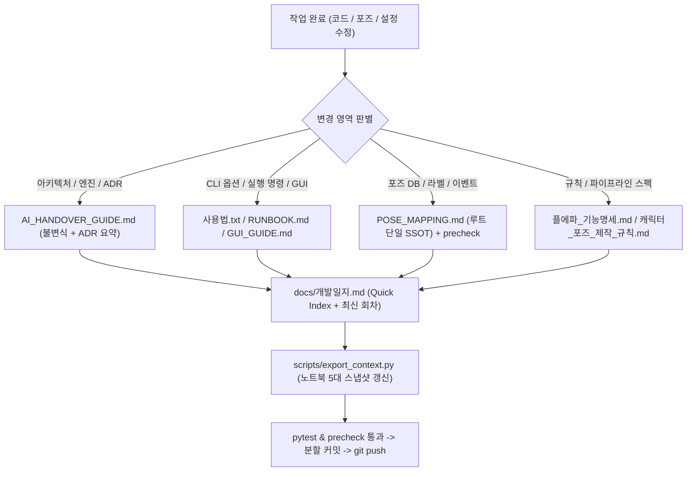

# 📚 플에파(PLEPA) 문서 체계 & 작성 가이드 (Documentation SSOT Guide)

> **문서 목적**: 플에파의 Active 문서와 아카이브(`docs/archive/`) 간의 역할 경계를 명확히 분리하고, 코드·포즈 변경 후 Git Push 전 **문서 정합성과 노트북 스냅샷(`scripts/export_context.py`)을 누락 없이 유지하는 운영 헌법**입니다.

---

## 1. Diátaxis 4분할 활성 문서 인벤토리 (Active SSOT)

모든 **현행 활성(Active) 문서**는 아래 역할별로 단일 진실 공급원(SSOT)만 유지합니다. 통합·노후화된 문서는 `docs/archive/`에 보관하며 신규 세션이나 저사양 모델은 아래 표의 Active 문서만 열람합니다.

| 계층 | 문서 경로 | 핵심 역할 (Role) | 갱신 트리거 (언제 고치는가?) |
| :---: | :--- | :--- | :--- |
| **0. 최상위 헌법** | [`GEMINI.md`](../GEMINI.md) | 에이전트 언어·커밋·삼위일체·실증·승인·토큰·미니에이전트 규칙 | 개발 거버넌스·레일 규율 변경 시 |
| **0. 문서 헌법** | **[`DOCUMENTATION_GUIDE.md`](DOCUMENTATION_GUIDE.md)** | Active SSOT 인벤토리·작업별 매핑·Push 5단계 게이트·자동화 점검 루틴 | Active 문서 추가·이관·게이트 절차 변경 시 |
| **1. 실행·운영**<br>*(How-To)* | **[`README.md`](../README.md)** | 프로젝트 개요, SDXL 스택 사양, 핵심 4대 엔진 아키텍처, 폴더 트리 | 진입점/스택/테스트 대규모 변경 시 |
| **1. 실행·운영**<br>*(How-To)* | **[`사용법.txt`](../사용법.txt)** | 사용자 1순위 CLI 치트시트, 포즈 표현식, 원격/검열/감사 명령 모음 | CLI 옵션·포즈 세트·실행 커맨드 변경 시 |
| **1. 실행·운영**<br>*(How-To)* | **[`RUNBOOK.md`](RUNBOOK.md)** | 환경 구축, ComfyUI 커스텀 노드·모델 설치, 일일 운용/장애 대응 절차 | 실행 환경·모델·포트·API·장애 대처 변경 시 |
| **1. 실행·운영**<br>*(How-To)* | **[`GUI_GUIDE.md`](GUI_GUIDE.md)** | NiceGUI 웹 스튜디오 **8대 탭**(`/characters`~`/settings`)·REST API 조작 매뉴얼 | 웹 GUI 페이지/버튼/액션 추가·수정 시 |
| **1. 실행·운영**<br>*(How-To)* | **[`REMOTE_INSPECTION_GUIDE.md`](REMOTE_INSPECTION_GUIDE.md)** | `:8080/mobile` 단일 원격 터널·수동 덧칠·원본복원·FIFO 대기열 런북 | 모바일 뷰어·터널 인증·검수 API 변경 시 |
| **2. 포즈 SSOT**<br>*(Reference)* | **[`POSE_MAPPING.md`](../POSE_MAPPING.md)** | 전체 포즈(`000~202`)·라벨·모브·배경·deprecated 통합 **단일 포즈 매핑표** | **포즈 라벨·코드·프롬프트 추가/수정 시 (필수)** |
| **3. 개발 규격**<br>*(Reference)* | **[`플에파_기능명세.md`](플에파_기능명세.md)** | V3 데이터 흐름도, 7단계 Mutator 체인, P2.5 검열, 코어 모듈 인터페이스 | 파이프라인·엔진·스키마·검열 API 변경 시 |
| **3. 개발 규격**<br>*(Reference)* | **[`캐릭터_포즈_제작_규칙.md`](캐릭터_포즈_제작_규칙.md)** | 캐릭터 JSON·포즈 DB·로스터 이벤트 작성 불변식 & 7단계 `precheck` 규격 | 프롬프트 규칙·금지어·남캐 음영·로스터 슬롯 변경 시 |
| **3. 챗봇 제작**<br>*(Reference)* | **[`젠잇_캐릭터채팅_제작법.md`](젠잇_캐릭터채팅_제작법.md)** | Gen-IT v2.2 5탭 시스템·CommonMark·`Status`/`Line` JSX·8대 변수 제작 가이드 | Gen-IT 플랫폼 스펙·JSX 템플릿 변경 시 |
| **3. 챗봇 제작**<br>*(Reference)* | **[`노벨챗_캐릭터채팅_제작법.md`](노벨챗_캐릭터채팅_제작법.md)** | 노벨챗 6탭·500장 상한·`_` 자동 파싱·변수/상태창 제작 가이드 | 노벨챗 스펙·호출어 풀·패키징 규칙 변경 시 |
| **3. 챗봇 공통**<br>*(Architecture)* | **`docs/platforms/`** | 멀티플랫폼 공통 코어 스펙([`CORE_SPEC.md`](platforms/CORE_SPEC.md)) 및 플랫폼 어댑터 | 신규 플랫폼 이식 또는 공통 스키마 변경 시 |
| **4. 결정·이력**<br>*(ADR & Log)* | **[`AI_HANDOVER_GUIDE.md`](AI_HANDOVER_GUIDE.md)** | 현행 15대 골든 스테이트 불변식 + Active ADR(`ADR-80~120+`) 핵심 요약 | 핵심 아키텍처 변경, 새 ADR 번호 부여 시 |
| **4. 결정·이력**<br>*(ADR & Log)* | **[`개발일지.md`](개발일지.md)** | 빈출 트러블슈팅 빠른 색인표 + 최근 10회차 증상 중심 플레이북 | **모든 작업 세션 마무리 및 푸시 직전 (필수)** |
| **5. 상용 완성본**<br>*(Deliverable)* | **`docs/genit/`** | Gen-IT 상용 5탭 완성본 (`v2.2` 현역) & 다테마 표준 템플릿 (`validate_genit_work.py`) | 챗봇 대본/에셋/변수 수정 시 |
| **5. 상용 완성본**<br>*(Deliverable)* | **`docs/novelchat/`** | 노벨챗 6탭 완성본 & 다테마 표준 템플릿 (`validate_novelchat_work.py`) | 노벨챗 대본/에셋/호출어 풀 수정 시 |
| **보관소/격리**<br>*(Archive)* | **`docs/archive/`** · **`scripts/{archive,benchmarks,ml}/`** | 초기~중기 이력(`ADR_HISTORY_FULL.md`, `개발일지` 중·초기 아카이브, 완료된 `plepa_refactoring_analysis.md`), 구 V2 포즈·리포트, 은퇴 `:8085` 뷰어·실험/ML 스크립트 | **열람/수정 불필요 (역사 보존·실험 격리용)** |

---

## 2. 작업 유형별 필수 문서 매핑 (Workflow Decision)



---

## 3. 문서 작성 표준 규격 (Playbook Format & Hygiene)

1. **`docs/개발일지.md` 증상 중심 플레이북**:
   - **최신 회차 최상단 역순 삽입**: 반드시 **「🔥 빈출 트러블슈팅 빠른 색인표」 바로 아래**에 최신 회차를 추가합니다(파일 맨 끝 append 엄격 금지).
   - 10회차를 초과하는 과거 회차는 `docs/archive/`로 주기적 롤링 이관하여 본문을 `~350줄` 이내로 유지합니다.
   - 표준 블록 구성: `TL;DR & 메타` ➔ `트러블슈팅 플레이북 (증상/원인/Before-After/재발방지)` ➔ `변경 파일 표` ➔ `복붙 검증 원라이너`.
2. **`docs/AI_HANDOVER_GUIDE.md` 다이어트 원칙**:
   - 상단 골든 스테이트 불변식(15조)과 Active ADR(`ADR-80~`) 요약표 중심(`<= 220줄`)을 유지하고, 장문 히스토리는 `docs/archive/ADR_HISTORY_FULL.md`에 보존합니다.
3. **노트북 협업 스냅샷 동기화 (`scripts/export_context.py`)**:
   - 문서나 코어 아키텍처가 바뀌면 `.\.venv\Scripts\python.exe scripts/export_context.py`를 실행해 `context_snapshot/` 고정 5개 파일(`00_README_FOR_AI.md` ~ `30_TIER3_RUNTIME.md`, `50_REFACTORING_PLAN.md`)을 갱신합니다.
4. **기밀·안전 & 민감 어휘 차단 (`GEMINI.md` 2조)**:
   - 커밋 메시지·주석·문서 설명에 성인물·신체 부위·성적 행동 묘사 등 민감 어휘를 배제하고 중립·기술적 한국어를 사용합니다(포즈 라벨 자체는 DB 식별용 공식 명칭으로만 취급).

---

## 4. 작업 마무리 & Git Push 5단계 프로토콜 (Pre-Push Gate)

1. **[1단계] 매핑 가이드 확인**: 본 문서의 표를 기준으로 영향받는 Active 문서를 전부 식별합니다.
2. **[2단계] 서류 및 일지 갱신**: 해당 Active SSOT 문서 + `docs/개발일지.md` 최상단(및 `Quick Symptom Index`)을 갱신합니다.
3. **[3단계] 드리프트 검사 · 노트북 스냅샷 & 검증**:
   ```powershell
   .\.venv\Scripts\python.exe scripts/check_doc_sync.py --diff
   .\.venv\Scripts\python.exe scripts/export_context.py
   .\.venv\Scripts\python.exe -m pytest -q
   .\.venv\Scripts\python.exe -m plepa_engine.precheck -r campus
   ```
4. **[4단계] Git 상태 점검 & 논리적 분할 커밋**:
   - `git status -s`로 바이너리·생성 에셋(`output/`, `projects/*/assets/`) 미포함을 확인한 뒤 성격별(`feat:`, `fix:`, `refactor:`, `docs:`, `test:`, `chore:`) 분할 커밋을 수행합니다.
   - `.\.venv\Scripts\python.exe scripts/install_git_hooks.py --install` 활성화 시 커밋 직후 `post-commit` 훅이 `context_snapshot/` 5종을 자동 최신화합니다.
5. **[5단계] 푸시 및 클린 확인**: `git push origin main` 후 `git status`의 `working tree clean` 상태를 확인합니다.

---

## 5. Antigravity Automation 주기 점검 프롬프트 (선택/권장)

주간 또는 작업 집중 기간에는 Antigravity Automation(`/schedule` 또는 `/automation`)에 아래 복붙 프롬프트를 등록해 서류 드리프트를 자동 감시할 수 있습니다:

> `.\.venv\Scripts\python.exe scripts/check_doc_sync.py --diff origin/main` 및 `.\.venv\Scripts\python.exe scripts/check_doc_sync.py`를 실행해 서류 드리프트가 발견되면 `docs/DOCUMENTATION_GUIDE.md` 매핑에 따라 수정 PR/패치 초안을 보고해 줘. (에셋·`legacy/`·`docs/archive/` 열람 금지, `check_doc_sync.py`가 0건이면 짧은 정상 보고만 출력)
