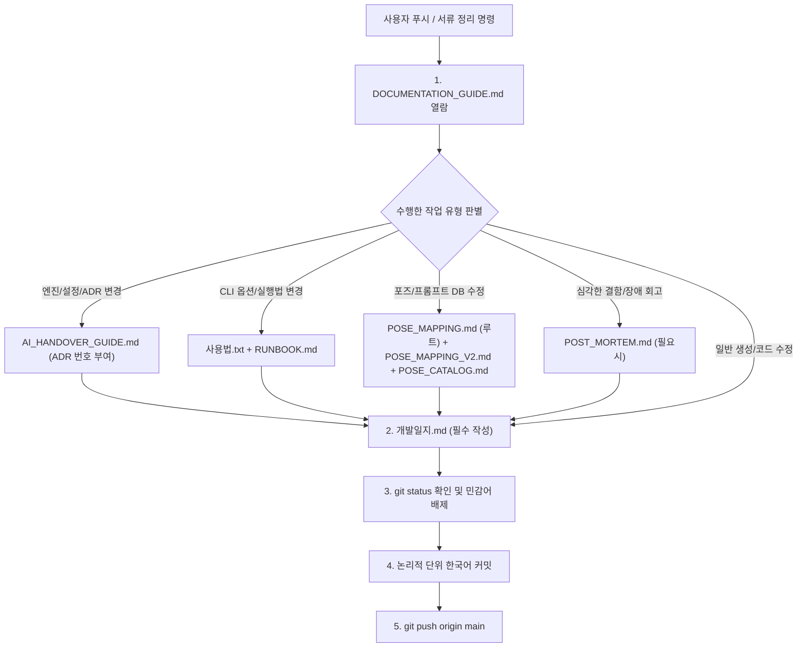

# 📚 플에파(PLEPA) 문서 작성 및 동기화 지침서 (Documentation Guide)

> **문서 목적**: 프로젝트 내 모든 기술 문서, 운영 매뉴얼, 개발일지의 역할과 형식을 정의하고, 작업 완료 후 또는 깃 푸시(Push) 명령 시 누락 없이 서류를 최신화하기 위한 단일 기준 지침서(SOP)입니다.  
> **적용 대상**: 모든 Antigravity AI 에이전트 및 프로젝트 기여자.  
> **핵심 원칙**: **"코드와 설정이 바뀌면 문서도 함께 살아 숨쉬어야 한다."** 서류 작업 또는 푸시 요청 시 **반드시 본 문서를 최우선 열람**하여 해당 문서를 동기화합니다.

---

## 🗺️ 1. 프로젝트 주요 문서 지도 (Diátaxis 4분할 체계)

플에파는 문서 간 중복과 구식화(Doc Drift)를 원천 차단하기 위해 현업 **Diátaxis 4분할 프레임워크**에 따라 핵심 문서만 유지하고, 완료된 일회성 기획서·통폐합된 구버전 문서는 `docs/archive/`로 격리합니다.

| 영역 (Diátaxis) | 문서명 | 역할 및 성격 (SSOT) | 주요 갱신 타이밍 |
| :---: | :--- | :--- | :--- |
| **0. 헌법 & 온보딩** | **[`GEMINI.md`](../GEMINI.md)** / **[`README.md`](../README.md)** | 에이전트 최상위 규칙 헌법 및 프로젝트 빠른 시작 가이드 | 핵심 원칙, 설치 환경, 디렉토리 구조 변경 시 |
| **1. 실행 & 운영**<br>*(How-To)* | **[`사용법.txt`](../사용법.txt)** | 사용자 원클릭 복사-실행 CLI 치트시트 | 신규 CLI 옵션, 자주 쓰는 배치 명령어 추가 시 |
| **1. 실행 & 운영**<br>*(How-To)* | **[`RUNBOOK.md`](RUNBOOK.md)** | 실무 운영 명령어 + 6대 계층별 장애 진단 체크리스트 통합 런북 | 서버/검열/QC 운영 절차 및 트러블슈팅 변경 시 |
| **1. 실행 & 운영**<br>*(How-To)* | **[`GUI_GUIDE.md`](GUI_GUIDE.md)** | 웹 GUI 대시보드 7대 페이지별 기능 명세, 데이터 흐름, 컴포넌트 구조도 및 조작 매뉴얼 | 웹 GUI 페이지 및 1클릭 액션 기능 추가/수정 시 |
| **2. 기술/포즈 규격**<br>*(Reference)* | **[`플에파_기능명세.md`](플에파_기능명세.md)** | 3계층 아키텍처, 코어 모듈, 서비스 레이어, 스키마 기술 명세서 | 신규 엔진 모듈, Mutator, 서비스 클래스 추가/변경 시 |
| **2. 기술/포즈 규격**<br>*(Reference)* | **[`POSE_MAPPING.md`](../POSE_MAPPING.md)** (루트 SSOT) / **[`POSE_MAPPING_V2.md`](POSE_MAPPING_V2.md)** / **[`POSE_CATALOG.md`](POSE_CATALOG.md)** | 사용자 1순위 열람 전체 포즈 요약 매핑표, V2 상세 카탈로그 및 V1↔V2 매핑 사전 | **포즈 라벨명, 프롬프트, 번호 매핑 추가/수정 시 (필수 세트 갱신)** |
| **3. 제작/검증 표준**<br>*(Standard)* | **[`캐릭터_포즈_제작_규칙.md`](캐릭터_포즈_제작_규칙.md)** | 캐릭터 JSON, V2 포즈 프롬프트, 테마 슬롯 제작 및 `precheck.py` 5단계 사전점검 통합 규칙서 | 프롬프트 공식, 금지어, 사전점검 규칙 변경 시 |
| **4. 결정 & 이력**<br>*(ADR & Log)* | **[`AI_HANDOVER_GUIDE.md`](AI_HANDOVER_GUIDE.md)** | 상단 골든 스테이트 10대 불변식 요약 + 역대 아키텍처 의사결정(ADR 1~55) | 핵심 설계 변경, 새 ADR 번호 부여 시 |
| **4. 결정 & 이력**<br>*(ADR & Log)* | **[`개발일지.md`](개발일지.md)** / **[`KIRO_SYNC_REPORT.md`](KIRO_SYNC_REPORT.md)** | 일자별 작업 로그·트러블슈팅 및 형제 프로젝트(`kiro`) 전파 리포트 | **모든 작업 세션 마무리 및 푸시 직전 (필수)** |
| **5. 상용 챗봇 완성본**<br>*(Deliverable)* | **`docs/genit/`** (현역) / **`docs/archive/genit/`** (봉인) | Gen-IT 상용 챗봇 5탭(프롬프트/설정집/캐릭터/108종 에셋) 완성본 마크다운 | 챗봇 프롬프트 갱신, 신규 시나리오 완성본 추가 시 |
| **보관소**<br>*(Archive)* | **`docs/archive/`** & **`scripts/archive/`** | 역할이 다했거나 상위 문서로 통합된 구버전 문서(12종) 및 V1 스크립트(9종) | 현역 열람/수정 불필요 (히스토리 보존용) |

---

## ⚡ 2. 작업 유형별 문서 갱신 매트릭스 (Update Matrix)

작업을 완료했거나 푸시 명령을 받았을 때, 수행한 작업 유형에 해당하는 문서들을 체크리스트 형태로 확인하고 갱신합니다.



### 상세 갱신 조건

1. **아키텍처 및 시스템 결정 변경 시**:
   - `AI_HANDOVER_GUIDE.md`: 2.2절에 순번(예: `19. ...`, `20. ...`)을 매겨 배경, 원인 규명, 최종 결정 사항 기록.
   - `개발일지.md`: 해당 일자에 목표 및 의사결정 내역 기록.
2. **CLI 인터페이스 및 사용자 실행법 변경 시**:
   - `사용법.txt`: 사용자가 바로 복사해 터미널에 붙여넣을 수 있는 원클릭 명령어 예시 반영.
   - `RUNBOOK.md`: 2절에 상세 옵션 설명 추가.
   - `개발일지.md`: 사용법 변경 사항 기록.
3. **포즈 및 프롬프트 DB 변경 시 (★ 필수 세트 동기화)**:
   - `data/sdxl_pose_database.json` 단일 수정 (※ `data/legacy/flux_pose_database.json` 수정 금지 - 토큰 절약).
   - **`POSE_MAPPING.md` (루트)**: 사용자 1순위 열람 전체 포즈 요약 매핑표의 라벨명·섹션·통계 즉시 갱신 (★ 최우선 필수).
   - `docs/POSE_MAPPING_V2.md` & `docs/POSE_CATALOG.md`: 라벨명, 설명, 상세 매핑 동기화.
   - `docs/캐릭터_포즈_제작_규칙.md`: 프롬프트 조립 규칙 및 불변식 동기화.
   - `docs/개발일지.md`: 포즈 개선 내역 및 대상 에셋 기록.
4. **생성 옵션 및 GUI 기능 추가/수정 시 (Trinity Sync 원칙)**:
   - `GENERATION_OPTION_SPECS` 레지스트리 ➔ `batch_generator.py` CLI ➔ `plepa_gui/pages/generate.py` ➔ `tests/test_cli_gui_sync.py` 4각 동기화 검증 (`pytest tests/test_cli_gui_sync.py`).
   - `docs/GUI_GUIDE.md`: 신규 UI 기능 및 조작법 동기화.
5. **모든 일반 작업 완료 및 푸시 시**:
   - **`개발일지.md` (필수)**: 당일 일자에 작업 내역 4단 템플릿으로 작성.

---

## 📝 3. 개발일지 작성 표준 템플릿 (`개발일지.md` — AI 파이프라인 플레이북 양식)

`개발일지.md`는 단순한 작업 일기가 아니라 **AI 이미지 생성 파이프라인 & 다중 에이전트 협업 환경에서 버그 재발을 막고 10초 내 즉시 해결하기 위한 '실전 트러블슈팅 플레이북'**입니다.
- 최신 날짜가 맨 위로 오는 **역순(Reverse-chronological)**으로 기록합니다.
- 문서 최상단에는 **「🔥 빈출 트러블슈팅 빠른 색인표 (Quick Symptom Index)」**를 유지하며, 오래된 초기 일지는 `docs/archive/`로 주기적으로 롤링 아카이빙합니다.
- 각 세션 기록은 기본 5대 요소에 **AI 이미지 파이프라인 특화 4대 실전 요소(`⚙️ 구동 환경 스냅샷`, `👁️ 시각적 합격/불합격 기준`, `⚠️ 부작용/상충 주의사항`, `🔄 상위 지침 격상 상태`)**를 결합한 아래 표준 규격을 준수합니다:

```markdown
### 📅 YYYY-MM-DD (요일) - N차: [세션 핵심 제목]
- **📌 TL;DR**: 무엇을 왜 고쳤고 어떤 결과가 나왔는지 1줄 핵심 결론 요약.
- **🏷️ 키워드**: `#모듈명` `#포즈번호` `#증상키워드` (예: `#SanitizerMutator` `#포즈060_061` `#ColorBurn` `#검열기`)
- **⚙️ 구동 환경 스냅샷**: `unholyDesireMixSinister_v90.safetensors` | `832x1216` | `CFG 5.0` | `Steps 28 (dpmpp_2m karras)` | `white_silhouette`

#### 1. 트러블슈팅 플레이북 (Troubleshooting Playbook)
##### 🔧 [TS-1] 문제/이슈 제목
- **🚨 증상 (Symptom)**: 육안으로 나타난 렌더링 결함, 콘솔 에러 메시지, 또는 이상 동작.
- **🔍 원인 (Root Cause)**: 해당 현상을 유발한 정확한 파일명·함수·프롬프트 태그 단위의 기술적 원인.
- **💊 처방 (`Before` vs `After`)**:
  - **Before**: 문제가 되었던 기존 코드/프롬프트 태그 핵심 스니펫
  - **After**: 교체·보강한 코드/프롬프트 태그 핵심 스니펫
- **👁️ 시각적 합격 판정 기준 (Visual QA Rule)**: 생성된 이미지를 볼 때 무엇을 기준으로 합격/불합격을 판정하는지 명확한 시각적 기준 1줄.
- **⚠️ 부작용 및 상충 주의사항 (Side Effects / Caveats)**: 풍선 효과를 막기 위해 주의해야 할 조건 (예: 착의/탈의 슬롯 분기, 성별 분기, 타 태그와의 충돌 조건).
- **🛡️ 재발 방지 가드 (Guardrail)**: 동일 문제 재발을 원천 차단하는 `precheck.py` 규칙, `qa_validator.py` 또는 `pytest` 테스트 케이스.
- **🔄 상위 지침 격상 상태 (Rule Promotion / SSOT Sync)**: `AI_HANDOVER_GUIDE.md` (ADR 번호), `캐릭터_포즈_제작_규칙.md`, `kiro` 전파(`sync_to_kiro.py`) 반영 여부.

#### 2. 변경 파일 및 영향 범위 요약표 (Impact Summary)
| 구분 | 대상 파일 | 핵심 변경 내용 | 영향 범위 (로스터/포즈) |
| :---: | :--- | :--- | :--- |
| 엔진/데이터/문서 | [`파일명`](경로) | 수정 요약 | 전 로스터 / 특정 포즈 |

#### 3. 복붙용 검증 원라이너 및 다음 계획 (Verification & Next Step)
```powershell
# 즉시 재현/검증 가능한 원라이너 명령어
.\.venv\Scripts\python.exe -m pytest -q; .\.venv\Scripts\python.exe -m plepa_engine.precheck -r campus
```
- **다음 계획**: 후속 작업 1~2가지 명시.

---
```

---

## 🔒 4. 깃 커밋 및 푸시 5단계 프로토콜 (Pre-push Protocol)

사용자가 **"일지 써줘", "푸시해줘", "정리해줘"** 등을 지시하거나 세션을 마무리할 때 아래 5단계를 철저히 순서대로 수행합니다.

### [1단계] 문서 가이드 열람 및 변경 파일 매핑
- 본 [`DOCUMENTATION_GUIDE.md`](DOCUMENTATION_GUIDE.md)를 확인하여 금번 작업에서 변경된 코드/설정에 대응하는 문서 목록을 확정합니다.

### [2단계] 문서 최신화
- 매핑된 기술 문서([`AI_HANDOVER_GUIDE.md`](AI_HANDOVER_GUIDE.md), [`RUNBOOK.md`](RUNBOOK.md), [`사용법.txt`](사용법.txt), [`POSE_MAPPING.md`](../POSE_MAPPING.md) 등)를 수정합니다.
- [`개발일지.md`](개발일지.md)에 당일 작업 내역을 4단 규격에 맞추어 작성합니다.

### [3단계] `git status` 점검 및 민감어 필터링
- `git status`를 실행하여 스테이징되지 않은 파일이나 불필요한 임시 파일이 없는지 점검합니다.
- **[절대 엄수] 성인물, 신체 부위, 성적 행동 묘사 등 민감한 표현이 커밋 메시지에 단 한 단어도 포함되지 않도록 검열합니다.**

### [4단계] 논리적 단위 분할 커밋
- 파일 성격에 따라 분할 커밋을 원칙으로 합니다:
  - `fix:` 프롬프트 결함, 버그 수정, 렌더링 예외 처리
  - `feat:` 엔진 파라미터 동기화, UI 기능, 신규 캐릭터 프로필
  - `docs:` 개발일지 갱신, ADR 등록, 매뉴얼 최신화
  - `test:` 스냅샷 테스트, 베이스라인 검증

### [5단계] 원격 푸시 및 상태 확인
- `git push origin main` 실행.
- 푸시 후 `git status`를 재확인하여 `working tree clean` 상태인지 최종 검증합니다.
- 사용자에게 일지 작성 내용과 푸시 완료 내역을 일목요연하게 보고합니다.
