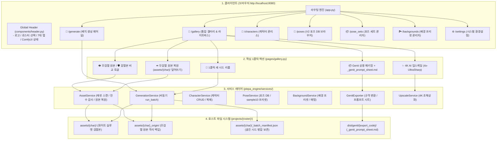

# 🖥️ 플에파 웹 GUI 대시보드 종합 가이드 & 아키텍처 명세서 (GUI Guide & Architecture)

> **문서 목적**: 플에파(PLEPA)의 브라우저 기반 GUI 대시보드([`plepa_gui/app.py`](../plepa_gui/app.py))의 **전체 구조도, 7대 페이지별 기능 명세, 데이터 흐름, 컴포넌트 계층 및 실전 조작 매뉴얼**을 정의하는 전용 문서입니다.  
> **구동 환경**: Python 3.10 + NiceGUI (FastAPI + Vue/Quasar 기반 고속 반응형 웹) | 포트 `http://localhost:8080`  
> **실행 파일**: 루트 디렉토리의 [`run_gui.bat`](../run_gui.bat) 더블클릭 (또는 `python -m plepa_gui.app`)

---

## 1. GUI 전체 아키텍처 및 상태 관리 구조도

플에파 GUI는 **단일 진실 공급원(SSOT)**인 `plepa_engine.services` 비즈니스 레이어를 직접 호출하며, 비동기 스레드 풀(`run.io_bound`)을 통해 ComfyUI 렌더링 중에도 브라우저 UI가 멈추지 않고 반응하도록 설계되어 있습니다.

---

## 2. 7대 페이지별 상세 기능 명세 (Page Specifications)

### 2.1 🚀 배치 생성 제어실 (`/generate` - [`pages/generate.py`](../plepa_gui/pages/generate.py))
- **주요 기능**:
  - **작품(로스터) 및 캐릭터 선택**: 상단 헤더의 전역 활성 로스터(`active_roster`)와 자동 연동되며 대상 캐릭터 다중 선택 지원.
  - **포즈 범위 지정**:
    - **`🌟 10대 골든 (sample10)`**: 10대 대표 골든 샘플러 원터치 선택 (`000, 002, 020, 024, 034, 040, 044, 060, 080, 088`).
    - **`🏫 캠퍼스 106종`**, **`👑 여성 100종 (unified_100)`**, **`마스터 (148종)`**, **`성인 H씬 (52)`** 등 원클릭 퀵버튼 바.
  - **데이터 주도형 옵션 레지스트리 (`GENERATION_OPTION_SPECS` 자동 렌더링)**:
    - `Face Detailer` (얼굴 디테일러 보정)
    - `4x AI 업스케일` (4x-UltraSharp 4K 초해상화)
    - `화이트 실루엣 검열` (MobileSAM 외곽선 검열 및 `_origin/` 백업)
    - `🔒 골든 시드 고정 (--reuse-seed)`: 매니페스트 이전 시드 재사용으로 동일 구도 유지
    - `🛡️ 엄격 검열 리롤 (--strict-censor-qc)`: 성인 씬 성기 미탐지 시 자동 리롤
    - `⚡ 0.2초 소급 검열 전용 (--censor-only)`: 생성 없이 기존 에셋에 실루엣 검열만 일괄 적용
    - `강제 덮어쓰기 (--overwrite)`
    - `Mock 시뮬레이션 (--mock)`
  - **실시간 라이브 프리뷰 모니터 (Live Preview Monitor)**:
    - 우측 상단에 방금 완성된 이미지 썸네일, 포즈명, 파일명, 소요 시간, 사용된 **`🔒 Seed 번호`**를 실시간으로 띄워 주어 생성 결과를 즉시 검수 가능.
  - **실시간 비동기 모니터링**:
    - ComfyUI 생성 진행률(스텝 수, 남은 시간, 현재 생성 중인 에셋)을 실시간 프로그레스 바로 표시하고 콘솔 로그 자동 스크롤.

---

### 2.2 🎨 통합 에셋 갤러리 (`/gallery` - [`pages/gallery.py`](../plepa_gui/pages/gallery.py))
- **주요 기능**:
  - **상단 `[📊 에셋 전수 감사]` 모달 다이얼로그**:
    - 버튼 1클릭으로 현재 로스터 캐릭터들의 **보유/기대 수량, 완비율(%), `_origin` 백업 수량, 누락 포즈 코드**를 일목요연한 테이블로 출력.
    - 누락 포즈가 있는 캐릭터 행 옆에 **`[⚡ 누락분 즉시 생성]`** 원터치 버튼을 제공하여 결손 에셋 즉각 보충.
  - **다중 뷰 모드 지원**:
    1. **매트릭스 뷰(Matrix View)**: 캐릭터(행) × 포즈(열) 그리드 비교 뷰.
    2. **단일 캐릭터 뷰(Single View)**: 선택한 캐릭터의 전체 에셋을 카드 형태로 일괄 열람.
    3. **비정규/샘플 뷰(Misc View)**: 3자리 포즈 번호 규격 외의 샘플이나 배경 이미지 열람.
  - **프로급 라이트박스 뷰어 (`open_lightbox`)**:
    - **키보드 단축키 & 연속 넘기기**: `←`(이전 포즈), `→`(다음 포즈), `Space`(무검열 원본 ↔ 화이트 실루엣 검열본 즉시 비교 토글).
    - **`[🎲 새 시드 리롤]`**: 새로운 무작위 시드로 즉시 재생성.
    - **`[🔒 시드 고정 리롤]`**: 기존 골든 시드를 고정하여 구도는 유지하고 의상/프롬프트만 재생성.
    - **`[👁️ 무검열 원본 / 🛡️ 검열본 토글]`**: `_origin/` 백업 파일과 원클릭 비교.
    - **`[⏪ 무검열 복원]`**: `_origin/`의 무검열 원본을 본 폴더로 복사해 검열 해제.
    - **`[✨ 4K AI 업스케일]`**: `4x-UltraSharp` 모델로 4K 초해상화.
    - **하단 메타데이터 & 시드 인스펙터**: `_batch_manifest.json`에서 읽어온 **`Seed 번호`, `생성시각`, `파일명`** 상시 노출.
    - **`[📦 Genit 내보내기]`**: Genit 상용 규격으로 1클릭 변환 및 `_genit_prompt_sheet.md` 자동 생성.
    - **`[PC 폴더 열기]`**: 호스트 OS 파일 탐색기를 열어 해당 파일 하이라이트 선택.

---

### 2.3 👥 캐릭터 관리소 (`/characters` - [`pages/characters.py`](../plepa_gui/pages/characters.py))
- **주요 기능**:
  - **캐릭터 프로필 시각 편집기**:
    - 외형(`face_and_hair`, `physique`), 기본 의상(`outfit`), SDXL 프롬프트(`sdxl_positive`, `sdxl_nude_positive`, `sdxl_negative`), LoRA 설정(`name`, `weight`), IP-Adapter 가중치(`ref_weight`).
  - **다중 의상 프로필 관리**:
    - 수영복, 바니걸, 메이드, 웨딩, 교복, 사복 등 캐릭터 JSON 내 `profiles` 섹션을 시각적으로 추가/수정/삭제.
  - **레퍼런스 이미지(IP-Adapter) 관리**:
    - `references/{prefix}.webp` 업로드, 미리보기, 삭제 기능.
  - **캐릭터 복제 마법사(Clone Wizard)**:
    - 기존 캐릭터 설정을 복제하여 새로운 `prefix`와 이름을 부여하는 신규 캐릭터 생성 기능 (전역 `prefix` 중복 자동 검증).
  - **원자적 백업 보장**:
    - 캐릭터 저장 시 자동으로 `.plepa_backup/`에 타임스탬프 백업본 생성.

---

### 2.4 💃 V2 포즈 DB 브라우저 (`/poses` - [`pages/poses.py`](../plepa_gui/pages/poses.py))
- **주요 기능**:
  - **8대 섹션별 포즈 목록 열람**:
    - `emotions`(`000~019`), `poses`(`020~039`), `events`(`040~052`), `romance`(`060~063`), `h_scenes`(`080~130`), `scenes_otokonoko`(`150~200`), `spy_actions`, `wuxia_actions`.
  - **포즈 세부 정보 확인 및 편집**:
    - 한글 라벨(파일명 사용), 연출 설명(description), 요구 의상(`required_outfit`), Danbooru 프롬프트, 성별 분기 태그(`prompt_female`, `prompt_otokonoko`), 추가 네거티브(`negative_add`).
  - **로스터별 오버라이드 실시간 반영**:
    - `projects/{roster}/pose_overrides.json`이 로드되어 특정 작품 전용 포즈가 시각적으로 구분되어 표시됨.

---

### 2.5 📦 포즈 세트 관리자 (`/pose_sets` - [`pages/pose_sets.py`](../plepa_gui/pages/pose_sets.py))
- **주요 기능**:
  - **골든 포즈 프리셋 관리**:
    - `sample10` (10대 대표 골든 샘플러 - 감정2, 일상2, 스킨십1, 이벤트2, 로맨스1, H씬2)
    - `unified_100` (상용 표준 통합 100종 여성 풀패키지)
    - `campus_106` (캠퍼스 106종 풀세트)
  - **사용자 정의 포즈 묶음 생성**:
    - 자주 사용하는 포즈 코드들을 묶어 고유 ID(예: `my_favorite_5`)로 저장하고, 배치 생성이나 갤러리에서 즉시 호출 가능.

---

### 2.6 🏞️ 배경 프리셋 관리자 (`/backgrounds` - [`pages/backgrounds.py`](../plepa_gui/pages/backgrounds.py))
- **주요 기능**:
  - **로스터별 배경 프리셋 관리**:
    - `projects/{roster}/background.json`에 정의된 배경 프롬프트(강의실, 옥상, 도서관, 침실, 샤워실 등)를 시각적으로 추가/수정.
  - **포즈별 자동 배경 매핑 (`pose_background_mapping.json`)**:
    - 특정 포즈 번호(예: `038` 샤워실, `051` 강의실)에 가장 어울리는 배경 키를 1:1 자동 매칭하는 테이블 관리.

---

### 2.7 ⚙️ 시스템 환경설정 (`/settings` - [`pages/settings.py`](../plepa_gui/pages/settings.py))
- **주요 기능**:
  - **ComfyUI 서버 설정**:
    - Host URL(`127.0.0.1`), Port(`8188`) 설정 및 실시간 연결 상태 핑(Ping) 테스트.
  - **기본 생성 파라미터 설정**:
    - 기본 체크포인트 모델명, 샘플러 알고리즘, 스케줄러, 기본 해상도(`832x1216`), CFG Scale(`5.0`), Steps(`28`).
  - **시스템 자가 진단 실행**:
    - 웹 UI 내에서 `run_self_test()`(듀얼 엔진 9개 항목 무결성 자가 진단)를 실행하고 실시간 리포트 출력.

---

## 3. 웹 갤러리 핵심 조작 매뉴얼 (Cheatsheet)

| 원하는 작업 | 화면 위치 | 조작 방법 | 결과 및 동작 |
| :--- | :--- | :--- | :--- |
| **마음에 안 드는 그림 리롤** | 라이트박스 상단 | **`[🔄 리롤]`** 클릭 | 백그라운드에서 새 시드로 즉시 재생성되며, 라이트박스 이미지가 실시간 교체됩니다. |
| **무검열 원본 확인** | 라이트박스 상단 | **`[👁️ 원본]`** 클릭 | 하얀 실루엣이 사라지고 `{char}_origin/`의 무검열 원본이 표시됩니다. (다시 클릭 시 검열본 복귀) |
| **검열 완전 해제 (복원)** | 라이트박스 상단 | **`[⏪ 원본 복원]`** 클릭 | `{char}_origin/`의 원본 파일이 본 에셋 폴더로 덮어써져 영구적으로 검열이 해제됩니다. |
| **4K 초고화질 확대** | 라이트박스 상단 | **`[✨ 4K AI 업스케일]`** 클릭 | ComfyUI 4x-UltraSharp 모델이 구동되어 4096×6144 무손실 4K 이미지로 변환됩니다. |
| **Genit 게임용 패키징** | 갤러리 메인 상단 | **`[📦 Genit 내보내기]`** 클릭 | 캐릭터를 선택하고 실행하면 `dist/genit/{코드}/`에 번호별로 패키징되고 `_genit_prompt_sheet.md`가 생성됩니다. |
| **PC 탐색기 열기** | 라이트박스 상단 | **`[PC 폴더 열기]`** 클릭 | 호스트 윈도우 탐색기가 열리며 해당 파일이 자동으로 파랗게 선택(Highlight)됩니다. |

---

## 4. 트러블슈팅 및 운영 가이드

### Q1. 브라우저에서 리롤을 눌렀는데 이전 이미지가 그대로 보여요.
- **해결**: 플에파 GUI는 이미지 갱신 시 `?t={timestamp}` 캐시 무효화 파라미터를 자동으로 부여합니다. 만약 브라우저 내부 캐시가 강하게 걸려 있다면 라이트박스를 닫았다가 다시 열거나 `Ctrl + F5`를 누르세요.

### Q2. `run_gui.bat` 실행 시 포트 8080 충돌 오류가 발생합니다.
- **해결**: 이미 백그라운드에 구동 중인 NiceGUI 프로세스가 있거나 타 프로그램이 8080 포트를 점유 중인 상태입니다.
  - 터미널에서 `netstat -ano | findstr :8080`으로 PID를 확인 후 `taskkill /F /PID {PID}`로 종료하고 다시 실행하세요.

### Q3. 무검열 원본 비교 버튼(`[👁️ 원본]`)이 보이지 않아요.
- **해결**: 해당 이미지는 탈의/성인 씬이 아니어서 검열 대상이 아니었거나, 이미 본래부터 무검열 상태인 일반 포즈(감정, 일상 등)입니다. `{char}_origin/` 폴더에 원본이 보관된 노출 씬에서만 자동으로 활성화됩니다.
