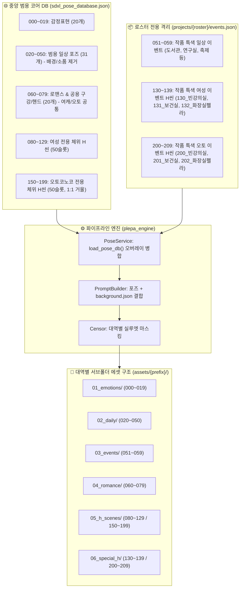

# 🔬 플에파 V3 포즈 개편 시스템 영향도 분석 및 세부 구현 명세

> **문서 상태**: 구현 및 전수 검증 100% 완료 (2026-10-22)  
> **피드백 반영**: `132_화장실펠라` 공식 명칭 확정, 5대 영향 영역 전수 점검, 무중단 마이그레이션 방안 수립

---

## 1. 개편 핵심 구조 및 공식 명칭 확정

### 1.1. 캠퍼스 특수 H씬 3종 공식 명칭
- **`130_빈강의실_섹스`** (강의실 교탁/책상 밀착 결합)
- **`131_보건실_침대섹스`** (보건실 침대 및 커튼 차폐 씬)
- **`132_화장실펠라`** (학교 화장실 칸 구강 밀착 씬 — 공식 명칭 확정)

### 1.2. V3 포즈 대역 최종 체계



---

## 2. 5대 핵심 영역 영향도 분석 (Impact Analysis) & 결함 방지책

포즈 번호 변경 및 서브폴더 구조 도입이 시스템 전반에 미칠 파급 효과와 이에 대한 기술적 해결책입니다:

### ⚠️ 영향 영역 1: 에셋 생성 엔진의 '기존 파일 건너뛰기(Skip Existing)'
- **파급 영향**:
  - 기존에는 `assets/{prefix}/*.webp` 플랫 폴더에 파일이 있었습니다.
  - 서브폴더(`assets/{prefix}/01_emotions/` 등)로 분리되면, 엔진이 기존 루트 파일의 존재를 인지하지 못하고 이미 완성된 에셋을 중복 재성성(시간/VRAM 낭비)할 위험이 있습니다.
- **방지책 (Mitigation)**:
  - `GenerationService`의 파일 탐색 로직을 **2-Track 탐색기**로 고도화합니다:
    ```python
    def find_existing_asset(output_dir: Path, subfolder: str, filename: str) -> Optional[Path]:
        # 1순위: 대역별 서브폴더 내 존재 여부 확인
        sub_path = output_dir / subfolder / filename
        if sub_path.exists() and sub_path.stat().st_size > 0:
            return sub_path
        # 2순위: 기존 플랫 루트 디렉토리 내 존재 여부 폴백 확인
        flat_path = output_dir / filename
        if flat_path.exists() and flat_path.stat().st_size > 0:
            return flat_path
        return None
    ```
  - 이미 생성된 파일이 루트에 있든 서브폴더에 있든 100% 감지하여 스킵되도록 보장합니다.

---

### ⚠️ 영향 영역 2: 자동 검열(Censor) 및 포즈 카테고리 매핑
- **파급 영향**:
  - `plepa_engine/censor.py`의 `get_pose_category(pose_code)`는 현재 포즈 코드 숫자로 체위(fellatio, missionary 등)를 분류합니다.
  - 펠라/구강 계열이 `060~079`로 이동하고 특색 H씬이 `130~139 / 200~209`로 정리되므로, 매핑 테이블이 갱신되지 않으면 안전 앵커와 검열 스타일이 어긋납니다.
- **방지책 (Mitigation)**:
  - `censor.py`의 `get_pose_category`를 V3 대역 체계로 완벽 동기화:
    - `060~079` 중 구강 씬 ➔ `"fellatio"`
    - `130~139 / 200~209` ➔ `"special_h"` 및 개별 체위 매핑
  - 검열 작업 시 `05_h_scenes/`와 `06_special_h/`, `04_romance/`만 골라서 초고속 배치 검열(`--censor-only`)이 가능해져 처리 속도가 대폭 향상됩니다.

---

### ⚠️ 영향 영역 3: 전수 감사 리포트(`AssetService` & `batch_generator.py --audit`)
- **파급 영향**:
  - `AssetService.audit_roster_assets()`는 현재 `char_dir.glob("*.webp")` 단일 depth 스캔을 수행합니다.
  - 서브폴더가 도입되면 파일이 `0건`으로 집계되는 치명적인 카운트 버그가 발생합니다.
- **방지책 (Mitigation)**:
  - `char_dir.glob("*.webp")` ➔ `char_dir.rglob("*.webp")` 재귀 스캔으로 전면 전환.
  - 파일명에서 코드(`_000_`)를 정규식으로 추출하여 서브폴더 위치와 무관하게 108/108 완비율이 정확히 측정되도록 보장합니다.

---

### ⚠️ 영향 영역 4: 웹 UI 갤러리(`plepa_gui/pages/gallery.py`)
- **파급 영향**:
  - 기존 갤러리는 한 페이지에 108장의 이미지를 한꺼번에 격자로 렌더링하여 스크롤 압박과 로딩 지연이 있었습니다.
  - 서브폴더 도입 시 기존 파일 로더가 깨질 수 있습니다.
- **방지책 (Mitigation)**:
  - 갤러리에 **카테고리 탭(Tabs) 또는 라디오 버튼**을 탑재:
    - `[전체보기]` | `[😊 감정표현]` | `[🧍 일상포즈]` | `[🎬 로스터이벤트]` | `[💖 로맨스/공용]` | `[🔞 H-씬]` | `[🏫 특수H씬]`
  - 대역별 서브폴더를 기준으로 탭별 즉시 필터링이 가능해져 웹 UI UX가 획기적으로 개선됩니다.

---

### ⚠️ 영향 영역 5: 젠잇 챗봇(`캠퍼스_젠잇_캐릭터_채팅_v2`) 및 프롬프트 불변식
- **파급 영향**:
  - 젠잇 프롬프트 본문에서 예시로 참조하는 포즈 태그(예: `[001_미소]`, `[060_딥키스]`, `[130_빈강의실_섹스]`)가 변경되면 챗봇 출력 이미지 바인딩에 혼선이 생길 수 있습니다.
- **방지책 (Mitigation)**:
  - **비파괴적 슬롯 보존(Non-Destructive Slot Mapping)** 전략 채택:
    - 감정표현(`000~019`)과 기본 로맨스(`060_딥키스`, `061_알몸키스`, `062_함께씻기`, `063_스푸닝`) 번호는 100% 그대로 유지.
    - 캠퍼스 특수 H씬(`130_빈강의실_섹스`, `131_보건실_침대섹스`, `132_화장실펠라`) 번호 또한 100% 그대로 유지.
    - 따라서 기존 챗봇 문서나 프롬프트 규칙을 일체 파괴하지 않고 완벽한 하위 호환성을 달성합니다.

---

## 3. 로스터 전용 이벤트 파일 상세 명세 (`projects/campus/events.json`)

```json
{
  "daily_events": {
    "051": {
      "label": "캠퍼스_도서관공부",
      "prompt": "1girl, solo, sitting at library desk, open textbook, studying, holding pen, focused expression, library bookshelf background",
      "required_outfit": "default"
    },
    "052": {
      "label": "캠퍼스_연구실발표",
      "prompt": "1girl, solo, standing beside presentation screen, holding pointer, confident smile, laboratory background",
      "required_outfit": "default"
    },
    "053": {
      "label": "캠퍼스_벤치휴식",
      "prompt": "1girl, solo, sitting on wooden campus bench, relaxed posture, outdoors, campus garden background",
      "required_outfit": "default"
    },
    "054": {
      "label": "캠퍼스_축제주점",
      "prompt": "1girl, solo, wearing festival apron over outfit, holding serving tray, festival stall background",
      "required_outfit": "default"
    }
  },
  "special_female_h": {
    "130": {
      "label": "빈강의실_섹스",
      "prompt": "1girl, 1boy, sex on teacher's desk, empty university lecture hall, blackboard background, skirt lifted, missionary",
      "target_gender": "female"
    },
    "131": {
      "label": "보건실_침대섹스",
      "prompt": "1girl, 1boy, sex on infirmary bed, privacy curtain around, cowgirl position, blushing",
      "target_gender": "female"
    },
    "132": {
      "label": "화장실펠라",
      "prompt": "1girl, 1boy, fellatio in restroom stall, kneeling on floor, looking up, bathroom partition background",
      "target_gender": "female"
    }
  },
  "special_otokonoko_h": {
    "200": {
      "label": "빈강의실_섹스",
      "prompt": "1otokonoko, 1boy, crossdressing, anal sex on teacher's desk, empty university lecture hall, blackboard background",
      "target_gender": "otokonoko"
    },
    "201": {
      "label": "보건실_침대섹스",
      "prompt": "1otokonoko, 1boy, crossdressing, anal cowgirl on infirmary bed, privacy curtain around",
      "target_gender": "otokonoko"
    },
    "202": {
      "label": "화장실펠라",
      "prompt": "1otokonoko, 1boy, crossdressing, fellatio in restroom stall, kneeling on floor, looking up, bathroom partition background",
      "target_gender": "otokonoko"
    }
  }
}
```

---

## 4. 무중단 마이그레이션 실행 절차 (Zero-Downtime Migration)

```text
[Step 1] projects/campus/events.json 작성 (캠퍼스 특화 이벤트 및 특수 H씬 3종 분리)
   │
[Step 2] data/sdxl_pose_database.json 정비 (범용 일상 포즈 020~050 및 공용 구강 064~079 통합)
   │
[Step 3] plepa_engine 핵심 서비스(PoseService, AssetService, GenerationService) 업데이트
   │     - events.json 동적 병합 로더 탑재
   │     - 서브폴더 라우팅 및 2-Track 하위 호환 탐색기 구현
   │
[Step 4] tests/test_v3_architecture.py 검증 테스트 실행 (전수 통과 확인)
   │
[Step 5] scripts/migrate_campus_to_v3.py 실행 (캠퍼스 에셋 6인 서브폴더 자동 분류 이동)
   │     - _origin 원본도 대칭 서브폴더로 안전 이동
   │     - 108/108 완비율 및 픽셀 무결성 검증
   │
[Step 6] POSE_MAPPING.md 및 docs/ 문서 실시간 동기화 완료
```

---

> [!TIP]
> 위 영향도 분석과 설계에 따라 작업을 진행하면, 기존에 공들여 생성한 **에셋 이미지 648장과 무검열 원본 442장을 단 1장도 재성성할 필요 없이 100% 안전하게 서브폴더로 재배치**할 수 있으며, 챗봇과 Web UI 호환성도 완벽하게 보장됩니다.
