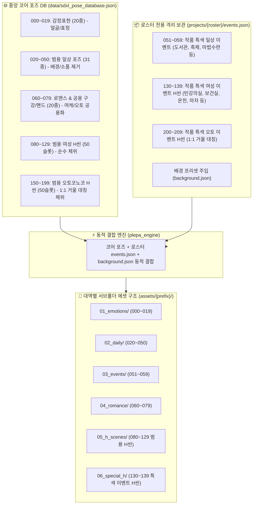

# 🏛️ 플에파(PLEPA) V3 포즈 아키텍처 및 계층화 마스터 플랜 (개정판)

> **문서 상태**: 구현 및 마이그레이션 100% 완료 (2026-10-22)  
> **적용 대상**: `data/sdxl_pose_database.json`, `projects/{roster}/`, `plepa_engine/`, `POSE_MAPPING.md`  
> **핵심 목표**: 범용 코어 포즈 DB 확립, **일상 이벤트(051~059) 및 특색 이벤트 H씬(130~139 / 200~209) 로스터 격리**, 배경/소품 디커플링, 여캐↔오토 H씬 거울 구조 정립, 에셋 서브폴더 계층화

---

## 1. 개편 아키텍처 다이어그램



---

## 2. 포즈 번호 대역 V3 단일 진실 공급원(SSOT) 매핑 설계표

| 대역 번호 | 카테고리 명칭 | 수량 | 관리 위치 | 대상 성별 | 세부 설명 및 포함 항목 |
| :---: | :---: | :---: | :---: | :---: | :--- |
| **`000 ~ 019`** | **감정 표현 (Emotions)** | 20개 | `data/` (중앙 코어) | 공용 | 평상, 미소, 활짝웃음, 수줍음, 토라짐, 분노, 경멸, 울먹임, 나른함, 진지함 등 20종 |
| **`020 ~ 050`** | **일상 포즈 (Daily Poses)** | 31개 | `data/` (중앙 코어) | 공용 | 손하트, 백허그, 전라스탠딩, 벽치기, 덮치기, 무릎베개, 엎드림, 침대숙면, 산책, 테라스휴식 등 범용 제스처 (배경/소품 완전 디커플링) |
| **`051 ~ 059`** | **작품 특색 일상 이벤트 (Daily Events)** | 9개 슬롯 | `projects/{roster}/events.json` | 작품 종속 | **중앙 DB 제외.** 캠퍼스: 도서관공부, 과제발표, 축제주점 / 판타지: 마법수련, 모험가길드 등 해당 로스터 지정 시에만 동적 로드 |
| **`060 ~ 079`** | **로맨스 & 공용 씬 (Romance & Shared)** | 20개 | `data/` (중앙 코어) | 공용 | **[소프트]** 딥키스, 알몸키스, 함께씻기, 스푸닝<br>**[공용 구강/핸드]** 남근핥기, 펠라치오약/강, 딥스로트, 대딸, 착의펠라약/강, 사후여운 (여캐/오토 공통 관리) |
| **`080 ~ 129`** | **범용 여성 H씬 (Universal Female H)** | 50개 슬롯 | `data/` (중앙 코어) | 여성 전용 | 정상위(약/강/절정), 후배위(약/강/절정), 기승위(약/강/절정), 측위, 들박, 교배프레스, 파이즈리, 커닐링구스, 착의섹스, 샤워섹스 등 순수 체위 |
| **`130 ~ 139`** | **작품 특색 여성 이벤트 H씬 (Special Female H)** | 10개 슬롯 | `projects/{roster}/events.json` | 여성 전용 (작품 종속) | **중앙 DB 제외.** 작품 특색 시추에이션 H씬.<br>캠퍼스: `빈강의실_섹스`, `보건실_침대섹스`, `화장실_밀착`<br>판타지: `던전야영_섹스`, `온천_밀착`, `마차안_섹스` |
| **`150 ~ 199`** | **범용 오토코노코 H씬 (Universal Otokonoko H)** | 50개 슬롯 | `data/` (중앙 코어) | 오토코노코 전용 | **여성 H씬(`080~129`)과 1:1 완벽 거울 대칭 체위 (+70 오프셋).** M자개각, 대면좌위, 정상위, 후배위, 기승위, 측위, 들박, 교배프레스, 애널섹스 등 |
| **`200 ~ 209`** | **작품 특색 오토 이벤트 H씬 (Special Otokonoko H)** | 10개 슬롯 | `projects/{roster}/events.json` | 오토코노코 전용 (작품 종속) | **여성 이벤트 H씬(`130~139`)과 1:1 완벽 거울 대칭 (+70 오프셋).**<br>캠퍼스: `200_빈강의실`, `201_보건실`, `202_화장실` |

---

## 3. 로스터 전용 이벤트 파일 규격 (`projects/{roster}/events.json`)

일상 이벤트와 특색 이벤트 H씬을 로스터 내 단일 파일에서 직관적으로 관리합니다:

```json
{
  "daily_events": {
    "051": {
      "label": "캠퍼스_도서관공부",
      "prompt": "sitting at study desk, studying with textbook and notebook, holding pen, focused expression, library background",
      "required_outfit": "default"
    },
    "052": {
      "label": "캠퍼스_연구실발표",
      "prompt": "standing next to presentation whiteboard, holding laser pointer, confident posture, lecture room background",
      "required_outfit": "default"
    }
  },
  "special_female_h": {
    "130": {
      "label": "빈강의실_섹스",
      "prompt": "1girl, 1boy, sex on teacher's desk, empty classroom background, missionary, skirt pulled up",
      "target_gender": "female"
    },
    "131": {
      "label": "보건실_침대섹스",
      "prompt": "1girl, 1boy, sex on infirmary bed, privacy curtain, cowgirl position",
      "target_gender": "female"
    },
    "132": {
      "label": "화장실_밀착",
      "prompt": "1girl, 1boy, standing sex against stall wall, restroom stall background",
      "target_gender": "female"
    }
  },
  "special_otokonoko_h": {
    "200": {
      "label": "빈강의실_섹스",
      "prompt": "1otokonoko, 1boy, crossdressing, anal sex on teacher's desk, empty classroom background",
      "target_gender": "otokonoko"
    },
    "201": {
      "label": "보건실_침대섹스",
      "prompt": "1otokonoko, 1boy, crossdressing, anal cowgirl on infirmary bed, privacy curtain",
      "target_gender": "otokonoko"
    },
    "202": {
      "label": "화장실_밀착",
      "prompt": "1otokonoko, 1boy, crossdressing, standing anal against stall wall, restroom stall background",
      "target_gender": "otokonoko"
    }
  }
}
```

---

## 4. 에셋 서브폴더 계층화 2가지 옵션 비교

| 구분 | Option A (6개 서브폴더 완전 분리 - 권장) | Option B (5개 서브폴더 통합) |
| :--- | :--- | :--- |
| **구조** | `01_emotions/` (000~019)<br>`02_daily/` (020~050)<br>`03_events/` (051~059)<br>`04_romance/` (060~079)<br>`05_h_scenes/` (080~129 / 150~199)<br>**`06_special_h/` (130~139 / 200~209)** | `01_emotions/` (000~019)<br>`02_daily/` (020~050)<br>`03_events/` (051~059)<br>`04_romance/` (060~079)<br>**`05_h_scenes/` (080~139 / 150~209 통합)** |
| **장점** | 작품 특색 H씬만 핀포인트로 따로 모아 보거나 관리하기 매우 용이함 | 서브폴더 개수가 5개로 간결함 |
| **검열 작업** | `05_h_scenes`와 `06_special_h` 모두 검열 대상이 명확히 격리됨 | `05_h_scenes` 폴더 하나만 검열 돌리면 됨 |

---

> [!IMPORTANT]
> **피드백 반영 완료**  
> 지적해 주신 대로 **이벤트 H씬(`130~139` 여캐 특색 H씬, `200~209` 오토 특색 H씬)** 또한 중앙 DB에서 완전히 배제하고, 각 로스터의 `projects/{roster}/events.json`에서 격리 보관하도록 완벽히 반영했습니다!
