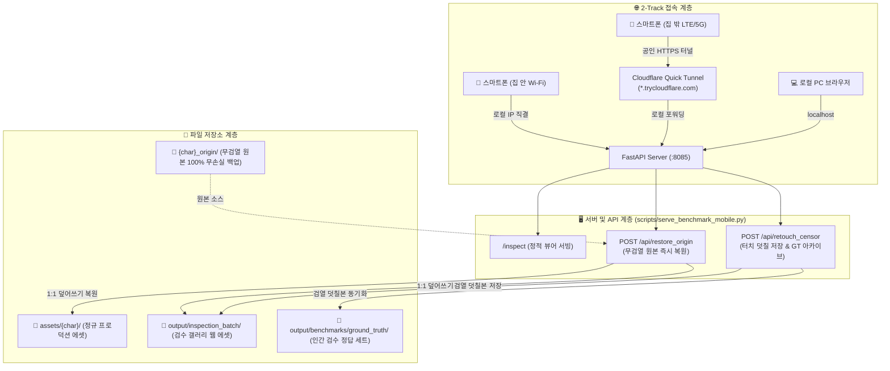

# 📱 플에파 모바일 원격 검수 갤러리 시스템 종합 가이드 (Remote Inspection Runbook)

> **문서 버전**: v1.0.0  
> **최초 제정일**: 2026-11-11  
> **적용 대상**: 모든 로스터(Campus, YKN, DON 등), 다중 PC 이식 환경, 모바일 원격 검수 파이프라인  
> **핵심 목적**: 로컬 Wi-Fi 및 공인 외부망(Cloudflare Tunnel)을 통한 스마트폰 원클릭 검수, 실시간 터치 덧칠(ADR-86), 오리지널 무검열 원본 즉시 복원 시스템의 완전한 재사용 및 표준화

---

## 1. 시스템 개요 및 아키텍처

플에파 모바일 원격 검수 시스템은 대규모 캐릭터 에셋(수백~수천 장)을 개발자가 PC 앞에 묶여 있지 않고, **침대나 소파, 대중교통 등 어디서나 스마트폰 터치만으로 초고속 검수·수정·복원**할 수 있도록 설계된 통합 웹 인프라입니다.



---

## 2. 2-Track 원격 접속 및 네트워크 인프라 (IP & Tunnel)

### 2.1 로컬 네트워크 (집 안 Wi-Fi 항시 접속)
* **원리**: 호스트 PC의 로컬 사설 IPv4 주소를 동적으로 감지하여同一 공유기 Wi-Fi에 물린 스마트폰이 터널 세션 만료 없이 항시 접속할 수 있도록 지원합니다.
* **IP 자동 감지 파이썬 코드**:
  ```python
  import socket

  def get_local_ip() -> str:
      try:
          s = socket.socket(socket.AF_INET, socket.SOCK_DGRAM)
          s.connect(("8.8.8.8", 80))
          ip = s.getsockname()[0]
          s.close()
          return ip
      except Exception:
          return "127.0.0.1"
  ```
* **접속 주소 형식**: `http://<호스트_LAN_IP>:8085/inspect?token=<ACCESS_TOKEN>`  
  *(예: `http://192.168.45.84:8085/inspect?token=...`, 서버 기동 시 콘솔에 토큰 포함 링크가 자동 출력됨)*

### 2.2 외부망 접속 (집 밖 LTE/5G Cloudflare Quick Tunnel)
* **원리**: 포트포워딩이나 공유기 DDNS 설정 없이, `cloudflared.exe`의 임시 터널(Quick Tunnel) 기능을 백그라운드로 구동하여 외부 공인 HTTPS 주소를 실시간 자동 개설하며, `ACCESS_TOKEN` 인증(`?token=` 쿠키 세팅 및 `X-Plepa-Token` / `Authorization: Bearer`)과 `Origin` 검증으로 미인가 접근을 차단합니다.
* **터널 기동 및 URL 자동 추출 로직**:
  ```python
  import subprocess, re, time
  from pathlib import Path

  def start_cloudflare_tunnel(port: int = 8085, root_dir: Path = Path(".")) -> str:
      cf_bin = root_dir / "cloudflared.exe"
      log_file = Path(os.environ.get("TEMP", ".")) / "plepa_bench_tunnel.log"
      if log_file.exists():
          log_file.unlink()

      with open(log_file, "w", encoding="utf-8") as log_fp:
          cf_proc = subprocess.Popen(
              [str(cf_bin), "tunnel", "--url", f"http://127.0.0.1:{port}"],
              cwd=str(root_dir),
              stdout=subprocess.DEVNULL,
              stderr=log_fp,
              creationflags=subprocess.DETACHED_PROCESS if os.name == "nt" else 0,
          )

      pattern = re.compile(r"https://[a-zA-Z0-9-]+\.trycloudflare\.com")
      tunnel_url = None
      for _ in range(35):
          time.sleep(1)
          if log_file.exists():
              with open(log_file, "r", encoding="utf-8", errors="ignore") as f:
                  matches = pattern.findall(f.read())
                  if matches:
                      tunnel_url = matches[0]
                      break
      return tunnel_url  # 예: https://consequently-compression-starter-cornwall.trycloudflare.com
  ```
* **접속 주소 형식**: `https://<터널서브도메인>.trycloudflare.com/inspect`

### 2.3 링크 제공 불변식 (GEMINI.md Rule 1)
* 사용자가 모바일에서 번거로운 복사·붙여넣기를 하지 않도록, 모든 URL은 백틱(``)이 아닌 **반드시 마크다운 원클릭 하이퍼링크**로 제공해야 합니다:
  - `[🏠 집 안 모바일 전용 (Wi-Fi 항시 접속)](http://<LAN_IP>:8085/inspect)`
  - `[🌐 집 밖 외부망 전용 (Cloudflare 터널)](https://<터널>.trycloudflare.com/inspect)`
  - `[💻 PC 로컬 브라우저 바로가기](http://localhost:8085/inspect)`

---

## 3. 인터랙티브 검수 갤러리 UI/UX 구조

### 3.1 상단 고정 통합 네비게이션 (`.sticky-top-container`)
* **스크롤 자유도**: 수백 장의 이미지를 스크롤해도 타이틀, 캐릭터 탭, 필터가 상단에 고정(`position: sticky; top: 0; z-index: 1000;`)되어 언제든지 다른 캐릭터로 전환 가능합니다.
* **원클릭 캐릭터 전환 & 최상단 점프**:
  ```javascript
  function switchChar(charId) {
    currentChar = charId;
    document.querySelectorAll('.tab-btn').forEach(btn => {
      btn.classList.toggle('active', btn.dataset.char === charId);
    });
    document.querySelectorAll('.grid').forEach(grid => {
      grid.style.display = grid.id === ('grid-' + charId) ? 'grid' : 'none';
    });
    applySubFilter();
    // 캐릭터 전환 시 즉시 부드럽게 최상단으로 스크롤
    window.scrollTo({ top: 0, behavior: 'smooth' });
  }
  ```
* **이중 최상단 이동 장치**:
  1. **헤더 내 맨위로 버튼**: 상단 헤더 우측에 `🔝 맨위로` 컴팩트 버튼 배치.
  2. **플로팅 탑 버튼 (`#floating-top-btn`)**: 280px 이상 스크롤 시 화면 우측 하단에 자동으로 떠오르는 원형 알약 버튼 (`▲ TOP`).

### 3.2 카드별 3-Button 액션 행 및 상단 검열 옵션 툴바
* **상단 검열 툴바 (`.censor-toolbar`)**: 전역 `censor_style`(`white_silhouette`, `black_silhouette`, `mosaic`, `bar`, `slim_bar`, `shadow`, `debug_bbox`) 셀렉터 및 `anchor_fallback` 토글 제공 (`⚡ 재검열` 및 `🎲 리롤` 시 선택 옵션 자동 전달).
* 각 이미지 카드 하단에 3개의 직관적인 액션 버튼을 나란히 배치합니다:
```html
<div class="card-btn-row">
  <button class="action-btn retouch-btn" onclick="openRetouch(event, ...)">✏️ 덧칠</button>
  <button class="action-btn recensor-btn" onclick="reapplyCensor(event, ...)">⚡ 재검열</button>
  <button class="action-btn origin-btn" onclick="restoreOrigin(event, ...)">🔄 원본</button>
</div>
```

---

## 4. 백엔드 API 명세 (`serve_benchmark_mobile.py` & `plepa_gui`)

### 4.1 터치 덧칠 검열 저장 (`POST /api/retouch_censor`)
* **목적**: 스마트폰 터치 드로잉으로 사후 보정한 검열 마스크 이미지를 저장하고 본체 에셋 및 Ground Truth에 동시 동기화.
* **요청 바디**:
  ```json
  {
    "file_path": "aya/02_h_scenes/aya_064_남근핥기.webp",
    "image_base64": "data:image/webp;base64,UklGR..."
  }
  ```
* **처리 절차**:
  1. Base64 디코딩 후 PIL RGB 이미지 변환 (`_origin` 경로 덮어쓰기 차단).
  2. `output/inspection_batch/{file_path}`에 95% 품질 WEBP 원자적 저장(`_atomic_save_webp`).
  3. 매핑되는 `projects/{roster}/assets/{file_path}` 본체 에셋에도 원자적 자동 동기화 (`synced_asset` 플래그 반환).
  4. `output/benchmarks/ground_truth/{folder}/`에 인간 검수 정답 세트로 자동 미러링.
* **응답**: `{"success": true, "synced_asset": true, "message": "성공적으로 저장되었습니다!", "file_name": "...", "timestamp": 1794375904}`

### 4.2 오리지널 원본 이미지 즉시 복원 (`POST /api/restore_origin`)
* **목적**: 검열이 과도하거나 훼손된 이미지를 단 한 번의 터치로 무검열 원본(`_origin`)으로 되돌림.
* **요청 바디**:
  ```json
  {
    "file_path": "aya/02_h_scenes/aya_064_남근핥기.webp"
  }
  ```
* **처리 절차**:
  1. 경로에서 캐릭터 코드(`aya`), 서브폴더(`02_h_scenes`), 파일명 분리.
  2. 원본 백업 디렉토리 탐색 (`projects/{roster}/assets/{c_code}_origin/` 등).
  3. 무검열 원본을 `output/inspection_batch/` 및 `projects/.../assets/`에 원자적 복사(`synced_asset` 반환).
* **프론트엔드 연동**:
  - 오클릭 방지를 위한 브라우저 `confirm` 팝업 구비.
  - 성공 시 `?t=timestamp` 캐시 버스팅을 적용하여 화면상의 이미지를 즉시 새로고침.

### 4.3 0.2초 즉시 재검열 API (`POST /api/reapply_censor`)
* **목적**: ComfyUI 재생성 없이 무검열 원본(`_origin`)을 읽어 `plepa_engine.censor.censor_image()`로 즉시 재검열한 뒤 `output/inspection_batch/`와 `projects/{roster}/assets/` 양쪽에 원자적으로 덮어씁니다. (`_require_auth(..., check_origin=True)` 적용)
* **요청 바디 (`ReapplyCensorRequest`)**:
  ```json
  {
    "file_path": "aya/02_h_scenes/aya_064_남근핥기.webp",
    "char_code": "aya",
    "pose_code": "064",
    "censor_style": "mosaic",
    "censor_targets": "penis",
    "min_confidence": 0.16,
    "enable_anchor_fallback": false
  }
  ```
* **응답**: `{"success": true, "censor_style": "mosaic", "detected_count": 1, "synced_asset": true}`

### 4.4 비동기 FIFO 순차 작업 큐 기반 실시간 리롤 (`POST /api/reroll_queue`, `GET /api/reroll_queue_status`)
* **목적**: 모바일 검수 중 마음에 들지 않는 이미지를 여러 장 연속으로 리롤할 때, ComfyUI VRAM 충돌이나 요청 유실 없이 **안전하게 1건씩 순차 처리(FIFO)**하는 대기열 시스템.
* **엔드포인트 1: 작업 등록 (`POST /api/reroll_queue`)**:
  - 요청: `{"file_path": "aya/01_normal/aya_001_미소.webp", "char_code": "aya", "pose_code": "001", "label": "미소", "censor_style": "white_silhouette", "censor_targets": "penis", "min_confidence": 0.16, "enable_anchor_fallback": false}`
  - 즉시 응답(0.01초): `{"success": true, "job": {"job_id": "job_...", "queue_position": 1, "status": "queued"}, "is_new": true}`
  - **중복 방지 (Deduplication)**: 동일한 이미지가 이미 대기 중이거나 처리 중인 경우, 중복 등록하지 않고 기존 작업 순번을 반환하여 오클릭 연타 방어.
* **엔드포인트 2: 대기열 상태 실시간 조회 (`GET /api/reroll_queue_status`)**:
  - 응답: `{"success": true, "data": {"total_pending": 2, "queued_count": 1, "processing_count": 1, "active_job": {...}, "jobs": {...}}}`
* **백엔드 단일 워커 루프 (`_worker_loop`)**:
  - `asyncio.Queue` 기반으로 큐에서 작업을 1개씩 꺼내 `asyncio.to_thread`로 블로킹 없이 격리 실행.
  - ComfyUI 신규 랜덤 시드 생성 ➔ `{char}_origin` 무검열 원본 백업 ➔ 전달된 검열 옵션(`censor_style`, `censor_targets`, `min_confidence`, `enable_anchor_fallback`) 적용 ➔ `inspection_batch` 및 정규 에셋 덮어쓰기 순차 완결.
* **프론트엔드 실시간 UX 연동**:
  - **상단 고정 바**: 대기열 발생 시 `⏳ 대기열 2건 (진행 1건 | 대기 1건)` 앰버색 펄스 배지 자동 표출.
  - **에셋 카드 우상단 버튼**: `🎲 리롤` ➔ `⏳ 대기 #N` ➔ `⚙️ 생성중` ➔ `✅ 완료!` ➔ 새 이미지 캐시버스팅 리로드 후 3초 뒤 기본 상태 복귀.

### 4.5 8080 스튜디오 브릿지 및 선택적 토큰 보호 (`plepa_gui`)
* **공용 REST API 통일 (`/api/assets/restore-origin`, `/api/assets/reapply-censor`)**: 8080 모바일 뷰어([📱 8080 모바일 뷰어](http://localhost:8080/mobile))에서도 8085와 동일하게 무검열 원본 복원 및 0.2초 즉시 재검열 수행.
* **선택적 `PLEPA_MOBILE_TOKEN` 보안 가드**:
  - 환경변수 `PLEPA_MOBILE_TOKEN`이 설정된 경우(예: `scripts/start_remote.py` 원격 터널 기동 시 자동 발급) `?token=` 진입 시 `HttpOnly; SameSite=Lax` 쿠키(`plepa_token`)를 발급하고, 외부 변경 API(`/api/assets/*`) 호출 시 토큰(`X-Plepa-Token` / `Authorization: Bearer` / 쿠키) 및 `Origin`을 검증합니다.
  - 환경변수 미설정 시(로컬 PC 단독 구동·오프라인 테스트)에는 인증 없이 기존과 동일하게 동작합니다.

---

## 5. 데이터 디렉토리 표준 구조

재사용 시 디렉토리 구조는 아래의 계약(Contract)을 준수해야 합니다:

```
plepa/
├── projects/
│   └── {roster}/                      # campus, ykn, don 등
│       └── assets/
│           ├── {char}/                 # 정규 배포용 에셋 (검열 적용본)
│           │   ├── 01_normal/          # 일상/감정 (000~059)
│           │   └── 02_h_scenes/        # 로맨스/H씬 (060~127+)
│           └── {char}_origin/          # ⭐ 무검열 원본 영구 무손실 보존
│               ├── 01_normal/
│               └── 02_h_scenes/
├── output/
│   └── inspection_batch/               # ⭐ 모바일 갤러리 서빙 루트
│       ├── index.html                  # 자동 조립된 인터랙티브 뷰어
│       ├── {char}/
│       │   ├── 01_normal/
│       │   └── 02_h_scenes/
│       └── ground_truth/               # 인간 검수 확정본 아카이브
└── scripts/
    ├── serve_benchmark_mobile.py       # FastAPI + Tunnel 데몬
    └── generate_inspection_viewer.py   # index.html 동적 빌더
```

---

## 6. 새 프로젝트/로스터 이식 및 재사용 가이드 (3분 셋업)

다른 프로젝트나 새로운 로스터를 본 검수 시스템에 연동할 때는 아래 3단계를 수행합니다:

### Step 1. 동적 로스터·캐릭터 탐색 (`scripts/generate_inspection_viewer.py`)
하드코딩된 매핑 딕셔너리 없이 `default_character_service.list_characters(roster)`를 호출하여 로스터 내 캐릭터 코드(`prefix`)와 표시 이름(`name`)을 자동으로 수집합니다. (`--roster` 또는 환경/인자로 대상 로스터 지정 가능)

### Step 2. 갤러리 HTML 조립 실행
에셋이 생성되거나 동기화된 후 빌더 스크립트를 1회 실행합니다:
```powershell
.\.venv\Scripts\python.exe scripts/generate_inspection_viewer.py
```
*출력 예시*:
```
Generated dynamic multi-character inspection HTML at output/inspection_batch/index.html
Characters found: ['aya', 'har', 'new_char']
Total assets loaded: 381
```

### Step 3. 모바일 검수 서버 및 터널 가동
```powershell
.\.venv\Scripts\python.exe scripts/serve_benchmark_mobile.py
```
콘솔에 출력된 **로컬 Wi-Fi 주소**와 **Cloudflare Tunnel 주소**로 모바일에서 즉시 접속합니다.

---

## 7. 운영 및 트러블슈팅 런북

### Q1. 포트 8085 충돌 ("Address already in use")
* **조치**: 기존에 떠 있는 8085 포트 프로세스를 강제 종료 후 재기동합니다:
  ```powershell
  Get-NetTCPConnection -LocalPort 8085 -ErrorAction SilentlyContinue | ForEach-Object { Stop-Process -Id $_.OwningProcess -Force }
  .\.venv\Scripts\python.exe scripts/serve_benchmark_mobile.py
  ```

### Q2. Cloudflare 터널 URL이 만료되었거나 접속이 되지 않을 때
* **조치**: 터널 로그(`$env:TEMP\plepa_bench_tunnel.log`)를 확인하고, 서버를 재기동하면 3초 내에 새로운 공인 서브도메인이 자동 발급됩니다.
* **집 안 Wi-Fi 권장**: 집 안에 있을 때는 터널 만료 위험이 없는 **로컬 IP 링크(`http://192.168.45.84:8085/inspect`)**를 사용하면 24시간 끊김 없이 영구 접속 가능합니다.

### Q3. Windows 콘솔 한글 인코딩 에러 (`cp949 UnicodeEncodeError`)
* **조치**: 모든 파이썬 스크립트 최상단에 표준 stdout 가드를 의무 적용합니다:
  ```python
  import sys
  if sys.stdout and hasattr(sys.stdout, "reconfigure"):
      sys.stdout.reconfigure(encoding="utf-8", errors="replace")
  ```

---

## 8. 핵심 유지보수 체크리스트

- [ ] **무검열 원본 백업**: 재생성 시 반드시 `{char}_origin/` 디렉토리에 원본을 먼저 저장했는가?
- [ ] **검열 일관성**: ADR-86 (화이트 실루엣 언더마스킹)이 정규 에셋과 검수 폴더에 동일 적용되었는가?
- [ ] **이원화 링크 제공**: 사용자 응답 시 집 안(Wi-Fi) 링크와 집 밖(Tunnel) 링크를 클릭 가능한 마크다운 형태로 제공했는가?
- [ ] **상단 고정 유지**: CSS `.sticky-top-container`가 뷰어에 정상 렌더링되어 모바일 스크롤 편의성이 보장되는가?
- [ ] **원본 복원 테스트**: 카드별 `🔄 원본` 클릭 시 실시간으로 무검열 이미지가 덮어쓰기 복원되는가?
