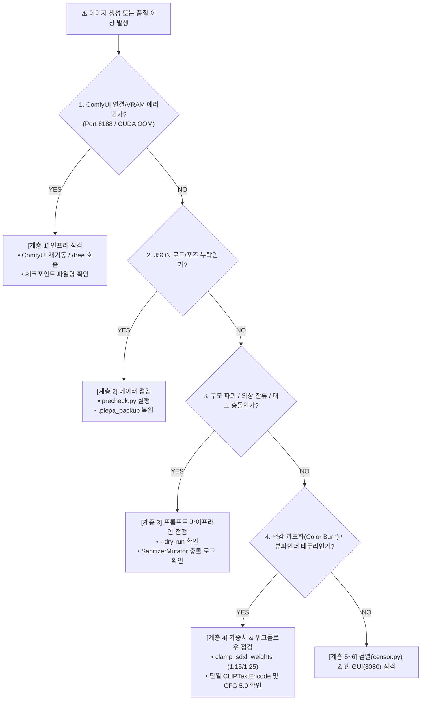

# 📘 [PLEPA Operations & Troubleshooting Runbook] 운영 및 장애 진단 통합 런북

> **문서 목적**: ComfyUI 로컬 서버 관리, 이미지 에셋 배치 생성 파이프라인(`batch_generator.py`) 가동, VRAM 부족(OOM) 대응 및 **6대 계층별 장애 진단 체크리스트**를 하나로 통합한 실무 운영 매뉴얼(SOP)입니다.  
> **기반 사양**: Windows 11, Python, NVIDIA RTX 4060 Ti 8GB + 48GB System RAM, ComfyUI (`127.0.0.1:8188`).  
> **표준 엔진**: **SDXL 단일 파이프라인** (`unholyDesireMixSinister_v90.safetensors`, CFG `5.0`, Steps `28`, `dpmpp_2m` + `karras`, `832x1216`).

---

## ⚡ 1. 10초 원클릭 긴급 진단 명령어

장애나 이상 징후 발생 시 터미널에서 아래 명령어들을 순서대로 실행하여 문제 지점을 즉시 격리합니다:

| 점검 목적 | CLI 명령어 | 정상 기대 결과 |
| :--- | :--- | :--- |
| **시스템 10단계 통합 무결성 진단 (`--test`)** | `python batch_generator.py --test` | `10 PASS, 0 WARN, 0 FAIL (10개 코어 무결성 100%)` |
| **전 로스터 1초 에셋 전수 감사 (`-r all --audit`)** | `python batch_generator.py -r all --audit` | 전체 10개 로스터별 보유/기대 수량, 완비율 표 연속 출력 |
| **단일 로스터 1초 에셋 전수 감사 (`--audit`)** | `python batch_generator.py -r campus --audit` | 캐릭터별 보유/기대 수량, 완비율, 백업 현황 표 출력 |
| **ComfyUI 서버 헬스체크** | `Invoke-RestMethod -Uri "http://127.0.0.1:8188/system_stats" \| ConvertTo-Json -Depth 3` | GPU/VRAM JSON 응답 반환 |
| **로스터 5단계 사전점검** | `.\.venv\Scripts\python.exe -m plepa_engine.precheck -r campus` | `✔ [PASS] 위반 사항 0건!` |
| **프롬프트 조립 점검 (GPU 미사용)** | `python batch_generator.py -r campus -c aya -p 000,060,080 --dry-run` | 조립된 긍정/부정 프롬프트 출력 |
| **단위 테스트 전수 검증** | `.\.venv\Scripts\python.exe -m pytest -q` | `78 passed` |


---

## 🚀 2. 에셋 생성 및 검열 실전 명령어 (`batch_generator.py`)

### 2.1 전 로스터 / 단일 / 다중 캐릭터 배치 생성
```powershell
# 0) [전 로스터 일괄] 전체 10개 로스터 전 캐릭터 기준점 1장(000) 초고속 생성 (외형 전수 점검)
python batch_generator.py -r all --all-chars -p 000 --censor

# 1) [전 로스터 일괄] 전체 10개 로스터 전 캐릭터 10대 골든샘플(sample10) 일괄 생성
python batch_generator.py -r all --all-chars -p sample10 --censor

# 2) [전 로스터 일괄] 전체 10개 로스터 전 캐릭터 V2 108종 풀 에셋 일괄 생성
python batch_generator.py -r all --all-chars -p all --censor

# 3) 단일 로스터 전체 캐릭터 일괄 생성 + 화이트 실루엣 자동 검열
python batch_generator.py -r sns --all-chars -p all --censor
python batch_generator.py -r campus --all-chars -p all --censor

# 4) 특정 캐릭터의 특정 포즈만 강제 덮어쓰기 재생성 (--overwrite / -f)
python batch_generator.py -r campus -c aya -p 051,060,061 --overwrite --censor

# 5) 오토코노코 캐릭터 생성 (여성 번호 080~130 입력 시 자동으로 +70 대칭 번호 150~200으로 변환)
python batch_generator.py -r campus -c mio -p all --censor
```

### 2.2 정밀 외곽선 화이트 실루엣 자동 검열 (`--censor` & `--censor-only`)
- **동작 원리**: `dghs-imgutils` 성기 감지(`penis` + `pussy`) + 고환 하단 35% 확장 + MobileSAM 외곽선 추출 + 멀티스케일 2x 타일 스캔 + `POSE_SAFE_ANCHORS` 안전 앵커 폴백.
- **저장 구조**:
  - 검열이 완료된 파일은 `projects/{roster}/assets/{char}/` 내의 해당 파일을 직접 교체합니다.
  - 노출이 감지되어 검열된 파일의 **무검열 원본**은 `projects/{roster}/assets/{char}_origin/` 폴더에 동일한 파일명으로 안전하게 격리 백업됩니다.
```powershell
# 1) 이미 생성된 에셋 폴더에 대해 ComfyUI 호출 없이 소급 검열만 단독 실행 (장당 0.2초)
python batch_generator.py -r campus -c aya -p all --censor-only

# 2) 검열 스타일 지정 (기본값: white_silhouette)
python batch_generator.py -r campus -c aya -p 080 --censor --censor-style white_silhouette
```

### 2.3 Auto-QC 불량 자동 감지 및 리롤 루프
- 생성 직후 [`plepa_engine/qa_validator.py`](../plepa_engine/qa_validator.py)가 4대 결함(① 색감 과포화 Color Burn, ② 남성 모브 분신 2명 이상, ③ 단독/여운 씬 남성 난입, ④ 9~10등신 기형 장신)을 검사하여 불량 시 새 시드로 자동 재시도합니다(기본 3회):
```powershell
# 최대 재시도 횟수 5회로 상향
python batch_generator.py -r campus -c aya -p 034 --max-retries 5

# Auto-QC 비활성화 (1회 강제 생성)
python batch_generator.py -r campus -c aya -p 034 --no-qc
```

### 2.4 보정 디테일러(Face & Hand Detailer) 및 동적 배경 운영
- **Face Detailer (얼굴 보정)**: 기본 활성화되어 이목구비 뭉개짐을 자동 보정합니다. 비활성화 시 `--no-face-detailer` 플래그를 사용합니다.
- **Hand Detailer (손 보정)**: 손가락 왜곡이 잦은 복합 씬에서 손 디테일러를 체이닝합니다 (`--hand-detailer`).
- **포즈별 동적 배경**: `projects/{roster}/pose_background_mapping.json`을 통해 각 포즈의 맥락에 맞는 최적 배경(카페, 도서관, 캠퍼스거리, 연구실, 침실 등)이 자동 주입됩니다.
```powershell
# Face Detailer 끄기 (순수 체크포인트 렌더링)
python batch_generator.py -r campus -c aya -p 000 --no-face-detailer

# Hand Detailer 체이닝 활성화 (손 보정)
python batch_generator.py -r campus -c aya -p 000..019 --hand-detailer
```

### 2.5 형제 프로젝트(`kiro`) 양방향 시너지 동기화
```powershell
# 1) 변경점 사전 시뮬레이션 (--dry-run)
python scripts/sync_to_kiro.py --dry-run

# 2) 포즈 DB, 오버라이드, 배경 매핑, censor.py, qa_validator.py 전파 실행
python scripts/sync_to_kiro.py
```

---

## 🛠️ 3. 6대 계층별 장애 진단 체크리스트 (Troubleshooting SOP)



### 🔌 [계층 1] 인프라 & ComfyUI 서버 (VRAM / 포트 8188)
- **증상**: `ConnectionRefusedError` 또는 `CUDA out of memory`.
- **조치**:
  1. ComfyUI 메모리 즉시 반환:
     ```powershell
     Invoke-RestMethod -Method Post -Uri "http://127.0.0.1:8188/free" -Body '{"unload_models": true, "free_memory": true}' -ContentType "application/json"
     ```
  2. 좀비 프로세스 강제 종료:
     ```powershell
     Get-NetTCPConnection -LocalPort 8188 -ErrorAction SilentlyContinue | ForEach-Object { Stop-Process -Id $_.OwningProcess -Force }
     ```

### 💾 [계층 2] 데이터 & 스키마 무결성 (`data/` & `projects/`)
- **증상**: `JSONDecodeError`, 특정 포즈 번호 누락, 성별 프롬프트 오주입.
- **조치**:
  1. `.\.venv\Scripts\python.exe -m plepa_engine.precheck -r {roster}` 실행하여 누락 필드 및 규칙 위반 코드 즉시 검출.
  2. 파일 손상 시 `.plepa_backup/` 디렉토리의 직전 타임스탬프 백업본으로 복원.

### 🧠 [계층 3] 프롬프트 파이프라인 (`plepa_engine/prompt_pipeline.py`)
- **증상**: 탈의 씬에서 평상복이 안 벗겨지거나, 여주인공 네거티브 태그가 사라짐.
- **조치**:
  1. 포즈의 `required_outfit`이 `"nude"`로 지정되어 있는지, 캐릭터 JSON에 `sdxl_nude_positive`가 존재하는지 확인.
  2. `SanitizerMutator`가 `[WARN] 프롬프트 태그 충돌 감지`를 출력할 경우, 긍정 프롬프트와 캐릭터 네거티브에 동일 단어가 중복 기입되었는지 점검 (모브 `BREAK` 블록 및 구조 제어 태그는 자동 보호됨).

### 🎨 [계층 4] 색감 과포화(Color Burn) 및 뷰파인더(`⌜ ⌝`) 방어
- **증상**: 피부가 붉게 타거나 화면 네 모서리에 카메라 뷰파인더(`⌜ ⌝`)가 찍힘.
- **조치**:
  1. `clamp_sdxl_weights()`가 긍정 가중치 `1.15`, 부정 가중치 `1.25` 상한선을 유지하는지 확인.
  2. 포즈 프롬프트 내에 `camera` 단어가 있으면 `viewer`로 치환하고, 네거티브에 `camera frame, viewfinder, HUD`가 포함되었는지 확인.

### 🛡️ [계층 5] 실루엣 검열 (`plepa_engine/censor.py`)
- **증상**: 검열 후 입술/혀가 하얗게 지워지거나, 성인 결합 씬에서 성기가 미탐지됨.
- **조치**:
  1. `censor.py`의 상반신 얼굴/입술 보호 가드(`y < H * 0.42`) 및 적색/분홍색 입술·혀 HSV 마스킹 + Hole Filling이 활성화되어 있는지 확인.
  2. 결합 씬(`080~130`, `150~200`)에서 1차+2차 멀티스케일 감지가 모두 실패할 경우 `POSE_SAFE_ANCHORS` 안전 앵커 보조 스캔이 동작하며, 콘솔의 `[WARN] 성인 결합 씬 성기 미탐지` 로그를 통해 확인 가능.
