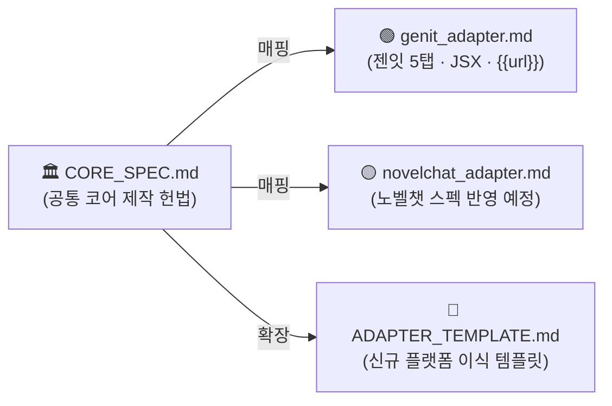

# 🌐 캐릭터 채팅 멀티플랫폼 이식 지시서 (Multi-Platform Porting Hub)

> **목적**: 실전 검증이 완료된 **젠잇(Gen-IT) v2.2 캐릭터 채팅 제작 방식**을 단일 기준(Reference Core)으로 삼아, **젠잇 · 노벨챗(NovelChat) 등 다양한 캐릭터 채팅 플랫폼**에 동일한 작품 품질과 게임 루프를 손실 없이 이식(Porting)하기 위한 통합 지시서입니다.

---

## 1. 아키텍처 개요: 코어(Core) + 어댑터(Adapter) 2계층 구조

플랫폼마다 **글자 수 한도, 이미지 호출 문법, 상태창/JSX 위젯 지원 여부, 로어북(설정집) 트리거 방식**이 다릅니다. 이를 매번 새로 설계하지 않도록 아래와 같이 **플랫폼 독립적 코어**와 **플랫폼별 어댑터**를 분리합니다.



---

## 2. 문서 구성 및 역할

| 문서 | 역할 | 상태 |
| :--- | :--- | :---: |
| [`CORE_SPEC.md`](CORE_SPEC.md) | **플랫폼 독립적 공통 코어 헌법** (서술 불변식, 8대 변수 모델, 4단계 서사 아크, 듀얼 트랙 이벤트, 포즈/에셋 계약) | ✅ 완료 |
| [`genit_adapter.md`](genit_adapter.md) | **젠잇(Gen-IT) 플랫폼 어댑터** (기준 레퍼런스: 5탭 한도, `{{url}}`, `[@id=Status]`/`Line` JSX, CommonMark HTML) | ✅ 완료 |
| [`ADAPTER_TEMPLATE.md`](ADAPTER_TEMPLATE.md) | **타 플랫폼 이식용 표준 어댑터 템플릿** (노벨챗 등 신규 플랫폼 스펙 수집·변환 양식) | ✅ 완료 |
| `novelchat_adapter.md` | **노벨챗(NovelChat) 플랫폼 어댑터** (6탭 한도, `{{char_이름}}`, ``, 500장 풀) | ✅ 완료 |

---

## 3. 신규 플랫폼 작품 이식 4단계 표준 절차

1. **코어 데이터 고정 (`CORE_SPEC.md`)**
   - 작품의 세계관, 캐릭터 6인 인격·외형·고유 키워드, 4단계 거대 서사 아크, 루트별 과거사, 실존 포즈 카탈로그(`POSE_MAPPING.md` / `genit_map.json`)를 먼저 확정합니다.
2. **타겟 플랫폼 어댑터 확인 (`{platform}_adapter.md`)**
   - 대상 플랫폼의 **프롬프트 총량 한도, 이미지 문법, 상태창/HTML/스크립트 지원 여부, 로어북 키워드 한도**를 어댑터 표에서 확인합니다.
   - 미지원 기능(예: React JSX 위젯 미지원)은 어댑터에 정의된 **텍스트/마크다운/코드블록 폴백(Fallback) 포맷**으로 다운그레이드 변환합니다.
3. **프롬프트 및 에셋 변환 패키징**
   - `12,000자` 기준 젠잇 코어 프롬프트를 타겟 플랫폼의 예산(예: 노벨챗 `7,000자`)에 맞게 압축하거나 로어북/모듈로 분산 배치합니다.
   - 에셋 해상도·파일명·경로 규격(예: `1024×1536` 일괄 크롭, 평면 vs 폴더 경로)을 플랫폼 요구사항에 맞춰 내보냅니다.
4. **플랫폼별 실전 검증 체크리스트 통과**
   - 첫 턴 프롤로그, 이미지 출력(404/엑박 0건), 변수 갱신, 대사 화자 매칭, 다크/라이트 모드 가독성을 검수합니다.

---

## 4. AI 작업자용 실행 지시 프롬프트 (복붙용)

다른 세션이나 AI 에이전트에게 특정 작품의 플랫폼 이식을 지시할 때 아래 템플릿을 사용합니다.

```text
[작업 지시: 캐릭터 채팅 플랫폼 이식]
1. 먼저 `docs/platforms/CORE_SPEC.md`를 정독해 작품의 공통 코어 불변식을 숙지하라.
2. 기준 완성본(`docs/genit/{작품}_젠잇_캐릭터_채팅_v2.2_완성본.md`)에서 세계관·캐릭터·서사 아크·실존 포즈 목록을 추출하라.
3. 타겟 플랫폼 어댑터(`docs/platforms/{대상플랫폼}_adapter.md`)의 제약 사항(글자수 한도, 이미지 태그, 상태창 포맷, 로어북 규칙)에 맞춰 1:1 변환 문서를 작성하라.
4. 포즈 코드는 절대 환각으로 창작하지 말고 원본 로스터의 실존 포즈 목록만 사용하라.
```
