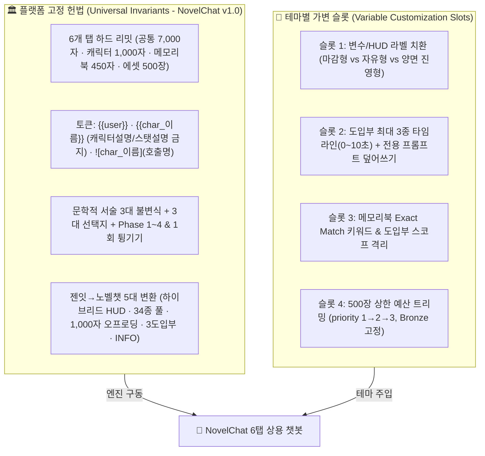

# [NovelChat Universal Master Framework v1.0] 노벨챗 6탭 시스템 제작 가이드 & 범용 AI 아키텍처 명세서

> **문서 목적**: 노벨챗(NovelChat) 커스텀 모드 6탭 플랫폼 규격에 맞춰 `plepa`의 모든 장르(청춘 캠퍼스, 현대 오피스, 판타지 모험, 스파이 느와르, 오토코노코 등)의 인터랙티브 콘텐츠를 제작·이식할 때 준수해야 하는 단일 기준 기술 명세서(SSOT)입니다.  
> **기준 레퍼런스**: [`젠잇_캐릭터채팅_제작법.md`](%EC%A0%A0%EC%9E%87_%EC%BA%90%EB%A6%AD%ED%84%B0%EC%B1%84%ED%8C%85_%EC%A0%9C%EC%9E%91%EB%B2%95.md) · [`NOVELCHAT_MULTI_THEME_TEMPLATE_v1.0.md`](novelchat/NOVELCHAT_MULTI_THEME_TEMPLATE_v1.0.md)  
> **관련 문서**: [`POSE_MAPPING.md`](../POSE_MAPPING.md) · [`CORE_SPEC.md`](platforms/CORE_SPEC.md) · [`validate_novelchat_work.py`](../scripts/validate_novelchat_work.py) · [`novelchat_asset_mapper.py`](../scripts/novelchat_asset_mapper.py)

---

## 📑 목차 (Table of Contents)

1. [아키텍처 개요: 고정 헌법 vs 가변 슬롯 2원화 체계](#아키텍처-개요-고정-헌법-vs-가변-슬롯-2원화-체계)
2. [PART 1: [고정 헌법] 전 테마 공통 불변 규칙 (Universal Invariants)](#part-1-고정-헌법-전-테마-공통-불변-규칙-universal-invariants)
   - [1.1 6개 탭 하드 리밋, 검수 정책 및 주입/비주입 필드 경계](#11-6개-탭-하드-리밋-검수-정책-및-주입비주입-필드-경계)
   - [1.2 확정 문법 및 치환 토큰 규격 (`{{user}}`, `{{char_이름}}`, ``)](#12-확정-문법-및-치환-토큰-규격-user-char_이름-char_이름호출명)
   - [1.3 문학적 서술 3대 불변식 & 스토리 유도형 3대 선택지 & Phase 법칙](#13-문학적-서술-3대-불변식--스토리-유도형-3대-선택지--phase-법칙)
   - [1.4 젠잇 → 노벨챗 5대 핵심 변환 공식](#14-젠잇--노벨챗-5대-핵심-변환-공식)
   - [1.5 AI 전용 필드 평문 개조식 압축 & 린터 파싱용 표준 헤딩 규약](#15-ai-전용-필드-평문-개조식-압축--린터-파싱용-표준-헤딩-규약)
3. [PART 2: [가변 슬롯] 작품 테마별 커스텀 가이드 (Variable Slots)](#part-2-가변-슬롯-작품-테마별-커스텀-가이드-variable-slots)
   - [2.1 가변 슬롯 1: 장르별 변수 & 텍스트 HUD 라벨 치환 매트릭스](#21-가변-슬롯-1-장르별-변수--텍스트-hud-라벨-치환-매트릭스)
   - [2.2 가변 슬롯 2: 도입부 타임라인(0~10초) & 도입부 이벤트(2,000자) 설계 패턴](#22-가변-슬롯-2-도입부-타임라인010초--도입부-이벤트2000자-설계-패턴)
   - [2.3 가변 슬롯 3: 메모리북 Exact Match 키워드 & 도입부 스코프 분리 전략](#23-가변-슬롯-3-메모리북-exact-match-키워드--도입부-스코프-분리-전략)
   - [2.4 가변 슬롯 4: 500장 에셋 상한 대응 & 우선순위 풀 예산 배분](#24-가변-슬롯-4-500장-에셋-상한-대응--우선순위-풀-예산-배분)
4. [PART 3: 실전 테마별 적용 프로필 4선 & 젠잇 이식 청사진](#part-3-실전-테마별-적용-프로필-4선--젠잇-이식-청사진)
5. [PART 4: 텍스트 HUD · 캐릭터 변수 · 도입부 타임라인 마스터 스니펫](#part-4-텍스트-hud--캐릭터-변수--도입부-타임라인-마스터-스니펫)
6. [PART 5: 실전 트러블슈팅 10선 & 배포 후 무중단 라이브 패치 규칙](#part-5-실전-트러블슈팅-10선--배포-후-무중단-라이브-패치-규칙)
7. [PART 6: 최종 프로덕션 검수 체크리스트 (12항목)](#part-6-최종-프로덕션-검수-체크리스트-12항목)

---

## 아키텍처 개요: 고정 헌법 vs 가변 슬롯 2원화 체계



---

## PART 1: [고정 헌법] 전 테마 공통 불변 규칙 (Universal Invariants)

### 1.1. 6개 탭 하드 리밋, 검수 정책 및 주입/비주입 필드 경계

> **운영 및 검수 정책**: 공개 작품 수정 시 대부분 **즉시 반영**되나, **대표 썸네일**과 **도입부 이미지** 변경 시에만 **관리자 검수 후 반영**됩니다.

| 탭 | 입력 항목 | 최대 한도 | AI 주입 | 필수 불변 규칙 |
| :--- | :--- | :--- | :---: | :--- |
| **탭 1<br>프로필** | **대표 썸네일** *(필수)* | PNG/JPG/WebP/MP4, `<= 5MB`, 3:4 권장 | X | 변경 시 **관리자 검수** 대상 |
| | **콘텐츠 이름** *(필수)* | `<= 20자` | X | **특수문자·이모지 절대 불가** |
| | **한줄 소개** *(필수)* | `<= 200자` | X | 외부 카드 노출용 요약 |
| | **콘텐츠 소개** *(필수)* | `<= 1,000자` | X | 작성/미리보기 전환, 젠잇 Intro 핵심 요약 |
| | **해시태그** *(필수)* | `<= 10개`, 각 `<= 10자` | X | 검색 노출용 핵심 키워드 |
| **탭 2<br>배경 설정** | **공통 프롬프트** *(필수)* | **`<= 7,000자`** | **O (상시)** | `[세계관/배경]`, `[공간 규칙]`, `[행동 원리]`, `[톤/문체]`, `[금지]` |
| | **캐릭터 이름** *(필수)* | `<= 20자` | **O** | `{{char_이름}}` 토큰의 기준 키 |
| | **캐릭터 한줄 소개** *(선택)* | `<= 200자` | X | 유저 열람용 |
| | **캐릭터 설명** *(필수)* | **`<= 1,000자`** | **O** | `[성격]`, `[말투]`, `[외형]`, `[관계]`, `[균열]` (`{{char_...}}` **금지**) |
| | **종속 변수** *(선택)* | 스탯 설명 `<= 200자` | **O** | 최소/최대/기본값 + `트리거 + 변화량(+N/-N)` (`{{char_...}}` **금지**) |
| **탭 3<br>도입부** | **도입부 개수 / 제목** | **최대 3개** / `<= 30자` | X | 제목 **특수문자·이모지 제외** |
| | **도입부 이미지** *(선택)* | `<= 5MB`, 1:1 권장 | X | 변경 시 **관리자 검수** 대상 |
| | **일반 메시지 블록** | **각 `<= 500자`** | **O** | 캐릭터/커스텀 캐릭터(`""` 2자 가산)/나레이션/사용자 |
| | **INFO 블록** | **`<= 300자`** | **O** | 표·줄바꿈 패널 렌더링 (핵심 규칙/HUD 안내) |
| | **이미지/영상 블록** | 파일 또는 `https://`/`//` URL | X (배경) | 타임라인(0~10초) 지정 시점부터 채팅방 배경 적용 |
| | **추천답변** *(선택)* | `<= 3개`, 각 `<= 50자` | **O** | 유저 첫 원클릭 입력 |
| | **도입부 이벤트** *(선택)* | `<= 2,000자` | **O (1턴)** | 첫 번째 턴에만 비공개 주입 (`[첫 상황]`, `[분기]`) |
| | **도입부 전용 프롬프트** | `<= 7,000자` *(추정)* | **O** | 2번째 이후 도입부에서 공통 프롬프트 덮어쓰기 |
| **탭 4<br>캐릭터 에셋** | **총량 / 포맷 / 용량** | **총 `<= 500개`**, 개당 `<= 5MB` | X (풀) | **도입부별 기본 이미지(`★`) 1장 이상 필수** |
| | **호출어 (태깅)** | 영문/한글/공백, **`_` 절대 금지** | **O** | 파일명 `{호출어}_{코드}.webp` → `_` 앞 자동 파싱 |
| | **수익화 등급** | `Bronze` 고정 (0플링) | X | 일반 계정 `Bronze` 고정 (`future_tier` 메타 보존) |
| **탭 5<br>메모리북** | **제목 / 키워드** | 키워드 `<= 5개`, 각 `<= 30자` | **O (조건)** | **Exact Match** 정확 일치 시에만 로드 |
| | **내용 / 적용 대상** | `<= 450자` / 전체·도입부 선택 | **O** | 특정 도입부 스코프 격리 가능 |
| **탭 6<br>기타 설정** | **연령 등급 / 크리에이터 코멘트** | 일반·**성인(비가역)** / `<= 1,000자` | X | **성인모드 설정 후 일반모드 복귀 불가** |

---

### 1.2. 확정 문법 및 치환 토큰 규격 (`{{user}}`, `{{char_이름}}`, ``)

1. **유저 치환 토큰**: `{{user}}` (전 탭 공통 사용).
2. **캐릭터 치환 토큰**: **`{{char_이름}}`** (예: `{{char_아야메}}`, `{{char_도미니카}}`).
   - **허용 구역 (`[캐릭터 ▾]` 버튼 지원)**: 공통 프롬프트, 도입부 전용 프롬프트, 도입부 이벤트, 메모리북, 도입부 블록.
   - **금지 구역 (`[캐릭터 ▾]` 버튼 미지원)**: **캐릭터 설명**, **변수 스탯 설명** → 반드시 `{{user}}`와 **캐릭터 실명 직접 기재**! (오용 시 리터럴 문자열 그대로 노출되어 AI 오작동 유발)
3. **변수 조건문 참조**: 노벨챗은 별도 코드형 조건 태그가 없으므로 **자연어 조건문**(예: `{{user}}와의 호감도가 50 이상이면 ~`)으로 분기 지시합니다.
4. **도입부 마크업**: 대사 `"텍스트"`, 지문 `*텍스트*`. 블록 자체가 화자를 부여하므로 본문에 캐릭터명을 중복 기재하지 않습니다.
5. **이미지 호출 문법**: **``**
   - 대사 바로 윗줄에 1:1 직결 배치하며, 1턴당 2~4회 적극 호출합니다.
   - 이미 `char_이름`이 캐릭터를 구분하므로 호출어에 캐릭터 접두어(`aya `, `dom ` 등)를 중복 기재하지 않고 순수 감정·상황명(`평상`, `미소`, `딥키스` 등)만 사용합니다.

---

### 1.3. 문학적 서술 3대 불변식 & 스토리 유도형 3대 선택지 & Phase 법칙

젠잇 v2.2에서 실전 검증된 서사 엔진 코어를 그대로 계승합니다:
1. **`{{user}}` 사칭 절대 금지**: 플레이어의 대사·속마음·자발적 행동·신체 반응을 AI가 대신 서술하지 않습니다.
2. **빙산 이론 (외적 감각 묘사)**: 내면 독백 설명 대신 시선 처리, 손끝 떨림, 귀 끝 홍조, 호흡, 옷자락 잡기 등 외적 감각으로 심리를 드러냅니다.
3. **1턴 1인 주 화자 포커스 & 구어체 원칙**: 1턴 600~800자 기준(`[이미지] > [대사] > [감각 서술]`), 일상 씬은 1:1 독점 집중, 다인 개입은 `[질투 인터셉트]`·`[합숙/이벤트]` 시에만 허용합니다.
4. **스토리 유도형 3대 선택지**: 매 턴 본문 직후(HUD 윗줄)에 ① 스토리 추진/거점 이동 ② 감정 심화/밀착 ③ 텐션 케어/완급 조절 3종 선택지를 출력합니다.
5. **호감도 Phase 1~4 & 1회 튕기기 법칙**: `Phase 1(탐색)` ➔ `Phase 2(친밀)` ➔ `Phase 3(연인)` ➔ `Phase 4(완전 함락)`. 단계 건너뛰기 요구 시 **1회 튕기기 + 조르기 돌파**로 긴장감을 유지합니다.

---

### 1.4. 젠잇 → 노벨챗 5대 핵심 변환 공식

| # | 젠잇 (Gen-IT) 방식 | 노벨챗 (NovelChat) 변환 공식 | 핵심 이점 |
| :-: | :--- | :--- | :--- |
| **1** | React JSX `Status` + `Line` 양방향 위젯 | **하이브리드 HUD**: 캐릭터별 수치 스탯(호감/텐션 등)은 **종속 변수**로 분리, 날짜·장소·진척도·메신저 한 줄 알림은 공통 프롬프트 말미 **텍스트/코드블록 HUD**로 출력 | 별도 JSX 없이 상태 기억 + UI 가독성 동시 확보 |
| **2** | 114종 포즈 파일명 전수 나열 | **34종 순수 감정·상황 랜덤 호출어 풀**(`data/novelchat_pose_pools.json`)로 압축 | 공통 프롬프트 7,000자 예산 대폭 절약 + 404 환각 차단 |
| **3** | 캐릭터 탭 프롬프트 500자 한도 | **캐릭터 설명 1,000자(2배)** 활용 → 말투 예시·균열·진영별 태도를 공통 프롬프트에서 캐릭터 설명으로 **오프로딩** | 공통 프롬프트 7,000자 한도 방어 + 캐릭터 입체감 상승 |
| **4** | 시작 설정 4루트 + 히든 2,000자 | **최대 3개 도입부 압축** + 2번째 이후 루트는 **`[도입부 전용 프롬프트]`**로 세계관·진영 규칙 완전 덮어쓰기 | 스파이 자경단/보안국 반전 루트 등 독립 구현 |
| **5** | 탭 1 HTML 10만자 인트로 | **프로필 콘텐츠 소개(1,000자)**에 매력·관계도 요약 + **도입부 INFO 블록(300자)**에 플레이 핵심 규칙 배치 | 플랫폼 UI 제약 내 정보 전달 최적화 |

---

### 1.5. AI 전용 필드 평문 개조식 압축 & 린터 파싱용 표준 헤딩 규약

- **AI 전용 비공개 필드**(`공통 프롬프트`, `캐릭터 설명`, `도입부 이벤트`, `메모리북 내용`)는 장식용 마크다운(`**`, `###`, `---`)과 공손체를 배제하고 `[섹션 태그] + - 개조식 명령` 평문으로 압축합니다.
- **자동 검증기(`scripts/validate_novelchat_work.py`) 파싱용 표준 헤딩 규약**:
  - 모든 작업 원고는 `docs/novelchat/{작품명}_노벨챗_v1.0.md`에 저장하며, 상단 YAML Frontmatter(`status`, `roster`, `version`)를 포함합니다.
  - 6탭 표준 헤딩(`## 1. [탭 1: 프로필]` ~ `## 6. [탭 6: 기타 설정]`)과 각 하위 코드블록 구조를 준수하면 검증기가 모든 글자 수·금지 문자·토큰·이미지 호출 문법을 자동 검사합니다.

---

## PART 2: [가변 슬롯] 작품 테마별 커스텀 가이드 (Variable Slots)

### 2.1. 가변 슬롯 1: 장르별 변수 & 텍스트 HUD 라벨 치환 매트릭스

| 슬롯 | 청춘 캠퍼스 (마감형) | 현대 오피스 (마감형) | 판타지 던전 (자유형) | 느와르 스파이 (양면 진영형) |
| :--- | :--- | :--- | :--- | :--- |
| **종속 변수 1** | 호감도 (`0~100`, 기본 35) | 신뢰/호감도 (`0~100`) | 유대도 (`0~100`) | 충성도 (`0~100`) |
| **종속 변수 2** | 질투/피로 (`0~100`, 기본 15) | 사내 소문 리스크 (`0~100`) | 마나 폭주 (`0~100`) | 의심 지수 (`0~100`) |
| **HUD 퀘스트** | 과제 완성도 (`0~100%`) | TF 통과율 (`0~100%`) | 미궁 돌파율 (`0~100%`) | 기밀 복제율 (`0~100%`) |
| **HUD 시간축** | 최종 발표 `D-14` (낮/밤) | 감사 `D-20` (출근/야근) | 무기한 탐색 (낮/밤) | 접선 `D-10` (작전/잠입) |
| **HUD 메신저** | `[LINE 알림]` | `[사내 메신저]` | `[마력 통신구]` | `[암호 무전기]` |

---

### 2.2. 가변 슬롯 2: 도입부 타임라인(0~10초) & 도입부 이벤트(2,000자) 설계 패턴

1. **도입부 타임라인 표준 배치**:
   - `0초`: `[이미지/영상 블록]` (첫 배경 세팅) + `[INFO 블록]` (300자 이내 세계관·조작 핵심 요약)
   - `2~5초`: `[나레이션 블록]` (500자 이내 현장 감각 묘사)
   - `6~9초`: `[캐릭터 블록]` (500자 이내 첫 대사, **화자명 본문 중복 금지**)
2. **도입부 이벤트 (`<= 2,000자`)**: 첫 번째 턴에만 비공개 주입되므로 `[첫 상황]`(직전 맥락 요약)과 `[분기]`(추천답변 3종 선택 시 전개 방향)만 간결하게 배치합니다.

---

### 2.3. 가변 슬롯 3: 메모리북 Exact Match 키워드 & 도입부 스코프 분리 전략

- 노벨챗 메모리북은 **키워드 정확 일치(Exact Match)** 시에만 로드됩니다.
  - ❌ 나쁜 예: `도서관에서 만났을 때`, `아야메가 질투하면` (조사·문장형은 매칭 실패 확률 급증)
  - ✅ 좋은 예: `도서관`, `자취방`, `합숙`, `질투`, `빈강의실` (핵심 명사·고유명사 최대 5개, 각 30자 이내)
- **도입부 스코프 분리**: 특정 도입부에서만 유효한 비밀 과거사·진영 설정은 적용 대상을 **해당 도입부**로 한정해 타 루트 기억 오염을 원천 차단합니다.

---

### 2.4. 가변 슬롯 4: 500장 에셋 상한 대응 & 우선순위 풀 예산 배분

- 노벨챗 에셋 총량 상한은 **500장**입니다. `campus`(684장), `spy`(1,140장) 등 대형 로스터는 `scripts/novelchat_asset_mapper.py --trim-to-limit`를 사용해 자동 예산 배분합니다:
  1. `priority: 1` (기본 감정 7종 + 일상활동 + 핵심 로맨스/H씬) 우선 보존
  2. 캐릭터별 균등 할당 + 동일 호출어 랜덤 풀 중복 상한 축소
  3. 업로드 등급은 전량 `Bronze`(0플링) 고정, `upload_manifest.json`에 `future_tier` 보존

---

## PART 3: 실전 테마별 적용 프로필 4선 & 젠잇 이식 청사진

| 프로필 | 콘텐츠 이름 (<=20자, 특수문자X) | 3도입부 압축 전략 | 젠잇 v2.2 레퍼런스 이식 포인트 |
| :--- | :--- | :--- | :--- |
| **A. 캠퍼스** | `청춘의 학점과 사랑의 조별과제` | ① 소꿉친구 재회 ② 초면 7조 ③ 올스타 합숙 | 114종 포즈 → 34종 풀 / `LINE` → HUD 1줄 알림 |
| **B. 오피스** | `블라인드 러브 탕비실 기안서` | ① 동기 비밀연애 ② 팀장 밀착 ③ TF 야근 | 콜론(`:`) 제거 제목 준수 / 사내 메신저 HUD |
| **C. 판타지** | `심연의 미궁 S급 원정대` | ① 길드 집결 ② 심층 야영 ③ 마탑 밀회 | 무기한 자유 탐색형 시간축 / 마력 통신구 HUD |
| **D. 스파이** | `코드네임 제로 장막 뒤의 요원들` | ① 자경단 잠입 ② 보안국 역잠입 ③ 살롱 교섭 | **`[도입부 전용 프롬프트]`**로 진영 규칙 완전 분리 |

---

## PART 4: 텍스트 HUD · 캐릭터 변수 · 도입부 타임라인 마스터 스니펫

### 4.1. 공통 프롬프트 말미 텍스트 HUD 스니펫 (복붙용)

```text
[출력 말미 HUD 규칙]
매 턴 서술과 [당신의 선택지] 3종 직후, 맨 마지막 줄에 아래 상태창 블록을 정확히 출력한다:
```status
📅 {{time_day}} | 📍 {{location}} | 🎯 {{quest_label}}: {{prog}}%
💬 [메신저 알림] {{line_msg}}
```
```

### 4.2. 캐릭터 종속 변수 스탯 설명 스니펫 (`{{char_...}}` 사용 금지!)

```text
변수명: 호감도 (최소 0 / 최대 100 / 기본 35)
{{user}}가 아야메의 취향을 기억하거나 진심으로 칭찬하면 +3
{{user}}가 아야메를 무시하거나 약속을 어기면 -4
```

---

## PART 5: 실전 트러블슈팅 10선 & 배포 후 무중단 라이브 패치 규칙

| 번호 | 증상 | 원인 | 해결 공식 |
| :-: | :--- | :--- | :--- |
| **NT-1** | 캐릭터 설명에 `{{char_아야메}}`가 글자 그대로 출력 | 캐릭터 설명·스탯 설명은 `[캐릭터 ▾]` 미지원 구역 | 반드시 `{{user}}`와 **캐릭터 실명** 직접 기재 |
| **NT-2** | 에셋 업로드 시 호출어가 `her` 또는 엉뚱한 단어로 잘림 | 업로더가 파일명의 **첫 번째 `_` 앞 문자열**만 호출어로 파싱 | `novelchat_asset_mapper.py`로 `{호출어}_{코드}.webp` 변환 업로드 |
| **NT-3** | 이미지 호출이 텍스트로만 뜨고 출력 안 됨 | `` 양식 변형 또는 호출어에 `_` 포함 | 양식 원형 유지 + 호출어 `_` 완전 제거 |
| **NT-4** | 메모리북 설정이 대화 중 전혀 로드되지 않음 | 키워드에 조사/문장형 사용 (Exact Match 실패) | 핵심 명사·고유명사 위주 5개 이내, 각 30자 이내로 수정 |
| **NT-5** | 커스텀 캐릭터 블록이 500자 초과로 저장 실패 | 커스텀 캐릭터 생성 시 큰따옴표 `""` 2자 자동 삽입 | 본문 498자 이내로 작성 (`validate_novelchat_work.py` 자동 가산 검사) |
| **NT-6** | 대표 썸네일/도입부 이미지 수정 후 바로 반영 안 됨 | 썸네일·도입부 이미지는 **관리자 검수 대상** | 텍스트 패치와 이미지 교체 일정을 분리하여 운영 |
| **NT-7** | 성인모드 테스트 후 일반모드로 못 되돌림 | **연령 등급 성인모드는 설정 후 되돌리기 불가(비가역)** | 초기 테스트는 비공개/일반모드 또는 별도 사본에서 검증 후 전환 |
| **NT-8** | 6~10인 로스터 에셋이 500장을 초과해 업로드 불가 | 총량 500장 하드 리밋 | `--trim-to-limit`로 `priority 1→2→3` 순 자동 예산 절삭 |
| **NT-9** | 도입부 대사에 캐릭터 이름이 두 번 겹쳐 나옴 | 블록 자체가 화자를 부여하는데 본문에 화자명 중복 기재 | 도입부 블록 본문에는 `"대사"`와 `*지문*`만 작성 |
| **NT-10** | 젠잇 `{{url}}`이나 `[@id=Status]`가 그대로 노출됨 | 젠잇 레거시 문법 잔재 혼입 | `validate_novelchat_work.py` 실행해 젠잇 잔재 0건 확인 |

---

## PART 6: 최종 프로덕션 검수 체크리스트 (12항목)

- [ ] **1. 자동 검증기 통과**: `.\.venv\Scripts\python.exe scripts/validate_novelchat_work.py [원고.md] --manifest dist/novelchat/{roster}/upload_manifest.json` **PASS ✅**
- [ ] **2. 6탭 글자 수 한도**: 공통 `<= 7,000자`, 캐릭터 설명 `<= 1,000자`, 도입부 이벤트 `<= 2,000자`, 일반 블록 `<= 500자`(커스텀 `""` 2자 포함), INFO `<= 300자`, 메모리북 `<= 450자`
- [ ] **3. 금지 문자 점검**: 콘텐츠 이름(`<= 20자`) 및 도입부 제목(`<= 30자`)에 특수문자·이모지 0건
- [ ] **4. `{{char_이름}}` 경계 준수**: 캐릭터 설명·스탯 설명에 `{{char_...}}` 0건, 지원 구역 내 미등록 캐릭터명 0건
- [ ] **5. 이미지 호출 문법**: 전 본문이 `` 규격이며 호출어 내 `_` 및 캐릭터 접두어 중복이 없는가?
- [ ] **6. 에셋 500장 & 5MB 이하**: `novelchat_asset_mapper.py` 산출물이 총 500장 이하, 장당 5MB 이하인가?
- [ ] **7. 도입부별 기본 이미지(`★`)**: 도입부마다 기본 이미지(`000_평상` 등) 1장 이상 지정했는가?
- [ ] **8. 업로드 등급 확인**: 전 에셋 `Bronze`(0플링) 등록 완료, `upload_checklist.csv`에 `future_tier` 기록 보관했는가?
- [ ] **9. 메모리북 Exact Match**: 모든 키워드가 5개 이하, 30자 이하의 명사/고유명사이며 도입부 스코프가 올바른가?
- [ ] **10. 젠잇 레거시 잔재 0건**: `{{url}}`, `[@id=`, `useTemplateValue`, `@캐릭터@` 등이 모두 제거되었는가?
- [ ] **11. 연령 등급 확인**: 성인모드 전환 전 비가역 정책을 최종 확인했는가?
- [ ] **12. 검수 대상 이미지 최종 확정**: 대표 썸네일(3:4)과 도입부 이미지(1:1)가 최종본인지 확인 후 게시했는가?
