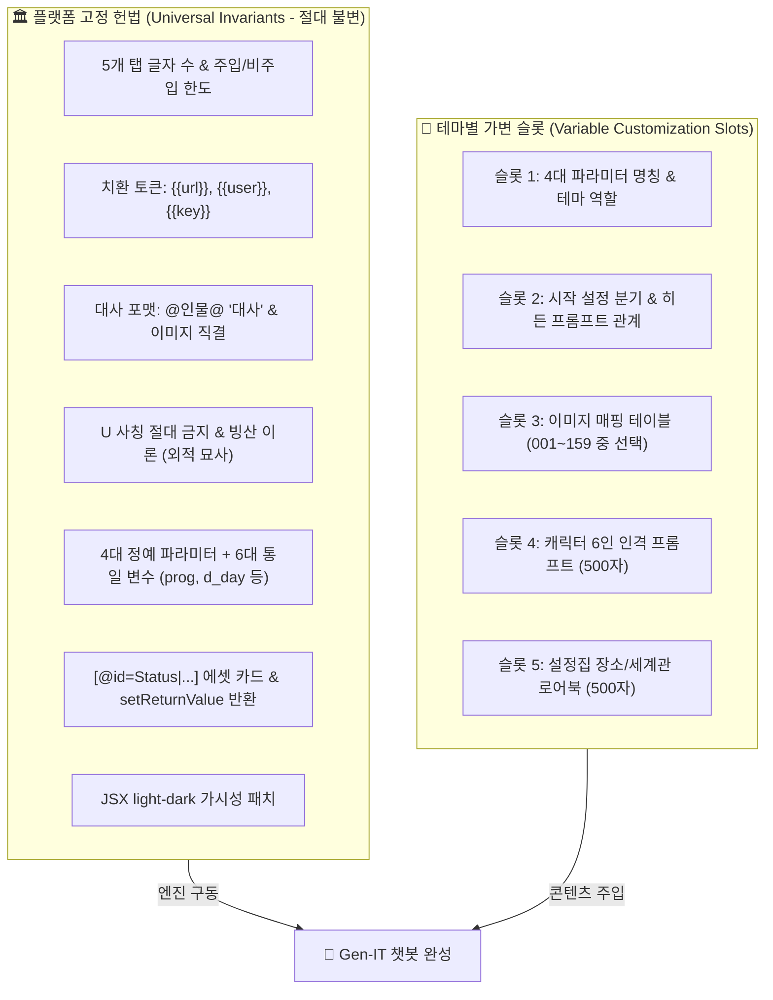

# [Gen-IT Universal Master Framework] 젠잇 5탭 시스템 제작 가이드 & 범용 AI 아키텍처 명세서

> **문서 목적**: 젠잇(genit.ai) 플랫폼에서 모든 장르(청춘 캠퍼스, 현대 오피스, 판타지 모험, 스파이 느와르 등)의 인터랙티브 콘텐츠를 제작할 때 준수해야 하는 단일 기준 기술 명세서(SSOT)입니다.  
> **아키텍처 핵심**: 어떤 장르든 절대 깨지지 않는 **[플랫폼 고정 헌법 (Universal Invariants)]**과 장르에 맞게 자유롭게 갈아 끼우는 **[테마별 가변 슬롯 (Variable Slots)]**을 명확히 분리하여, AI의 환각을 차단하고 제작 확장성을 극대화합니다.  
> **관련 문서**: [`POSE_MAPPING.md`](../POSE_MAPPING.md), [`docs/POSE_MAPPING_V2.md`](POSE_MAPPING_V2.md), [`DOCUMENTATION_GUIDE.md`](DOCUMENTATION_GUIDE.md)

---

## 📑 목차 (Table of Contents)

1. [아키텍처 개요: 고정 헌법 vs 가변 슬롯 2원화 체계](#아키텍처-개요-고정-헌법-vs-가변-슬롯-2원화-체계)
2. [PART 1: [고정 헌법] 전 테마 공통 불변 규칙 (Universal Invariants)](#part-1-고정-헌법-전-테마-공통-불변-규칙-universal-invariants)
   - [1.1 5개 탭 시스템 제약 및 주입/비주입 필드 경계](#11-5개-탭-시스템-제약-및-주입비주입-필드-경계)
   - [1.2 시스템 내장 치환 토큰 규격](#12-시스템-내장-치환-토큰-규격)
   - [1.3 대사 및 이미지 직결 표준 포맷 (`@인물@ "대사"`)](#13-대사-및-이미지-직결-표준-포맷-인물-대사)
   - [1.4 문학적 서술 3대 불변식 (U 사칭 금지, 빙산 이론, 구어체)](#14-문학적-서술-3대-불변식-u-사칭-금지-빙산-이론-구어체)
   - [1.5 4대 슬림화 파라미터 구조 원리 (4 Core Parameters)](#15-4대-슬림화-파라미터-구조-원리-4-core-parameters)
   - [1.6 `[@id=Status|...]` 인라인 에셋 상태창 호출 및 탄력적 시간 경과 규칙](#16-idstatus-인라인-에셋-상태창-호출-및-탄력적-시간-경과-규칙)
   - [1.7 실전 검증 10대 코어 룰 엔진 불변식](#17-실전-검증-10대-코어-룰-엔진-불변식)
3. [PART 2: [가변 슬롯] 작품 테마별 커스텀 가이드 (Variable Slots)](#part-2-가변-슬롯-작품-테마별-커스텀-가이드-variable-slots)
   - [2.1 가변 슬롯 1: 4대 파라미터 장르별 치환 매트릭스](#21-가변-슬롯-1-4대-파라미터-장르별-치환-매트릭스)
   - [2.2 가변 슬롯 2: 시작 설정(루트) 및 히든 프롬프트 오버라이드](#22-가변-슬롯-2-시작-설정루트-및-히든-프롬프트-오버라이드)
   - [2.3 가변 슬롯 3: 4단계 거대 서사 아크 (Macro Story Flow) 설계](#23-가변-슬롯-3-4단계-거대-서사-아크-macro-story-flow-설계)
   - [2.4 가변 슬롯 4: 포즈 매핑 카탈로그 범위 바인딩](#24-가변-슬롯-4-포즈-매핑-카탈로그-범위-바인딩)
   - [2.5 가변 슬롯 5: 캐릭터 탭(500자) 및 로어북 설정집(500자)](#25-가변-슬롯-5-캐릭터-탭500자-및-로어북-설정집500자)
4. [PART 3: 실전 테마별 적용 프로필 4선 (Reference Profiles)](#part-3-실전-테마별-적용-프로필-4선-reference-profiles)
   - [Profile A: 청춘 캠퍼스 시뮬레이션 (조별과제 & 소꿉친구)](#profile-a-청춘-캠퍼스-시뮬레이션-조별과제--소꿉친구)
   - [Profile B: 현대 오피스 사내 로맨스 (비밀 사내연애 & 프로젝트)](#profile-b-현대-오피스-사내-로맨스-비밀-사내연애--프로젝트)
   - [Profile C: 판타지 모험 / 던전 레이드 (파티 호감도 & 보스 토벌)](#profile-c-판타지-모험--던전-레이드-파티-호감도--보스-토벌)
   - [Profile D: 느와르 / 스파이 첩보물 (기밀 탈취 & 의혹 관리)](#profile-d-느와르--스파이-첩보물-기밀-탈취--의혹-관리)
5. [PART 4: [탭 5: 에셋] 표준 변수 목록 및 마스터 JSX 상태창 코드 (`[@id=Status]`)](#part-4-탭-5-에셋-표준-변수-목록-및-마스터-jsx-상태창-코드-idstatus)
6. [PART 5: 실전 캐릭터 채팅 제작 트러블슈팅 8선 & 생성 후 사후 라이브 패치(Post-Launch Patching) 가이드](#part-5-실전-캐릭터-채팅-제작-트러블슈팅-8선--생성-후-사후-라이브-패치post-launch-patching-가이드)
   - [5.1 실전 제작 중 겪은 8대 핵심 트러블슈팅 및 개선 공식](#51-실전-제작-중-겪은-8대-핵심-트러블슈팅-및-개선-공식)
   - [5.2 생성(배포) 이후 사후 라이브 패치 & 무중단 유지보수 플레이북](#52-생성배포-이후-사후-라이브-패치--무중단-유지보수-플레이북)
7. [PART 6: 최종 프로덕션 검수 체크리스트](#part-6-최종-프로덕션-검수-체크리스트)

---

## 아키텍처 개요: 고정 헌법 vs 가변 슬롯 2원화 체계

모든 인터랙티브 AI 콘텐츠는 아래의 2원화 구조로 조립됩니다:



---

## PART 1: [고정 헌법] 전 테마 공통 불변 규칙 (Universal Invariants)

어떤 테마나 장르를 제작하더라도 **시스템 오류, 토큰 초과, AI 환각을 막기 위해 100% 동일하게 유지해야 하는 시스템 헌법**입니다.

### 1.1. 5개 탭 시스템 제약 및 주입/비주입 필드 경계

| 탭 | 입력 항목 | 최대 한도 | AI 주입 여부 | 필수 불변 규칙 |
| :---: | :--- | :--- | :---: | :--- |
| **탭 1<br>[기본]** | **카테고리** | 단일 선택 | **O** | 다중 인물·인터랙티브 롤플레잉은 무조건 **`시뮬레이션`** 선택 |
| | **제목 / 한 줄 소개** | 제한 없음 / **20자** | 제목 O / 한 줄 X | 한 줄 소개는 외부 검색용 카드로만 쓰임 |
| | **설명 / 모험 가이드** | 각 **50,000자** | **X (주입 안 됨)** | 유저 전용 페이지. 마크다운/HTML 지원. 스포일러 방지 작성 |
| **탭 2<br>[프롬프트]** | **메인 프롬프트** | **합산 8,000자** | **O (전역 상시)** | 공통 서술 지침, 출력 문법, Few-shot 포함 (추가 프롬프트와 한도 공유) |
| | **시작 설정 이름** | **20자** | X (UI 선택창) | 다중 루트 타이틀. 배경 이미지 등록 가능 |
| | **프롤로그** | **2,000자** | **O (초기 컨텍스트)** | 선택된 루트 진입 시 AI의 첫 턴 출력 지문 |
| | **히든 프롬프트** | **2,000자 (루트별 독립)** | **O (해당 루트 전용)** | **8,000자 한도와 무관한 독립 2,000자 버퍼**. 루트별 서사/관계 오버라이드 |
| | **추가 프롬프트** | **합산 8,000자 공유** | **O (해당 루트 전용)** | **루트별 특화 규칙/이벤트. 다수 등록해도 '가장 긴 1개'만 메인에 합산** |
| | **추천 답변** | 1~3개 | **O (유저 첫 입력)** | 프롤로그 직후 유저 원클릭 버튼 |

> [!IMPORTANT]
> **젠잇 프롬프트 총 길이 계산 공식 (8,000자 한도 검증 로직)**:
> $$\text{프롬프트 총 길이} = \text{메인 프롬프트} + \max(\text{각 시작 설정의 추가 프롬프트}) \le 8,000\text{자}$$
> * 시작 설정이 여러 개여도 추가 프롬프트를 전부 합산하는 것이 아니라, **그 중 가장 긴 항목 하나만 메인 프롬프트에 합산**하여 8,000자 한도를 확인합니다.
> * **히든 프롬프트(2,000자)**는 위 8,000자 합산 공식에서 완전히 제외되는 **루트별 독립 보너스 버퍼**입니다.
| **탭 3<br>[설정집]** | **키워드 / 프롬프트** | **15자 / 500자** | **O (조건부 주입)** | 단어가 대화에 등장할 때만 메모리에 주입되는 로어북 |
| **탭 4<br>[캐릭터]** | **이름 / 프롬프트** | **20자 / 500자** | **O (조건부 주입)** | 캐릭터 등장 시 주입. **각 캐릭터는 개별 일지(Memory)를 독립 유지** |
| | **소개** | **300자** | **X (주입 안 됨)** | 유저에게만 노출되는 프로필 |
| **탭 5<br>[에셋]** | **전역 변수** | 최대 **30개** | **O (`{{key}}`)** | Key 15자 이내, Value 200자 이내. 실시간 추적 변수 |
| | **컴포넌트 코드** | **50,000자** | X (UI 렌더링) | React JSX 또는 HTML 기반 시각 HUD |

---

### 1.2. 시스템 내장 치환 토큰 규격
* **`{{user}}`**: 대화를 진행하는 플레이어(유저)의 닉네임으로 자동 치환됩니다.
* **`{{url}}`**: 에셋에 등록된 파일들의 원격 스토리지 루트 URL 경로로 치환됩니다.
  * ⚠️ 변형 태그(`i-url`, `{iurl}`, `{{i-url}}`, `IURL` 등)는 시스템 인식이 불가능하므로 엄격히 금지됩니다.
* **`{{key}}`**: 에셋 탭의 변수 목록에 등록된 키를 호출하여 현재 값을 가져옵니다 (예: `{{team_prog}}`, `{{d_day}}`).
* **`{{random(N)}}`**: 1부터 N까지의 무작위 난수를 생성합니다 (예: `{{random(20)}}` → 1~20 중 1개).
* **`{{random(N,id)}}`**: 하나의 프롬프트 내에서 복수의 독립 난수를 생성할 때 식별자(`id`)를 부여하여 구분합니다.

---

### 1.3. 대사 및 이미지 직결 표준 포맷 (`@인물@ "대사"`)
다중 인물이 등장하는 시뮬레이션에서 화자 오인과 음성(TTS) 엔진 오류를 방지하기 위한 절대 규칙입니다.
1. **호출 포맷**: **`@캐릭터이름@ "대사 내용"`**
   * 인물 식별 기호로 골뱅이(`@`)를 양쪽에 감쌉니다.
   * 정체가 드러나지 않은 인물은 `@???@ "대사 내용"`으로 표기합니다.
2. **배치 순서**: **반드시 상황 이미지 바로 아랫줄에 해당 캐릭터의 대사가 이어지도록 배치**합니다.
3. **노출 빈도**: 1턴당 상황과 감정에 맞춰 **3~4회 적극 노출**합니다.

```markdown
{{url}}aya_004_토라짐.webp
@아야메@ "야, {{user}}. 멍하니 있지 말고 이것 좀 봐봐."
```

---

### 1.4. 문학적 서술 3대 불변식
1. **`U(플레이어) 사칭 절대 금지 (최우선 헌법)`**:
   * **어떠한 경우에도 플레이어의 대사, 속마음, 감정, 신체 반응, 행동을 AI가 대신 서술하거나 인용하지 않습니다.**
   * 플레이어가 침묵하거나 짧게 입력하더라도 대화를 멈추지 않고, 주변 사건과 NPC의 독자적 행동으로 상황을 진전시킵니다.
2. **`빙산 이론 (등장인물 내면 독백 비공개)`**:
   * 캐릭터의 속마음(독백, 혼잣말, 내면 서술)을 직접 서술하지 않고 **표정, 시선 처리, 손짓, 목소리의 떨림, 신체적 반응 등 외적 감각 묘사**로만 드러냅니다.
3. **`자연스러운 2025~2026 구어체`**:
   * 번역투(일본식 어투, 영단어 남발 등), 고어체/문어체, 과거 유행어를 금지하고 현대 한국어 일상 구어체를 유지합니다.
   * 1턴당 분량은 **600~800자**를 기준으로 합니다.

---

### 1.5. 4대 슬림화 파라미터 구조 원리 (4 Core Parameters)
변수가 5개 이상 늘어나면 LLM이 토큰 인지 부하(Cognitive Load)로 인해 계산 실수를 하거나 상태창 출력을 누락하는 환각이 발생합니다.  
어떤 장르든 상태 관리는 **오직 4개의 핵심 역할 슬롯**으로 압축합니다:

```text
┌────────────────────────────────────────────────────────────────────────┐
│                   [4대 슬림화 파라미터 구조 원리]                       │
├────────────────────────────────────────────────────────────────────────┤
│ ① 메인 퀘스트 진행도 (0~100%) : 장기 목표 엔진. 25% 단위 마일스톤 이벤트 │
│ ② 타임어택 긴장감 (D-Day/카운트다운) : 시간 압박을 주어 지루함 방지       │
│ ③ 핵심 감정/관계 지표 (0~100) : 메인 캐릭터와의 친밀도/신뢰도/호감도    │
│ ④ 상호작용/케어 지표 (0~100)  : 유저의 즉각적 행동을 유도하는 피로/위기 수치 │
└────────────────────────────────────────────────────────────────────────┘
```

---

### 1.6. `[@id=Status|...]` 인라인 에셋 상태창 호출 및 탄력적 시간 경과 규칙
채팅 메시지 맨 마지막 줄(선택지 3종 바로 아래)에 **`[@id=Status|...]`** 인라인 태그를 고정 출력합니다.  
젠잇 렌더러는 이 태그를 인식하여 그 자리에 [탭 5: 에셋]의 JSX 동적 상태창 카드를 즉시 렌더링하며, 동시에 LLM의 단기 기억 앵커(Memory Anchor) 역할을 수행합니다.

* **주의 (`{{변수}}` 초기값 고정 방지)**: 호출 공식에 `prog={{team_prog}}`처럼 치환 토큰을 쓰면 초기값으로 고정되므로, 반드시 **`prog=[연산된수치]|d_day=[남은일수]`** 형태로 AI가 매 턴 계산한 최신 숫자를 직접 기입하도록 지시합니다.
* **다중 인물 등장 시 대표 타겟 원칙**: 2명 이상 등장하는 턴에서는 **해당 턴에서 마지막으로 대사를 쳤거나 유저와 가장 깊게 상호작용한 핵심 히로인 1명**의 이름과 수치를 대표로 기입합니다.
* **탄력적 하루 시간 흐름 (4~8턴 = 1일)**:
  * 하루는 **낮(2~4턴) + 밤(2~4턴) = 총 4~8턴**으로 구성됩니다.
  * 짧은 일상 대화 위주일 때는 완만하게(낮 4턴+밤 4턴) 흐르지만, **한 턴에 긴 행동(장시간 자료조사, 장소 이동, 합숙 작업, 취침 등)이 명시되면 2~3턴 만에 낮에서 밤으로, 밤에서 다음 날 아침으로 빠르게 진행**됩니다.
  * 밤에서 다음 날 아침으로 넘어갈 때마다 `d_day`를 `-1` 차감합니다.

```text
[@id=Status|turn=[누적턴수]|location=[장소코드또는장소명]|char_name=[현재히로인]|prog=[과제진척도숫자]|d_day=[남은일수숫자]|affection=[호감도숫자]|stress=[피로도숫자]|reaction=[캐릭터의 짧은 속마음/한마디]]
```

---

### 1.7. 스토리 유도형 3대 선택지 (Story-Driven Tri-Choice) 엔진
플레이어의 입력 피로도를 없애고, 스토리가 겉돌지 않고 다음 챕터로 확실히 굴러가도록 **매 턴 본문 대사 직후(INFO 블록 바로 위)에 3가지 행동/대사 선택지를 고정 출력**합니다.
* **선택지 ① [스토리 추진 / 장소 이동 유도] 🚀 (스토리 유도 1)**: 현재 챕터 메인 퀘스트 달성 또는 다음 밀착 장소(자취방/빈강의실/카페 등) 이동 제안.
* **선택지 ② [감정 심화 / 과거사 회상 유도] 💖 (스토리 유도 2)**: 과거 추억(소꿉친구 시절)이나 숨겨진 감정을 건드려 둘만의 핑크빛 텐션 폭발.
* **선택지 ③ [유쾌한 티격태격 / 완급 조절] ☕ (피로도 케어)**: 가볍게 장난치거나 캔커피/간식을 건네며 분위기 환기.

```markdown
[💡 당신의 선택지]
1. (스토리 추진) "벌써 밤 10시네. 도서관 곧 닫는데… 남은 PPT는 우리 집(자취방) 가서 마저 할래?"
2. (감정 심화) "아야메, 너 예전에 교토에서 시험 망쳤을 때도 내 방 와서 울었잖아. 지금도 나한테 기대도 돼."
3. (유쾌 완급) "에이, 캔커피 하나로 퉁치려고? 이 과제 끝나면 맛있는 거 사줘야 한다?"
```

---

### 1.8. 실전 검증 12대 코어 룰 엔진 불변식
1. **무제한 순수 턴 누적 (`turn=1`, `[+1]`)**: `/40` 표기나 강제 종료를 배제하고 `1, 2, 3...`으로 영구 누적.
2. **화자 독점 패치 (1턴 1인 원칙)**: 1:1 대화 중인 경우 해당 캐릭터 1명만 단독 발화. 동석자는 지문으로만 묘사.
3. **4대 정예 파라미터 슬림화 준수**: 4개 초과의 변수를 운용하지 않음.
4. **`U(플레이어) 사칭 절대 금지`**: 플레이어 대필 원천 차단.
5. **빙산 이론 (외적 감각 묘사)**: 내면 독백 금지, 행동과 시선으로 심리 유추.
6. **`@캐릭터@ "대사"` 표준 포맷 및 이미지 직결**: 대사 바로 윗줄 이미지 배치.
7. **4단계 관계 Phase 체계**: `Phase 1(탐색: 0~39) ➔ Phase 2(신뢰: 40~69) ➔ Phase 3(밀착: 70~89) ➔ Phase 4(전속: 90~100)`.
8. **듀얼 트랙 이벤트 엔진**: 메인 거대 분기(10턴) + 주사위 돌발 해프닝(5턴) + `used_events` 중복 방지.
9. **히든 프롬프트를 통한 루트별 관계 격리**: 시작 설정별 고유 관계(소꿉친구 vs 초면 등)는 `히든 프롬프트(2,000자)`에서 오버라이드.
10. **JSX 라이트/다크 모드 가시성 패치**: 텍스트 색상을 `color: "light-dark(#000000, #ffffff)"`로 고정.
11. **스토리 유도 3대 선택지 의무 출력**: 매 턴 대사 직후 [스토리 추진], [감정 심화], [유쾌 완급] 3가지 선택지를 번호 매겨 고정 출력.
12. **사이드 3인 캠퍼스 난입 엔진 (Intrusion Engine)**: 1:1 소꿉친구 루트에서도 후배 하루(커피 질투 난입), 시즈쿠 선배(과방/강의실 무릎베개), 마이 교수(연구실 퀘스트 점검)가 주사위 및 마일스톤에 따라 자연스럽게 개입.

---

## PART 2: [가변 슬롯] 작품 테마별 커스텀 가이드 (Variable Slots)

작품의 장르와 세계관에 따라 **창작자가 자유롭게 변경·치환하여 사용하는 커스터마이징 영역**입니다.

### 2.1. 가변 슬롯 1: 4대 파라미터 장르별 치환 매트릭스
어떤 장르를 만들든, 아래 매트릭스처럼 4대 슬롯의 **ID, 표시 이름, 역할**만 변경하여 탭 5의 에셋과 메인 프롬프트에 적용합니다.

| 슬롯 번호 | 역할 구분 | 청춘 캠퍼스 | 현대 오피스 | 판타지 던전 | 느와르 스파이 |
| :---: | :--- | :--- | :--- | :--- | :--- |
| **슬롯 ①** | **메인 퀘스트 진행도** | `team_prog`<br>(조별과제 완성도) | `proj_prog`<br>(프로젝트 통과율) | `raid_prog`<br>(보스 공략 진척도) | `intel_prog`<br>(기밀 탈취율) |
| **슬롯 ②** | **타임어택 긴장감** | `d_day`<br>(최종 발표 D-Day) | `audit_dday`<br>(감사/보고 D-Day) | `blood_moon`<br>(붉은 달 카운트다운) | `escape_time`<br>(탈출선 접선 D-Day) |
| **슬롯 ③** | **핵심 관계 지표** | `cha_affinity`<br>(히로인 호감도) | `cha_trust`<br>(사내 호감/신뢰도) | `cha_bond`<br>(동료 유대/애정도) | `cha_loyalty`<br>(파트너 충성/유대) |
| **슬롯 ④** | **상호작용/케어 지표** | `cha_stress`<br>(피로도 / 스트레스) | `rumor_risk`<br>(사내 소문/리스크) | `mana_burn`<br>(마나 폭주/부상도) | `suspicion`<br>(적국의 의혹 지수) |

---

### 2.2. 가변 슬롯 2: 시작 설정(루트) 분기 - 히든 프롬프트 vs 추가 프롬프트 2중 특화 엔진

유저가 고르는 진입 루트에 따라 캐릭터와의 관계와 전용 시스템 룰을 완전히 다르게 분기할 수 있습니다.  
젠잇의 시스템을 극한으로 활용하기 위해 **[히든 프롬프트]**와 **[추가 프롬프트]**의 역할을 엄격히 분담합니다.

```
┌────────────────────────────────────────────────────────────────────────┐
│            [시작 설정(루트)별 2중 특화 버퍼 아키텍처]                   │
├────────────────────────────────────────────────────────────────────────┤
│ 🎭 [히든 프롬프트 (루트별 독립 2,000자)] ➔ '서사 & 관계성' 오버라이드  │
│   • 8,000자 한도와 무관한 독립 보너스 버퍼                              │
│   • 유저와의 과거사 (소꿉친구 vs 첫 만남 동기 vs 지도교수-제자)         │
│   • 캐릭터의 숨겨진 속마음, 초기 호감도 수치 강제 주입                  │
├────────────────────────────────────────────────────────────────────────┤
│ ⚙️ [추가 프롬프트 (8,000자 공유 버퍼)] ➔ '루트 전용 시스템 & 룰' 주입   │
│   • max(추가 프롬프트) 1개만 메인 프롬프트(8,000자)에 합산             │
│   • 해당 루트에서만 돌아가는 전용 미션, 고유 주사위 난수 로직            │
│   • 특정 히로인 전용 돌발 이벤트 테이블 (하교길/자취방 밀착 vs 조별과제)│
└────────────────────────────────────────────────────────────────────────┘
```

#### 💡 최적의 8,000자 용량 배분 전략
메인 프롬프트에 모든 분기 룰을 때려 넣으면 글자 수가 터집니다. 아래 공식으로 배분하면 100% 안전합니다:
* **[메인 프롬프트]**: 약 **6,200자** (공통 헌법 + 159종 포즈 매핑 + Few-shot)
* **[각 시작 설정의 추가 프롬프트]**: 각 **1,200 ~ 1,500자**
  * 시작 1 (아야메 루트 전용 룰): 1,300자
  * 시작 2 (유리카 루트 전용 룰): 1,300자
  * 시작 3 (카오루 루트 전용 룰): 1,300자
  * 시작 4 (올스타 조별과제 전용 룰): **1,500자 (최대치)**
  * 👉 **시스템 검증 합산**: $6,200자 + 1,500자 = 7,700자 \le 8,000자$ (**초안전 합격!**)
* **[각 시작 설정의 히든 프롬프트]**: 각 **1,200 ~ 1,500자** (독립 2,000자 버퍼 활용)

---

---

### 2.3. 가변 슬롯 3: 4단계 거대 서사 아크 (Macro Story Flow) 설계
작품이 단순 잡담으로 흐르지 않도록, D-Day와 메인 퀘스트 진행도에 따른 4단계 거대 서사 이정표를 사전에 정의합니다:

| 챕터 | 진행 구간 (과제 / D-Day) | 챕터 핵심 사건 및 목표 | 주요 발생 공간 |
| :---: | :---: | :--- | :--- |
| **Chapter 1<br>[재회 & 착수]** | **진행도 0 ~ 25%**<br>(D-14 ~ D-11) | • 유저와 히로인의 재회(또는 첫 만남) 및 과제 주제 선정.<br>• 오랜만에 마주한 데서 오는 낯섦과 은근한 설렘. | 중앙도서관, 학생회관 잔디밭, 교내 카페 |
| **Chapter 2<br>[심야 작업 & 밀착]** | **진행도 26 ~ 50%**<br>(D-10 ~ D-6) | • 1차 기획 통과 및 중간 점검의 압박.<br>• 카페 마감 후 **유저 자취방 또는 심야 과방**으로 이동하여 밤샘 작업.<br>• 과거 추억 회상 및 둘만의 감정 급진전. | 시내 24시 카페, 유저의 자취방 원룸 |
| **Chapter 3<br>[위기 & 빈 강의실]** | **진행도 51 ~ 75%**<br>(D-5 ~ D-2) | • 발표 자료 오류나 외부 변수로 인한 스트레스 발생.<br>• 늦은 밤 불 꺼진 **제2공학관 304호 빈 강의실**에서 최종 리허설.<br>• 좁은 교탁 뒤 밀착, 숨소리가 닿는 거리에서의 스킨십 및 첫 결합 씬. | 불 꺼진 제2공학관 빈 강의실, 옥상 테라스 |
| **Chapter 4<br>[최종 발표 & 결말]** | **진행도 76 ~ 100%**<br>(D-1 ~ D-Day) | • 마이 교수와 학생들 앞에서의 완벽한 최종 발표 & A+ 달성.<br>• 캠퍼스 축제 포장마차 뒤풀이, 인파를 벗어난 둘만의 시간.<br>• 진솔한 고백과 영구적인 연인 관계(또는 심야 밀착 엔딩). | 대형 계단식 강의실, 캠퍼스 축제 야경 벤치, 자취방 침대 |

---

### 2.4. 가변 슬롯 4: 포즈 매핑 카탈로그 범위 바인딩
작품 장르에 맞춰 사용할 포즈 DB 범위를 선택합니다:
* **일상/캠퍼스/오피스물**: `001~050` (일상 표정/제스처), `062~065` (스킨십/무릎베개), `112~115` (특수 밀착 씬).
* **스파이/액션/느와르물**: `040` (제압/덮쳐짐), `055~059` (취조/잠입), 특수 액션 오버라이드.
* **성인/특수 씬**: [`POSE_MAPPING.md`](../POSE_MAPPING.md)의 159종 전체 카탈로그 활용.

---

### 2.5. 가변 슬롯 5: 캐릭터 탭(500자) 및 로어북 설정집(500자)
* **캐릭터 탭**: 외모 키워드, 특유의 말버릇, 행동 습관, 약점(갭모에)을 Key-Value 개조식으로 500자 이내 작성.
* **설정집(Lorebook)**: 주요 거점 장소(`001~005`), 조직/학과의 규칙, 돌발 해프닝(`211~217`) 정의.

---

## PART 3: 실전 테마별 적용 프로필 4선 (Reference Profiles)

### Profile A: 청춘 캠퍼스 시뮬레이션 (조별과제 & 소꿉친구)
* **타이틀 예시**: `청춘 스캔들 : 4인 조별과제에서 살아남는 법`
* **4대 파라미터 (6대 통일 변수 기준)**:
  * `prog` (과제 완성도, 0~100%)
  * `d_day` (최종 발표 D-Day, 14~0)
  * `affection` (호감도, 0~100)
  * `stress` (피로도/스트레스, 0~100)
* **`[@id=Status]` 상태창 호출 예시**:
  ```text
  [@id=Status|turn=3|location=제2공학관 304호 빈 강의실|char_name=아야메|prog=25|d_day=12|affection=42|stress=35|reaction=손가락이 닿자 심장이 터질 것 같아...]
  ```

---

### Profile B: 현대 오피스 사내 로맨스 (비밀 사내연애 & 프로젝트)
* **타이틀 예시**: `블라인드 러브 : 탕비실의 비밀 기안서`
* **4대 파라미터 (UI 라벨 커스텀)**:
  * `prog` (`prog_label=TF 프로젝트 통과율`, 0~100%)
  * `d_day` (`dday_label=감사 D-`, 20~0)
  * `affection` (`aff_label=사내 신뢰/호감`, 0~100)
  * `stress` (`care_label=사내 소문/리스크`, 0~100 - 80 초과 시 인사팀 경고)
* **`[@id=Status]` 상태창 호출 예시**:
  ```text
  [@id=Status|turn=5|location=본사 14층 어두운 탕비실|char_name=유리카 팀장|prog=50|d_day=7|affection=65|stress=15|reaction=이 시간엔 아무도 안 오니까... 조금만 더 가까이 와요.]
  ```

---

### Profile C: 판타지 모험 / 던전 레이드 (파티 호감도 & 보스 토벌)
* **타이틀 예시**: `심연의 미궁 : S급 여기사들과의 원정대`
* **4대 파라미터 (UI 라벨 커스텀)**:
  * `prog` (`prog_label=미궁 심층 돌파율`, 0~100%)
  * `d_day` (`dday_label=붉은 달 D-`, 10~0)
  * `affection` (`aff_label=동료 유대도`, 0~100)
  * `stress` (`care_label=마나 폭주/부상도`, 0~100)
* **`[@id=Status]` 상태창 호출 예시**:
  ```text
  [@id=Status|turn=8|location=지하 7층 안전지대 모닥불|char_name=카오루 기사단장|prog=40|d_day=5|affection=58|stress=30|reaction=네가 옆에 있으면 이상하게 검 끝이 흔들리지 않아.]
  ```

---

### Profile D: 느와르 / 스파이 첩보물 (기밀 탈취 & 의혹 관리)
* **타이틀 예시**: `코드네임 제로 : 장막 뒤의 요원들`
* **4대 파라미터 (UI 라벨 커스텀)**:
  * `prog` (`prog_label=기밀 문서 복제율`, 0~100%)
  * `d_day` (`dday_label=탈출선 D-`, 10~0)
  * `affection` (`aff_label=파트너 충성도`, 0~100)
  * `stress` (`care_label=적국 의혹 지수`, 0~100 - 75 초과 시 검문 검색 발동)
* **`[@id=Status]` 상태창 호출 예시**:
  ```text
  [@id=Status|turn=12|location=대사관 지하 서버실 환기구|char_name=비비안 요원|prog=75|d_day=3|affection=80|stress=45|reaction=등 뒤는 너한테 맡길게, 파트너.]
  ```

---

## PART 4: [탭 5: 에셋] 표준 변수 목록 및 마스터 JSX 상태창 코드 (`[@id=Status]`)

### 4.1. [탭 5: 에셋] 전역 변수(Variables) 등록 표준 목록
AI가 호출하는 `[@id=Status|...]` 태그의 속성명(props) 및 `setReturnValue` 반환변수 키와 **100% 동일한 6개 변수명**으로 통일하여 등록합니다:

| Key (변수명) | 초기값 (Value) | 역할 구분 | 설명 및 반환변수(`setReturnValue`) 연동 |
| :--- | :---: | :---: | :--- |
| **`prog`** | `0` | **슬롯 ① (메인 퀘스트)** | 과제 완성도 / 메인 퀘스트 진행률 (0~100%) |
| **`d_day`** | `14` | **슬롯 ② (타임어택)** | 최종 발표 / 결전 D-Day 카운트다운 (14~0) |
| **`affection`** | `20` | **슬롯 ③ (핵심 관계)** | 현재 대화 중인 히로인의 호감도 (0~100) |
| **`stress`** | `20` | **슬롯 ④ (케어 지표)** | 히로인의 피로도 / 스트레스 / 위기 수치 (0~100) |
| **`turn`** | `1` | 보조 (턴 추적) | 무제한 누적 대화 턴 수 (`1, 2, 3...`) |
| **`location`** | `001` | 보조 (장소 추적) | 현재 머무르고 있는 거점 장소 코드 또는 장소명 |

---

### 4.2. `setReturnValue` 연동 마스터 범용 JSX 상태창 코드 (`Status`)
렌더링 시 현재 6대 변수를 `setTemplateValue`와 `setReturnValue`에 동시에 기록하여 **다음 턴 AI에게 `[](prog=..., d_day=...)` 형태로 강제 전달**하며, 퀵 액션 버튼 클릭 시 보정된 스탯을 즉시 반환변수로 주입합니다.

```jsx
function Status(props) {
  // 1. 젠잇 전역 변수 구독 (통일 키 및 레거시 별칭 모두 안전 호환)
  const gTurn = typeof useTemplateValue === "function" ? (useTemplateValue("turn") || useTemplateValue("turn_count")) : null;
  const gLoc = typeof useTemplateValue === "function" ? (useTemplateValue("location") || useTemplateValue("loc_cur")) : null;
  const gProg = typeof useTemplateValue === "function" ? (useTemplateValue("prog") || useTemplateValue("team_prog")) : null;
  const gDday = typeof useTemplateValue === "function" ? useTemplateValue("d_day") : null;
  const gAff = typeof useTemplateValue === "function" ? (useTemplateValue("affection") || useTemplateValue("cha_affinity")) : null;
  const gStress = typeof useTemplateValue === "function" ? (useTemplateValue("stress") || useTemplateValue("cha_stress")) : null;

  // 2. 턴 및 D-Day 계산
  const rawTurn = props.turn || gTurn || "1";
  const displayTurn = String(rawTurn).split("/")[0].trim();
  const turnNum = parseInt(displayTurn, 10) || 1;
  const dDayLabel = props.dday_label || "D-";
  const dDayNum = parseInt(props.d_day !== undefined ? props.d_day : (gDday !== null ? gDday : "14"), 10);

  // 3. 메인 퀘스트 진행도 (슬롯 ①)
  const progLabel = props.prog_label || "과제 완성도";
  const progNum = Math.min(100, Math.max(0, parseInt(props.prog !== undefined ? props.prog : (gProg || "0"), 10)));

  // 4. 장소 및 캐릭터 매핑 (코드 및 한글 장소명 직접 입력 모두 호환)
  const resolvedLoc = props.location || gLoc || "001";
  const locationMap = {
    "001": "중앙도서관 3층 열람실",
    "002": "도서관 2층 스터디룸",
    "003": "학생회관 잔디밭 벤치",
    "004": "제2공학관 304호 빈 강의실",
    "005": "마이 교수 연구실 (402호)",
    "006": "유저의 자취방 원룸",
    "007": "제1인문관 101호 대형 강의실"
  };
  const displayLocation = props.location_name || locationMap[resolvedLoc] || resolvedLoc || "캠퍼스 구역";
  const charName = props.char_name || "캠퍼스 히로인";

  // 5. 핵심 관계 지표(슬롯 ③) 및 케어/피로 지표(슬롯 ④)
  const affLabel = props.aff_label || "호감도";
  const affNum = Math.min(100, Math.max(0, parseInt(props.affection !== undefined ? props.affection : (gAff || "20"), 10)));
  const careLabel = props.care_label || "피로도 / 스트레스";
  const stressNum = Math.min(100, Math.max(0, parseInt(props.stress !== undefined ? props.stress : (props.care_val !== undefined ? props.care_val : (gStress || "20")), 10)));
  const reaction = props.reaction || "상황을 지켜보고 있습니다...";

  // 6. [핵심] 전역 변수 갱신 및 다음 턴 AI에게 반환변수(setReturnValue) 자동 전달
  const syncReturnValues = (nextTurn, nextProg, nextDday, nextAff, nextStress, nextLoc) => {
    if (typeof setTemplateValue === "function") {
      setTemplateValue("turn", String(nextTurn));
      setTemplateValue("prog", String(nextProg));
      setTemplateValue("d_day", String(nextDday));
      setTemplateValue("affection", String(nextAff));
      setTemplateValue("stress", String(nextStress));
      setTemplateValue("location", String(nextLoc));
    }
    if (typeof setReturnValue === "function") {
      setReturnValue("turn", nextTurn);
      setReturnValue("prog", nextProg);
      setReturnValue("d_day", nextDday);
      setReturnValue("affection", nextAff);
      setReturnValue("stress", nextStress);
      setReturnValue("location", nextLoc);
    }
  };

  // 렌더링 시 현재 상태를 반환변수로 즉시 등록하여 다음 턴 AI에 전달
  syncReturnValues(turnNum, progNum, dDayNum, affNum, stressNum, resolvedLoc);

  // 7. 호감도 Phase 판정
  let phaseText = "Phase 1 탐색/경계";
  if (affNum >= 90) phaseText = "Phase 4 전속/헌신";
  else if (affNum >= 70) phaseText = "Phase 3 밀착/스킨십";
  else if (affNum >= 40) phaseText = "Phase 2 호감/신뢰";

  // 8. 퀵 액션 버튼 핸들러 (클릭 시 보정된 스탯을 반환변수로 먼저 주입 후 메시지 전송)
  const handleQuickAction = (type) => {
    if (type === "encourage") {
      const boostedAff = Math.min(100, affNum + 4);
      const reducedStress = Math.max(0, stressNum - 5);
      syncReturnValues(turnNum + 1, progNum, dDayNum, boostedAff, reducedStress, resolvedLoc);
      if (typeof sendMessage === "function") {
        sendMessage(`*${charName}의 손을 따뜻하게 맞잡으며 다정한 눈빛으로 격려한다.*`, false);
      }
    } else if (type === "coffee") {
      const boostedAff = Math.min(100, affNum + 3);
      const reducedStress = Math.max(0, stressNum - 15);
      syncReturnValues(turnNum + 1, progNum, dDayNum, boostedAff, reducedStress, resolvedLoc);
      if (typeof sendMessage === "function") {
        sendMessage(`*${charName}에게 시원한 캔커피를 건네며 잠시 쉬어가자고 말한다.*`, false);
      }
    }
  };

  return (
    <div style={{
      margin: "12px 0",
      padding: "14px 16px",
      borderRadius: "14px",
      background: "light-dark(#ffffff, #18181b)",
      border: "1px solid light-dark(#e4e4e7, #27272a)",
      boxShadow: "0 4px 12px rgba(0, 0, 0, 0.05)",
      fontFamily: "system-ui, -apple-system, sans-serif"
    }}>
      {/* 상단 헤더: 위치 배지 & D-Day / TURN */}
      <div style={{ display: "flex", justifyContent: "space-between", alignItems: "center", marginBottom: "10px" }}>
        <span style={{
          fontSize: "12px",
          fontWeight: "700",
          padding: "3px 8px",
          borderRadius: "6px",
          background: "light-dark(#f4f4f5, #27272a)",
          color: "light-dark(#18181b, #f4f4f5)"
        }}>
          📍 {displayLocation}
        </span>
        <div style={{ display: "flex", gap: "6px", alignItems: "center" }}>
          <span style={{
            fontSize: "11px",
            fontWeight: "800",
            padding: "2px 6px",
            borderRadius: "4px",
            background: "#fef2f2",
            color: "#dc2626",
            border: "1px solid #fecaca"
          }}>
            ⏳ {dDayLabel}{dDayNum}
          </span>
          <span style={{
            fontSize: "13px",
            fontWeight: "800",
            color: "light-dark(#000000, #ffffff)"
          }}>
            TURN {displayTurn}
          </span>
        </div>
      </div>

      {/* 메인 퀘스트 진행도 게이지 (슬롯 ①) */}
      <div style={{ marginBottom: "10px", padding: "8px 10px", borderRadius: "8px", background: "light-dark(#f8fafc, #27272a)" }}>
        <div style={{ display: "flex", justifyContent: "space-between", fontSize: "11px", fontWeight: "700", color: "light-dark(#000000, #ffffff)", marginBottom: "3px" }}>
          <span>📊 {progLabel}</span>
          <span style={{ color: progNum >= 75 ? "#22c55e" : "#3b82f6" }}>{progNum}%</span>
        </div>
        <div style={{ width: "100%", height: "6px", background: "light-dark(#e2e8f0, #3f3f46)", borderRadius: "3px", overflow: "hidden" }}>
          <div style={{ width: `${progNum}%`, height: "100%", background: "linear-gradient(90deg, #3b82f6, #60a5fa)", transition: "width 0.3s ease" }} />
        </div>
      </div>

      {/* 캐릭터 이름 및 Phase 상태 */}
      <div style={{ display: "flex", justifyContent: "space-between", alignItems: "baseline", marginBottom: "8px" }}>
        <span style={{ fontSize: "15px", fontWeight: "800", color: "light-dark(#000000, #ffffff)" }}>
          {charName}
        </span>
        <span style={{ fontSize: "12px", fontWeight: "700", color: "#ec4899" }}>
          {phaseText}
        </span>
      </div>

      {/* 핵심 관계 지표 게이지 (슬롯 ③) */}
      <div style={{ marginBottom: "8px" }}>
        <div style={{ display: "flex", justifyContent: "space-between", fontSize: "11px", fontWeight: "700", color: "light-dark(#000000, #ffffff)", marginBottom: "3px" }}>
          <span>💖 {affLabel}</span>
          <span>{affNum}/100</span>
        </div>
        <div style={{ width: "100%", height: "6px", background: "light-dark(#f4f4f5, #27272a)", borderRadius: "3px", overflow: "hidden" }}>
          <div style={{ width: `${affNum}%`, height: "100%", background: "linear-gradient(90deg, #f472b6, #ec4899)", transition: "width 0.3s ease" }} />
        </div>
      </div>

      {/* 케어/위기 지표 게이지 (슬롯 ④) */}
      <div style={{ marginBottom: "10px" }}>
        <div style={{ display: "flex", justifyContent: "space-between", fontSize: "11px", fontWeight: "700", color: "light-dark(#000000, #ffffff)", marginBottom: "3px" }}>
          <span>☕ {careLabel}</span>
          <span style={{ color: stressNum >= 70 ? "#ef4444" : "light-dark(#000000, #ffffff)" }}>{stressNum}/100</span>
        </div>
        <div style={{ width: "100%", height: "6px", background: "light-dark(#f4f4f5, #27272a)", borderRadius: "3px", overflow: "hidden" }}>
          <div style={{
            width: `${stressNum}%`,
            height: "100%",
            background: stressNum >= 70 ? "linear-gradient(90deg, #f87171, #ef4444)" : "linear-gradient(90deg, #a1a1aa, #71717a)",
            transition: "width 0.3s ease"
          }} />
        </div>
      </div>

      {/* 캐릭터 리액션 말풍선 */}
      <div style={{
        padding: "8px 10px",
        borderRadius: "8px",
        background: "light-dark(#f8fafc, #27272a)",
        fontSize: "12px",
        fontStyle: "italic",
        color: "light-dark(#000000, #ffffff)",
        fontWeight: "600",
        marginBottom: "10px",
        borderLeft: "3px solid #ec4899"
      }}>
        "{reaction}"
      </div>

      {/* 원클릭 인터랙션 퀵 액션 버튼 2종 (setReturnValue 연동) */}
      <div style={{ display: "grid", gridTemplateColumns: "1fr 1fr", gap: "6px" }}>
        <button
          onClick={() => handleQuickAction("encourage")}
          style={{
            padding: "8px 0",
            borderRadius: "8px",
            border: "1px solid light-dark(#fbcfe8, #831843)",
            background: "light-dark(#fdf2f8, #500724)",
            color: "light-dark(#000000, #ffffff)",
            fontSize: "12px",
            fontWeight: "700",
            cursor: "pointer"
          }}
        >
          💖 손 맞잡기 (호감↑)
        </button>
        <button
          onClick={() => handleQuickAction("coffee")}
          style={{
            padding: "8px 0",
            borderRadius: "8px",
            border: "1px solid light-dark(#e2e8f0, #334155)",
            background: "light-dark(#f1f5f9, #1e293b)",
            color: "light-dark(#000000, #ffffff)",
            fontSize: "12px",
            fontWeight: "700",
            cursor: "pointer"
          }}
        >
          ☕ 캔커피 건네기 (피로-15)
        </button>
      </div>
    </div>
  );
}
```

---

## PART 5: 실전 캐릭터 채팅 제작 트러블슈팅 8선 & 생성 후 사후 라이브 패치(Post-Launch Patching) 가이드

오늘 캠퍼스 6인 캐릭터 채팅 세팅을 설계·검증하면서 발생한 **8가지 핵심 트러블슈팅(시행착오와 해결 공식)** 및 **작품 생성·배포 이후 라이브 상태에서 무중단으로 패치하는 실전 가이드**입니다. 차기 캐릭터 채팅 제작이나 런칭 후 유지보수 시 본 섹션을 최우선으로 참조하십시오.

### 5.1. 실전 제작 중 겪은 8대 핵심 트러블슈팅 및 개선 공식

| 번호 | 문제 / 시행착오 (Symptom) | 근본 원인 (Root Cause) | 최종 해결 및 표준 공식 (Solution) |
| :---: | :--- | :--- | :--- |
| **TS-1**<br>*(파라미터 과부하)* | 학점(GPA), 비밀도, 질투도 등 변수를 많이 넣으면 장기 대화 시 AI가 계산을 틀리거나 상태창을 누락함. 학점은 매 턴 변화가 없어 지루함. | LLM의 토큰 인지 부하 및 비실시간 변수의 피드백 부재 | **4대 핵심 파라미터(`prog`, `d_day`, `affection`, `stress`)로 슬림화**. 실시간으로 오르내리며 즉각적인 긴장감과 행동을 유도하는 지표만 유지. |
| **TS-2**<br>*(8,000자 한도 공식)* | 다중 시작 설정(4개 루트)의 규칙과 서사를 메인 프롬프트에 다 넣으면 8,000자 한도가 초과됨. | 젠잇 합산 공식($\text{메인} + \max(\text{추가}) \le 8,000$) 및 독립 버퍼 미활용 | **히든 프롬프트(루트별 독립 2,000자)**에는 과거사/관계성 오버라이드를, **추가 프롬프트(8,000자 공유)**에는 루트 전용 룰과 주사위를 분리 배치. |
| **TS-3**<br>*(포즈 환각 & 파일명 불일치)* | 포즈를 일부만 적으면 AI가 없는 파일명을 지어내고(`404`), 공백이나 `/`가 섞인 라벨(`051_캠퍼스발표/지도`, `112_착의섹스 전`)은 엑박이 뜸. | 1) 포즈 목록 미기재 시 AI의 파일명 추측 환각<br>2) 엔진(`asset_filename`)이 공백·특수문자를 `_`로 치환함 | **114종 전수 목록을 메인 프롬프트에 탑재(약 1,700자)**하되, 실제 파일명(`048_캠퍼스_카페`, `051_캠퍼스_공부_연구`, `112_착의섹스_전`, `130_빈강의실_섹스`)과 언더바(`_`)까지 100% 일치시킴. |
| **TS-4**<br>*(스토리 정체 & 입력 피로)* | 유저가 매번 할 말을 직접 타이핑하기 피로해하고, 일상 잡담만 반복되어 진도가 안 나감. | 챕터 이정표 부재 및 수동적 응답 구조 | **4단계 거대 서사 아크(0~25~50~75~100%)**를 정의하고, 매 턴 끝에 **스토리 유도 3대 선택지(①스토리 추진 🚀 / ②감정 심화 💖 / ③유쾌 완급 ☕)** 출력 의무화. |
| **TS-5**<br>*(사이드 3인 증발 & 주사위 중복)* | 1:1 소꿉친구 루트에서 사이드 캐릭터(후배/선배/교수)가 아예 안 나오거나, `{{random(6,id)}}` 주사위가 같은 번호만 반복 당첨됨. | 1:1 루트 내 타 캐릭터 등장 트리거 및 중복 회피 로직 부재 | 추가 프롬프트 주사위 테이블에 **사이드 3인 난입 이벤트**를 배정하고, 이미 발생한 번호 재당첨 시 **미사용 다음 번호(`+1`, 6➔1 순환)로 자동 슬라이딩** 지시. |
| **TS-6**<br>*(캐릭터 탭 관계 꼬임)* | 캐릭터 탭(탭 4)에 "10년 소꿉친구"를 고정해 두면, 초면 설정인 4번 올스타 루트에서도 소꿉친구처럼 구는 기억 오염 발생. | 캐릭터 탭 프롬프트(500자)는 모든 시작 설정에 공통 주입됨 | 메인 히로인 3인의 캐릭터 탭에는 고유 성격/외모만 적고 **`[대인관계 불변식] {{user}}와의 관계는 [히든 프롬프트] 설정을 절대 최우선 적용한다`**고 선언. (사이드 3인은 전 루트 고정 역할 명시) |
| **TS-7**<br>*(날짜 경과 & 과제 방치)* | D-Day가 언제 줄어드는지 기준이 모호하고, 과제를 안 하고 놀기만 해도 캐릭터들이 아무렇지 않아 함. | 턴당 시간 경과 규칙 및 마감 임박 위기(Crisis) 트리거 부재 | **하루 = 4~8턴(낮 2~4턴 + 밤 2~4턴)**으로 정의하되, **긴 행동 명시 시 2~3턴 만에 낮➔밤➔다음날로 가속 전환 및 `d_day -1`**. **`D-7`(경고) / `D-3`(비상사태 강제 합숙) / `D-0`(85% 기준 엔딩 분기)** 트리거 탑재. |
| **TS-8**<br>*(상태창 호출 & 변수 동기화)* | 1) ` ```INFO ``` ` 블록은 JSX 카드로 표시되지 않음.<br>2) `[@id=Status|prog={{prog}}]`처럼 쓰면 초기값(`0`)으로 박제됨.<br>3) 장기 턴에서 AI가 이전 스탯을 잊어버림. | 1) 젠잇 에셋 호출 문법(`[@id=Status]`) 미적용<br>2) 프롬프트 내 `{{변수}}` 토큰의 정적 치환 특성<br>3) JSX➔AI 역방향 반환 누락 | 1) 프롤로그와 메인 프롬프트 모두 **`[@id=Status|...]`**로 통일.<br>2) 호출 공식에는 `{{변수}}` 대신 **`prog=[과제완성도숫자]`** 플레이스홀더 사용.<br>3) 에셋 변수 6개(`prog`, `d_day`, `affection`, `stress`, `turn`, `location`) 통일 및 JSX 내 **`setReturnValue` + `setTemplateValue` 동시 호출**로 다음 턴 AI에게 스탯 강제 전달. |

---

### 5.2. 생성(배포) 이후 사후 라이브 패치 & 무중단 유지보수 플레이북

캐릭터 채팅을 젠잇에 생성(런칭)한 이후에도, 직접 플레이해 보거나 유저 반응을 보면서 **언제든 에디터에서 수정(패치)하여 업데이트**할 수 있습니다. 이때 **기존 진행 중인 대화방에 즉시 반영되는 항목**과 **주의해야 할 항목**을 구분하면 세이브 데이터를 깨뜨리지 않고 안전하게 라이브 패치가 가능합니다.

#### 🟢 1. 기존 대화방(진행 중인 유저)에도 즉시 반영되는 무중단 핫픽스 항목
아래 항목들은 에디터에서 수정 후 저장하면 **이미 대화를 진행 중인 유저의 다음 턴부터 즉시 반영**됩니다:
* **[탭 2] 메인 프롬프트 & 추가 프롬프트 & 히든 프롬프트**:
  * 밸런스 패치(예: 과제 완성도가 너무 안 오르면 `+5~10%`를 `+10~15%`로 상향, 호감도 상승폭 조정).
  * 시간 흐름 패치(예: 하루 턴 수를 줄이거나 늘리고 싶을 때 3.5절 텍스트만 수정).
  * 말투/분량 교정(예: 특정 캐릭터의 대사가 너무 길거나 어색할 때 서술 지침 보강).
* **[탭 3] 설정집 (Lorebook)**:
  * 새로운 캠퍼스 장소(예: `축제주점`, `온천여행`, `동아리방`)나 신규 서브 이벤트를 언제든 추가(최대 99개)하면 키워드 언급 시 즉시 작동합니다.
* **[탭 4] 캐릭터 프롬프트 (500자)**:
  * 캐릭터의 말버릇, 반응 디테일, 갭모에 포인트를 추가·수정하면 다음 턴 대사부터 즉시 반영됩니다.
* **[탭 5] JSX 컴포넌트 코드 (`Status` UI 디자인 및 로직)**:
  * 상태창 색상, 폰트 크기, 게이지 바 디자인, 퀵 액션 버튼의 증감 수치(`+4`, `-15` 등), `locationMap` 장소 이름 매핑은 언제 수정해도 기존 채팅방의 상태창 카드에 즉시 새 디자인으로 렌더링됩니다.

#### 🟡 2. 사후 패치 시 주의해야 할 항목 (세이브 호환성 보호 규칙)
* **[탭 2] 프롤로그 (첫 인사말)**:
  * 프롤로그는 **'새 대화를 시작할 때'만 최초 1회 출력**됩니다. 프롤로그를 수정하더라도 이미 대화를 시작한 기존 채팅방의 첫 메시지는 바뀌지 않으며, 새로 시작하는 채팅방부터 적용됩니다.
* **[탭 5] 에셋 전역 변수의 `Key(이름)` 변경 금지**:
  * 런칭 후 에셋 탭에 등록된 6대 변수(`prog`, `d_day`, `affection`, `stress`, `turn`, `location`)의 **Key 이름을 바꾸거나 삭제하면 기존 대화방의 변수 연결이 끊어질 수 있습니다.**
  * 만약 화면에 표시되는 텍스트만 바꾸고 싶다면 변수 Key(`prog`)는 그대로 두고, **JSX 코드 내의 `progLabel` 기본값(`"과제 완성도"` ➔ `"졸업작품 완성도"`)만 수정**하십시오.

#### 🚀 3. 사후 신규 포즈 이미지 추가 & 교체 패치 프로토콜 (3-Step)
런칭 이후 플에파 엔진으로 새로운 포즈(예: `132_축제불꽃놀이.webp`)를 추가 생성했거나 기존 이미지를 고화질로 교체하고 싶을 때는 아래 3단계만 수행하면 됩니다:
1. **[탭 5: 에셋] 이미지 업로드**:
   * 새 이미지 파일을 에셋 탭에 업로드합니다. (기존 이미지를 교체할 때는 기존 파일을 삭제하고 **동일한 파일명**으로 재업로드하면 프롬프트 수정 없이 1초 만에 교체됩니다.)
2. **[탭 2: 메인 프롬프트] 5절 포즈 테이블에 코드 1줄 추가**:
   * 신규 포즈번호인 경우, 메인 프롬프트 5절(상황별 포즈 코드 매핑)의 해당 카테고리에 `132_축제불꽃놀이` 텍스트만 추가해 주면 기존 대화방에서도 다음 턴부터 AI가 즉시 새 이미지를 호출합니다.
3. **로컬 SSOT 문서 동기화**:
   * [`POSE_MAPPING.md`](../POSE_MAPPING.md) 및 [`docs/POSE_MAPPING_V2.md`](POSE_MAPPING_V2.md)에 추가된 포즈 번호와 실제 파일명을 기록하여 프로젝트 정합성을 유지합니다.

#### 🛠️ 4. 플레이 중 자주 발생하는 증상별 1분 핫픽스 치트시트
* **증상 A: "과제 완성도(`prog`)가 너무 느리게 올라서 D-0까지 85%를 못 채워요"**
  * **처방**: 메인 프롬프트 3절 `prog` 설명에 `(자료조사/발표연습 1회당 +10~20%씩 큼직하게 상승시킬 것)` 문구를 한 줄 추가합니다.
* **증상 B: "낮에서 밤으로, 혹은 다음 날(`d_day -1`)로 너무 안 넘어가요"**
  * **처방**: 메인 프롬프트 3.5절에 `(절대 같은 시간대에 4턴 이상 머물지 말고, 3턴마다 과감하게 밤이나 다음 날 아침으로 시간을 점프시키며 d_day를 1씩 차감하라)`고 강조 문구를 보강합니다.
* **증상 C: "AI가 가끔 상태창(`[@id=Status|...]`)을 빼먹거나 포맷을 다르게 적어요"**
  * **처방**: 메인 프롬프트 최하단 `[Few-shot 예시]`의 마지막 줄에 있는 `[@id=Status|...]` 예시가 손상되지 않았는지 확인하고, 6절 상단에 `(경고: 어떠한 경우에도 메시지 마지막 줄의 [@id=Status|...] 출력을 절대 누락하지 마라)`를 추가합니다.

---

## PART 6: 최종 프로덕션 검수 체크리스트

작품 배포 및 젠잇 에디터 입력 전 아래 8개 항목을 체크합니다:

- [ ] **고정 헌법 준수**: `U(플레이어) 사칭 절대 금지`, `빙산 이론(내면 독백 금지)`, `@인물@ "대사"` 포맷이 메인 프롬프트에 불변식으로 박혀 있는가?
- [ ] **이미지 직결 및 실제 파일명 일치**: 대사 바로 윗줄에 `{{url}}코드.webp`가 배치되어 있으며, 공백 대신 언더바(`_`)가 적용된 실제 파일명(114종)과 100% 일치하는가?
- [ ] **4대 파라미터 및 6대 변수 통일**: 에셋 탭의 변수 목록이 `prog`, `d_day`, `affection`, `stress`, `turn`, `location` 6개로 등록되어 있는가?
- [ ] **`[@id=Status]` 및 `setReturnValue` 연동**: 상태창 호출 공식에 `{{변수}}` 초기값 고정 함정이 제거되었고, JSX에서 `setReturnValue`로 다음 턴 AI에게 스탯을 반환하는가?
- [ ] **탄력적 하루 시간 흐름 (4~8턴=1일)**: 낮(2~4턴) + 밤(2~4턴) 및 긴 행동 시 2~3턴 가속 전환, D-7/D-3 미완성 조급함 트리거가 명시되어 있는가?
- [ ] **히든 프롬프트 격리**: 시작 설정별 고유 관계(소꿉친구 vs 초면)가 캐릭터 탭이 아닌 `히든 프롬프트(2,000자)`에 안전하게 분리되어 있는가?
- [ ] **글자 수 한도 준수**: `메인 프롬프트 + max(추가 프롬프트) <= 8,000자`, 프롤로그 2,000자, 설정집 500자, 캐릭터 프롬프트 500자 이내를 준수했는가?
- [ ] **JSX 다크/라이트 호환**: 텍스트 색상이 `light-dark(#000000, #ffffff)`로 라이트/다크 모드 양쪽에서 모두 선명하게 보이는가?
