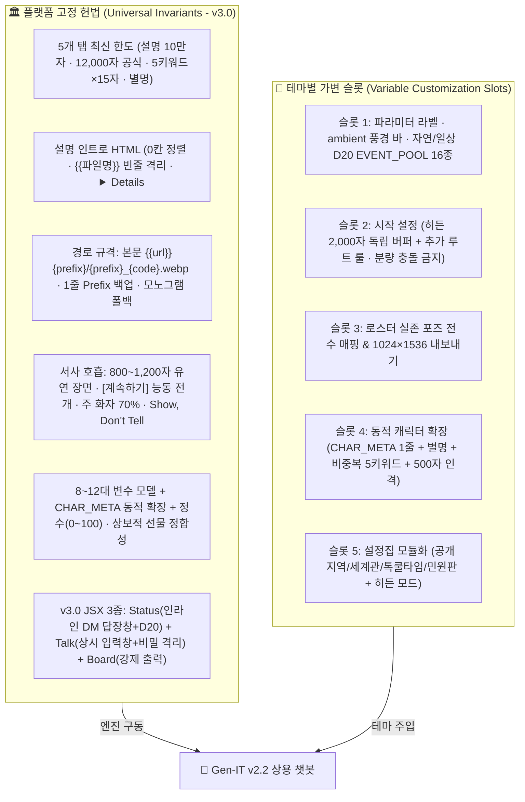

# [Gen-IT Universal Master Framework v3.0] 젠잇 5탭 시스템 제작 가이드 & 범용 AI 아키텍처 명세서

> **문서 목적**: 젠잇(genit.ai) 최신 플랫폼 규격(2026 기준)에 맞춰 모든 장르(청춘 캠퍼스, 현대 오피스, 판타지 모험, 스파이 느와르, 오토코노코 등)의 인터랙티브 콘텐츠를 제작할 때 준수해야 하는 단일 기준 기술 명세서(SSOT, v3.0 실전 검증 표준)입니다.  
> **기준 레퍼런스**: [`GENIT_MULTI_THEME_TEMPLATE_v3.0.md`](genit/GENIT_MULTI_THEME_TEMPLATE_v3.0.md) *(신규 제작 표준)* · [`oto_v3_0.md`](genit/oto_v3_0.md) *(실구동 검증 마스터)* · [`캠퍼스_젠잇_캐릭터_채팅_v2.2_완성본.md`](genit/%EC%BA%A0%ED%8D%BC%EC%8A%A4_%EC%A0%A0%EC%9E%87_%EC%BA%90%EB%A6%AD%ED%84%B0_%EC%B1%84%ED%8C%85_v2.2_%EC%99%84%EC%84%B1%EB%B3%B8.md) *(v2.2 레거시 기준)*  
> **관련 문서**: [`POSE_MAPPING.md`](../POSE_MAPPING.md) · [`DOCUMENTATION_GUIDE.md`](DOCUMENTATION_GUIDE.md) · [`validate_genit_work.py`](../scripts/validate_genit_work.py)

---

## 📑 목차 (Table of Contents)

1. [아키텍처 개요: 고정 헌법 vs 가변 슬롯 2원화 체계](#아키텍처-개요-고정-헌법-vs-가변-슬롯-2원화-체계)
2. [PART 1: [고정 헌법] 전 테마 공통 불변 규칙 (Universal Invariants)](#part-1-고정-헌법-전-테마-공통-불변-규칙-universal-invariants)
   - [1.1 5개 탭 최신 시스템 제약 및 주입/비주입 필드 경계](#11-5개-탭-최신-시스템-제약-및-주입비주입-필드-경계)
   - [1.2 탭 1 `[설명]` 인트로 HTML 작성 가이드 & CommonMark 안전 공식](#12-탭-1-설명-인트로-html-작성-가이드--commonmark-안전-공식)
   - [1.3 시스템 내장 치환 토큰 규격 (`{{url}}` vs JSX `ASSET_BASE_URL`)](#13-시스템-내장-치환-토큰-규격-url-vs-jsx-asset_base_url)
   - [1.4 대사 및 이미지 직결 표준 포맷 (`@인물@ "대사"` & 폴더 경로 규격)](#14-대사-및-이미지-직결-표준-포맷-인물-대사--폴더-경로-규격)
   - [1.5 문학적 서술 3대 불변식 (U 사칭 금지, 빙산 이론, 구어체)](#15-문학적-서술-3대-불변식-u-사칭-금지-빙산-이론-구어체)
   - [1.6 4대 슬림화 파라미터 & 8대 통일 변수 아키텍처](#16-4대-슬림화-파라미터--8대-통일-변수-아키텍처)
   - [1.7 `[@id=Status]` 상태창 & `[@id=Line]` 양방향 메신저 호출 규칙](#17-idstatus-상태창--idline-양방향-메신저-호출-규칙)
   - [1.8 스토리 유도형 3대 선택지 & 실전 검증 14대 코어 룰 불변식](#18-스토리-유도형-3대-선택지--실전-검증-14대-코어-룰-불변식)
3. [PART 2: [가변 슬롯] 작품 테마별 커스텀 가이드 (Variable Slots)](#part-2-가변-슬롯-작품-테마별-커스텀-가이드-variable-slots)
   - [2.1 가변 슬롯 1: 4대 파라미터 장르별 표시 라벨 치환 매트릭스](#21-가변-슬롯-1-4대-파라미터-장르별-표시-라벨-치환-매트릭스)
   - [2.2 가변 슬롯 2: 시작 설정(루트) 분기 — 히든 vs 추가 2중 버퍼 전략](#22-가변-슬롯-2-시작-설정루트-분기--히든-vs-추가-2중-버퍼-전략)
   - [2.3 가변 슬롯 3: 4단계 거대 서사 아크 (Macro Story Flow)](#23-가변-슬롯-3-4단계-거대-서사-아크-macro-story-flow)
   - [2.4 가변 슬롯 4: V2/V3 실존 포즈 카탈로그 바인딩 & `GenitExporter` 해상도 통일](#24-가변-슬롯-4-v2v3-실존-포즈-카탈로그-바인딩--genitexporter-해상도-통일)
   - [2.5 가변 슬롯 5: 설정집(11종 모듈식) & 캐릭터 탭(`별명` + 중복 차단 5키워드)](#25-가변-슬롯-5-설정집11종-모듈식--캐릭터-탭별명--중복-차단-5키워드)
   - [2.6 유저 열람 필드 vs AI 전용 필드의 이원화 작성 원칙](#26-유저-열람-필드-vs-ai-전용-필드의-이원화-작성-원칙)
4. [PART 3: 실전 테마별 적용 프로필 4선 (Reference Profiles)](#part-3-실전-테마별-적용-프로필-4선-reference-profiles)
5. [PART 4: [탭 5: 에셋] 8대 변수 & 양방향 `Status` + `Line` 마스터 JSX 템플릿](#part-4-탭-5-에셋-8대-변수--양방향-status--line-마스터-jsx-템플릿)
6. [PART 5: 실전 트러블슈팅 12선 & 배포 후 사후 라이브 패치 가이드](#part-5-실전-트러블슈팅-12선--배포-후-사후-라이브-패치-가이드)
7. [PART 6: 최종 프로덕션 검수 체크리스트 (12항목)](#part-6-최종-프로덕션-검수-체크리스트-12항목)

---

## 아키텍처 개요: 고정 헌법 vs 가변 슬롯 2원화 체계



---

## PART 1: [고정 헌법] 전 테마 공통 불변 규칙 (Universal Invariants)

### 1.1. 5개 탭 최신 시스템 제약 및 주입/비주입 필드 경계

| 탭 | 입력 항목 | 최대 한도 (2026 최신) | AI 주입 여부 | 필수 불변 규칙 |
| :---: | :--- | :--- | :---: | :--- |
| **탭 1<br>[기본]** | **카테고리** | 단일 선택 | **O** | 다중 인물·인터랙티브 롤플레잉은 **`시뮬레이션`** 선택 |
| | **제목 / 한 줄 소개** | 제한 없음 / **20자** | 제목 O / 한 줄 X | 한 줄 소개는 외부 목록 카드로만 표시 |
| | **태그** | 최대 **10개** | X (검색용) | 핵심 장르·관계성 키워드 10개 배치 |
| | **설명** | **100,000자** | **X (비주입)** | 유저 전용 소개 페이지. 마크다운 + 인라인 HTML + `[이미지 업로드]`(`{{파일명.webp}}`) 지원 |
| | **모험 가이드** | **50,000자** | **X (비주입)** | 유저 플레이 가이드(마크다운). 버전별 저장 |
| **탭 2<br>[프롬프트]** | **메인 프롬프트** | **합산 12,000자** | **O (전역 상시)** | 공통 헌법, 출력 공식, 실존 포즈 테이블, Few-shot 포함 |
| | **시작 설정 이름** | **20자** | X (UI 선택창) | 루트 선택 버튼 타이틀 (대표 이미지 지정 가능) |
| | **프롤로그** | **2,000자** | **O (초기 컨텍스트)** | 루트 진입 첫 턴 출력 (말미 `[@id=Status|...]` 필수) |
| | **히든 프롬프트** | **2,000자 (루트 독립)** | **O (해당 루트 전용)** | **12,000자 한도 외 별도 독립 버퍼**. 관계성·과거사 최우선 오버라이드 |
| | **추가 프롬프트** | **합산 12,000자 공유** | **O (해당 루트 전용)** | 루트별 마일스톤·주사위 엔진. **가장 긴 1개만 메인에 합산** |
| | **추천 답변** | 1~3개 | **O (유저 첫 입력)** | 프롤로그 직후 원클릭 선택지 3종과 1:1 동기화 |
| **탭 3<br>[설정집]** | **이름 / 분류 / 숨기기** | **20자** / 7대 분류 / ON·OFF | 분류별 차등 | 공개(`지역`/`설정`, OFF) vs 히든(`모드`, ON) |
| | **키워드** | **각 15자 이내 · 최대 5개** | **O (트리거)** | 쉼표 구분 태그 입력. 대화 내 키워드 등장 시 주입 |
| | **설명 / 프롬프트** | **500자 / 500자** | 설명 X / 프롬프트 O | 설명은 유저 안내용(비주입), 프롬프트는 AI 주입용 |
| **탭 4<br>[캐릭터]** | **이름 / 프로필 사진** | **20자** / 이미지 업로드 | 이름 O | 채팅 대사창 옆 프로필 아이콘으로 자동 표시 |
| | **별명 (신규)** | **각 15자 이내 (쉼표 구분)** | **O (화자 매칭)** | `@아야메@` 등 단축 화자명을 캐릭터 프로필과 자동 연결 |
| | **키워드** | **각 15자 이내 · 최대 5개** | **O (트리거)** | **타 캐릭터와 중복 금지** (`동기` 같은 공통 명사 절대 배제) |
| | **소개 / 프롬프트** | **300자 / 500자** | 소개 X / 프롬프트 O | 소개는 유저 열람용, 프롬프트는 AI 인격·외형 주입용 |
| **탭 5<br>[에셋]** | **전역 변수** | 최대 **30개** (Key 15자 / Val 200자) | **O (`{{key}}`)** | **8~12대 변수** (`turn`,`time`,`location`,`char_name`,`affection`,`submissiveness`/`stress`,`tension`,`roster_stats` + 샌드박스 `day`,`weather`,`trust`,`items`) |
| | **컴포넌트 코드 (JSX)** | **50,000자** | X (UI 렌더링) | 공식 규격(`React.` 접두·리터럴 `setReturnValue` 200자·클릭 전용 변경) 기반 **`Status` + `Talk` + `Board` 3종** |

> [!IMPORTANT]
> **젠잇 프롬프트 12,000자 한도 공식**:
> $$\text{프롬프트 총 길이} = \text{메인 프롬프트} + \max(\text{각 시작 설정의 추가 프롬프트}) \le 12,000\text{자}$$
> * 권장 배분: **메인 `9,000~9,800자`** + **추가 `1,800~2,500자`** (안전 여유 버퍼 500~700자 확보, 히든 `2,000자`는 합산 한도 외 별도 독립 버퍼).
> * 작성 원칙: 불필요한 장식 문구로 분량을 채워 AI 주의력을 희석하지 말고 기존 개조식 압축을 유지한 채 **Few-shot 예시·다인 관계성·루트 분기 정밀도 강화**에 여유 한도를 활용합니다.

---

### 1.2. 탭 1 `[설명]` 인트로 HTML 작성 가이드 & CommonMark 안전 공식

젠잇 `[설명]` 입력창은 **보안 필터 + CommonMark(마크다운+HTML 혼합 파서)**를 동시에 거치므로 아래 4대 규칙을 반드시 지켜야 깨지지 않습니다.

1. **젠잇 HTML 보안 가이드 준수**:
   - **금지**: CSS 파일, `<style>` 태그, `class`, `id`, 이벤트 속성(`on*`), `position: fixed/sticky`, 과도한 `z-index`, `data:` / `javascript:` URL.
   - **허용**: 인라인 `style` 속성, 기본 레이아웃 태그(`div`, `span`, `b`, `i`, `details`, `summary`, `br`, `hr`, `h1~h4`, `p`, `ul`, `ol`, `li`, `img`, `a` 등) 및 SVG 그래픽 태그.
2. **들여쓰기 0칸 정렬 (CommonMark 코드블록 오인 차단)**:
   - CommonMark 규칙상 **빈 줄 뒤에 공백 4칸 이상 들여쓰기(`    <div>`)**가 나오면 HTML이 아닌 **코드 블록(`<pre><code>`)**으로 처리되어 흰색 막대로 깨집니다.
   - 따라서 인트로 HTML의 모든 줄은 **선행 공백 0칸**으로 작성합니다.
3. **`[설명]` 전용 이미지 업로드 매크로(`{{파일명.webp}}`) 빈 줄 격리**:
   - `[설명]` 란에서는 채팅용 `{{url}}` 매크로가 치환되지 않습니다. 반드시 `[이미지 업로드]` 버튼으로 파일을 올리고 `{{파일명.webp}}` 형식을 사용합니다.
   - 젠잇은 `{{파일명.webp}}`를 내부적으로 **마크다운 이미지(``)**로 치환합니다. `<div>` 태그와 빈 줄 없이 붙어 있으면 HTML 블록 내부로 간주되어 텍스트 그대로 노출되므로, **매크로 위·아래에 정확히 빈 줄 1줄씩** 넣어 격리합니다:
     ```html
     <div style="max-width:290px;margin:0 auto 12px;border-radius:10px;overflow:hidden;border:1px solid rgba(196,181,253,0.4);">

     {{aya_000_평상.webp}}

     </div>
     ```
4. **모바일·PC 동시 반응형 밸런스 & 다인 확장 카드 공식**:
   - 최상위 컨테이너에 **`max-width:540px;margin:6px auto;word-break:keep-all;overflow-wrap:break-word;`**를 적용하고, 고정 인원수 문구("N인방" 등)를 쓰지 않습니다.
   - 캐릭터가 많은 작품은 **`<details>` 아코디언**으로 기존 인물 명부를 접이식 정리하고, 최상단 **`[NEW RESIDENTS]`** 카드 블록에 신규 합류 인물을 1분 복제 추가하는 확장 구조를 권장합니다.
5. **경로 슬래시 누락 금지 & 분량 충돌 방지 불변식**:
   - `[캐릭터]` 탭이나 프롬프트의 이미지 경로 예시에서 `{{url}}/xxx_000.webp`처럼 루트 슬래시를 오용하지 말고 반드시 **`{{url}}{prefix}/{prefix}_{code}.webp`** 규격을 지킵니다.
   - 시작 설정별 히든 프롬프트에 별도의 분량·이미지 개수를 재정의해 메인 프롬프트와 충돌시키지 말고, **"출력 분량·이미지 규격은 메인 프롬프트를 준수한다"**로 단일 위임합니다.

---

### 1.3. 시스템 내장 치환 토큰 규격 (`{{url}}` vs JSX `ASSET_BASE_URL`)

* **`{{user}}`**: 플레이어 닉네임으로 자동 치환.
* **`{{url}}`**: **AI 채팅 본문 텍스트 전용** 이미지 스토리지 루트 URL 치환 토큰 (`i-url`, `{url}` 등 변형 엄금).
* **⚠️ JSX 내부 `{{url}}` 미치환 주의 (필수)**:
  - 탭 5 `[에셋]`의 React JSX 코드 내부 JS 문자열(`` `{{url}}...` ``)에서는 `{{url}}`이 치환되지 않고 `%7B%7Burl%7D%7D` 경로로 요청되어 404 엑박이 발생합니다.
  - 반드시 채팅 본문에 정상 출력된 이미지에서 **`우클릭 ➔ 이미지 주소 복사`**로 실제 CloudFront 베이스 URL(`https://{CDN_HOST}/media/characters/{UUID}/assets/`)을 추출하여 JSX 내 **`ASSET_BASE_URL` 상수 + `encodeURIComponent(...)`**로 바인딩합니다.
* **`{{key}}`**: 전역 변수 호출 토큰 (`{{prog}}`, `{{d_day}}` 등).
* **`{{random(N,id)}}`**: 1~N 독립 난수 생성 (중복 당첨 시 `+1` 순환 슬라이딩 규칙과 결합).

---

### 1.4. 대사 및 이미지 직결 표준 포맷 (`@인물@ "대사"` & 폴더 경로 규격)

1. **대사 포맷**: **`@캐릭터이름@ "대사 내용"`** (정체 불명 시 `@???@`). 탭 4 캐릭터의 **`별명`**에 단축 이름(`아야메` 등)을 등록하면 프로필 사진이 대사창에 자동 매칭됩니다.
2. **이미지 출력 공식 (폴더 경로 규격)**:
   ```text
   {{url}}[캐릭터접두사]/[캐릭터접두사]_[3자리코드]_[포즈명].webp
   ```
   - 예시: `{{url}}aya/aya_004_토라짐.webp`, `{{url}}yur/yur_054_캠퍼스_도서관.webp`
   - 반드시 대사 바로 윗줄에 1:1 직결 배치하며, 1턴당 감정·자세 변화에 맞춰 **2~4회** 적극 호출합니다.

---

### 1.5. v3.0 문학적 서술 불변식 (`[계속하기]` · 70% 스포트라이트 · Show, Don't Tell)

1. **`U(플레이어) 사칭 절대 금지 (No Auto-play)`**: 플레이어의 대사·속마음·행동·신체 반응을 AI가 절대 대신 서술하지 않습니다.
2. **Show, Don't Tell & 완급(Contrast)**: "독점욕의 수위를 짐작할 수 있었다" 같은 건조한 심리 해설 문장을 금지하고 시선·손끝 떨림·호흡·공간 소리로 드러냅니다. 고호감도(Phase 3~4)에서도 매 턴 과열을 반복하지 않고 일상 장난·투닥거림과 밀착 순간의 온도 차이를 살립니다.
3. **유연한 웹소설 장면 호흡(800~1,200자) & `[계속하기]` 대응**:
   - 구형 단문 하드스탑(`350~500자`)을 폐기하고, 웹소설 한 장면 분량인 **800~1,200자 내외**로 유연하게 전개한 뒤 결정적 비트(Beat)에서 종료합니다. (하단 JSX 상태창이 잘리지 않도록 여유 확보, 시작 설정 히든 프롬프트도 동일 기준 통일)
   - 유저가 침묵하거나 **`[계속하기]`**를 누르면 대치 상황을 제자리 반복하지 말고 **캐릭터 쪽에서 먼저 한 발 다가가거나 자연스럽게 상황을 전환**합니다.
4. **주 화자 70% 스포트라이트 (최대 3인 · 출석 체크 금지)**:
   - 기본은 주 화자 1인 1:1 집중입니다. 다인 씬에서도 최대 3인까지만 허용하며 주 화자 1명이 대사·묘사의 약 70%를 이끌고 나머지 인원은 추임새 1~2마디 후 자연 퇴장시킵니다. 방 안 전원이 돌아가며 말하는 출석 체크식 발화를 금지합니다.
5. **선물·인벤토리 설정 정합성 & Prefix 백업 테이블**:
   - 각 캐릭터의 선호 선물(`CHAR_META.fav`, `[캐릭터]`, `[프롬프트]`, `Board` 보상)은 **본인의 직업·종교·판매/수호 물품과 충돌하지 않는 상보적 품목**으로 설계합니다 *(예: 중화풍 주인 `시아→고급 녹차`, 무녀 `아오이→수제 화과자`, 수녀 `세라→들꽃 꽃다발`, 체육부 `유키→시원한 이온음료`)*.
   - 메인 프롬프트 `[에셋 인덱스]` 바로 윗줄에는 키워드 미매칭 턴 오출력을 막는 **1줄 요약 `[캐릭터 접두사(prefix)]` 테이블**을 반드시 배치합니다.

---

### 1.6. 8~12대 유기적 변수 & 동적 확장(`CHAR_META`) 아키텍처

핵심 게임 루프의 LLM 인지 부하를 막기 위해 **기본 8변수**를 코어로 삼되, 자유 거점 샌드박스·의뢰·선물 루프에서는 **확장 4변수**를 더한 **8~12대 변수 체계**를 표준으로 삼습니다. 모든 `0~100` 수치는 프롬프트에 **`%` 기호 없이 순수 정수만 기입**합니다.

| 구분 | 변수 Key | 초기값 예시 | 역할 |
| :---: | :--- | :---: | :--- |
| **코어 8종** | `turn` / `time` / `location` | `1` / `낮` / `마을 입구` | 누적 턴, 시간대, 직관적 한글 거점명 |
| **코어 8종** | `char_name` / `affection` | `아야메` / `35` | 현재 주 화자 및 호감도 (**0~100 정수**, `%` 생략) |
| **코어 8종** | `submissiveness`(또는 `stress`) / `tension` | `15` / `15` | 굴복·피로 지수 / 열기·질투 텐션 (**`70+` 난입·고조**) |
| **동적 DB** | `roster_stats` | `이름:호감/보조,...` | **전원 개별 영구 기록장** (고정 인원수 없이 신규 인물 자동 추가) |
| **확장 4종** | `day` / `weather` | `1일차 (월)` / `맑음` | 요일별 축제·배경·복장(`attire`) 분기 *(샌드박스 선택 확장)* |
| **확장 4종** | `trust` / `items` | `20` / `품목:수량,...` | 평판·비밀 거점 해금(`50+`) 및 선물 인벤토리 *(전역변수 전용)* |

* **고정 인원수 탈피 불변식**: 프롬프트·설정집·HTML·JSX 어디에도 "6인방", "13명 전원" 같은 고정 인원수를 하드코딩하지 않으며, JSX 상단 **`CHAR_META` 1줄 추가** 및 `roster_stats` 동적 파싱으로 신규 캐릭터가 즉시 합류합니다.

---

### 1.7. 탈 얀데레 `Status` · `Talk` · `Board` & `ambient` 풍경 바 규칙

1. **매 턴 맨 마지막 줄 고정 — `[@id=Status|...]`** *(수치는 `%` 제외 정수, 평소 70~80%는 `dm_from=없음`)*:
   ```text
   [@id=Status|turn=[정수]|day=[N일차(요일)]|time=[아침/낮/저녁/밤]|weather=[날씨]|location=[한글장소명]|char_name=[주화자]|affection=[정수]|submissiveness=[정수]|tension=[정수]|trust=[정수]|roster_stats=[이름:호감/보조,...]|items=[품목:수량,...]|ambient=[배경풍경1줄]|dm_from=[발신자또는없음]|dm_preview=[미리보기또는빈값]|attire=[복장상태]|reaction=[속마음]]
   ```
   - **탈 얀데레 1:1 DM 쿨타임 규칙**: 매 턴 상단에 톡 알림을 띄우지 않습니다. 평소 턴의 **70~80%는 `dm_from=없음|dm_preview=`로 비워 두고 `ambient`에 고요한 풍경·소리 1줄**만 출력합니다. 개인톡은 **최소 3~4턴 쿨타임** 후 시간대 전환·헤어진 직후·이벤트 후에만 1건 도착시키며, **[일상·나눔 / 가벼운 부탁·초대 / 수줍은 여운]** 위주로 작성합니다. 질투·독점형 톡은 **`affection >= 75` AND `tension >= 75`일 때만 예외 허용**합니다.
   - **1:1 개인톡 완벽 격리 3대 불변식 (메인 프롬프트 + 로어북 이중 방어)**:
     1. **정보 비대칭(텔레파시 금지)**: 개인톡(`Talk`)은 {{user}}와 발신자 둘만의 비밀입니다. 유저가 화면을 보여주거나 직접 말하기 전까지 현장 타인의 대사·지문·`Status.reaction`에 톡 발신자/내용을 절대 언급하지 않습니다. (외적으로 폰을 보는 모습만 인지)
     2. **본문 중복 발화 & 원격 유령 등장 금지**: 1:1 톡 메시지는 오직 `[@id=Talk]` `log=` 안에서만 출력하며, 현장에 없는 톡 상대를 본문 `@이름@ "..."`으로 재발화하거나 원격 이미지를 띄우지 않습니다.
     3. **유저 답장(`나:...`) 대필 금지 & 배지 초기화**: 유저가 직접 `[1:1 톡 답장]`·`[1:1 톡 선톡]`으로 보낸 원문만 `log=`의 `나:...`로 기록하며, **유저가 도착한 톡을 확인/답장한 턴에는 반드시 `dm_from=없음|dm_preview=`로 배지를 비웁니다.**
2. **조건부 1:1 개인톡 — `[@id=Talk|...]`** *(하단 답장 입력창 상시 오픈 · 헤더 우측 `[📴 덮기]`)*:
   ```text
   [@id=Talk|room=[상대이름]|time=[HH:MM]|log=[상대:내용;;나:내답장;;상대:후속답장]]
   ```
   - `Status` 알림 배너에서 **`[💬 열기]` 클릭 시 AI 턴을 쓰지 않고 인라인 답장창을 먼저 펼쳐 답장**하며, `[@id=Talk]` 위젯은 유저의 직접 `[1:1 톡 답장]`/`[1:1 톡 선톡]` 턴에만 `Status` 바로 윗줄에 출력합니다 (`[톡 종료]` 시 중단).
3. **조건부 의뢰·공지 알림판 — `[@id=Board|...]`** *(호출 시 출력 강제)*:
   ```text
   [@id=Board|day=[N일차(요일)]|weather=[날씨]|notice=[오늘의공지1줄]|q1=[인물:의뢰제목:장소:보상]|q2=[...]|q3=[...]]
   ```
   - 새 아침, 거점 방문, 유저의 `[알림판/민원판 확인]` 호출 시 **서술만 하고 넘기지 말고 반드시 `Status` 바로 윗줄에 `[@id=Board|...]`를 출력**합니다.

---

### 1.8. 스토리 유도형 3대 선택지 & 실전 검증 코어 불변식

매 턴 본문 직후(상태창 윗줄)에 **`[💡 당신의 선택지]`** 3종(① 스토리 추진/거점 이동 ② 감정 심화/밀착 ③ 케어/완급 조절)을 고정 출력합니다.

1. **무제한 순수 턴 누적 (`turn=1, 2, 3...`) & 유연 호흡(`800~1,200자`)**
2. **주 화자 70% 스포트라이트 (일상 1:1 집중, 다인 씬 최대 3인 · 출석 체크 금지)**
3. **8~12대 변수 (`%` 제외 정수) + `roster_stats` 동적 인원 확장 (`CHAR_META`)**
4. **`U(플레이어) 사칭 절대 금지` + `[계속하기]` 능동 전환**
5. **Show, Don't Tell (외적 감각 묘사 & 고호감도 온도 차/완급 유지)**
6. **`@캐릭터@ "대사"` + 폴더형 이미지 직결 (`{{url}}{prefix}/{prefix}_{code}.webp`) + 1줄 Prefix 백업**
7. **4단계 관계 Phase + 소프트 락 & 조르기 돌파 + 1회 튕기기 법칙**
8. **듀얼 트랙 이벤트 + 선택형 D20 Fail-Forward (자연·일상 16종 `EVENT_POOL`)**
9. **히든 프롬프트(2,000자 독립 버퍼) 관계 격리 + 고호감도 프롤로그 1인 집중**
10. **상보적 선호 선물 정합성 (직업·종교·자체 상품 충돌 금지) & `items=` 누락 점검**
11. **1:1 개인톡 비밀 격리 3불변식 (텔레파시·원격발화·`나:` 대필 금지 & `dm_from=없음` 초기화)**
12. **`Status` 인라인 DM(`isDmOpen`) + 상시 입력창 `Talk` + `Board` 강제 출력**
13. **JSX 공식 규격 (`React.` 접두 · 리터럴 `setReturnValue` 200자 · 클릭 전용 · `fillInput`/`sendMessage` 분리 · `light-dark()`)**
14. **CommonMark 0칸 정렬 & `<details>` / `[NEW RESIDENTS]` 확장형 인트로 HTML**

---

## PART 2: [가변 슬롯] 작품 테마별 커스텀 가이드 (Variable Slots)

### 2.1. 가변 슬롯 1: 4대 파라미터 장르별 표시 라벨 치환 매트릭스

| 슬롯 | 고정 Key | 청춘 캠퍼스 | 현대 오피스 | 판타지 던전 | 느와르 스파이 |
| :---: | :---: | :--- | :--- | :--- | :--- |
| **① 퀘스트** | `prog` | 과제 완성도 (%) | TF 프로젝트 통과율 (%) | 보스 공략 진척도 (%) | 기밀 문서 복제율 (%) |
| **② 마감** | `d_day` | 최종 발표 `D-14` | 임원 감사 `D-20` | 붉은 달 `D-10` | 탈출선 접선 `D-10` |
| **③ 관계** | `affection` | 히로인 호감도 | 사내 신뢰/호감도 | 동료 유대도 | 파트너 충성도 |
| **④ 텐션** | `stress` | 피로·질투 텐션 | 사내 소문 리스크 | 마나 폭주/부상도 | 적국 의혹 지수 |
| **메신저** | `Line` | LINE / 7조 단톡방 | 사내 메신저 / TF 방 | 마력 통신구 | 암호 무전기 |

---

### 2.2. 가변 슬롯 2: 시작 설정(루트) 분기 — 히든 vs 추가 2중 버퍼 전략

* **히든 프롬프트 (루트별 독립 2,000자)**: 과거사, 관계성(소꿉친구 vs 초면 동기), 말투 불변식, 초기 호감도 강제 주입. *(타임라인 모순 점검 필수 · 출력 분량(800~1,200자)·이미지 규격은 메인 프롬프트에 단일 위임)*
* **고호감도 시작 설정 프롤로그 1인 집중 원칙**: 4~6명이 동시 발화하면 첫 턴부터 다인 출석 체크가 고착되므로, 고호감도 루트 프롤로그도 **주 화자 1인 집중 + 창밖·문밖 인기척 + 1:1 개인톡 배지(`dm_from`)**로 설계합니다.
* **추가 프롬프트 (12,000자 공유, 최장 1개만 합산)**: 해당 루트 전용 4단계 마일스톤, 낮/밤 주사위 6종 해프닝. *(권장 배분: 메인 9,000~9,800자 + 추가 1,800~2,500자)*
* **v2.2 기존 작성본 호환 실측**: 메인(`6,706자`) + 최장 추가[올스타](`1,244자`) = **`7,950 / 12,000자`** (여유 4,050자, PASS ✅).

---

### 2.3. 가변 슬롯 3: 4단계 거대 서사 아크 (Macro Story Flow)

| 챕터 | 진행 구간 | 핵심 사건 & 목표 | 주요 공간 & 연동 포즈 |
| :---: | :---: | :--- | :--- |
| **Ch.1 착수** | `0~25%` (D-14~11) | 재회/초면, 주제 선정, 첫 뒤풀이 | 도서관·벤치·카페 (`054`, `053`, `055`) |
| **Ch.2 합숙** | `26~50%` (D-10~6) | 중간 점검, 심야 자취방 밤샘 합숙 | 유저 자취방 (`038`, `045`, `043`, `115`) |
| **Ch.3 위기** | `51~75%` (D-5~2) | 발표 리허설, 심야 밀폐 공간 첫 결합 | 빈 강의실·교탁 뒤 (`112~114`, `130`) |
| **Ch.4 결말** | `76~100%` (D-1~0) | 최종 발표 A+, 축제 주점 고백·웨딩 에필로그 | 축제·야경·웨딩 (`052`, `050`, `046`, `095`) |

---

### 2.4. 가변 슬롯 4: V2/V3 실존 포즈 카탈로그 바인딩 & `GenitExporter` 해상도 통일

1. **실존 포즈 전수 바인딩 (404 원천 차단)**:
   - 메인 프롬프트에 해당 로스터 6인 공통 실존 포즈 서픽스(캠퍼스 기준 **114종**)를 언더바(`_`)까지 정확히 기재하고 `scripts/validate_genit_work.py --force`로 불일치 0건을 검증합니다.
   - `000~019`(감정 20) · `020~039`(전신 20) · `040~055`(일상/캠퍼스 16) · `060~079`(로맨스/봉사 20) · `080~095`(H씬 기본 16) · `103~124`(H씬 특수 19) · `130~132`(특수 장소 3).
2. **생성 해상도 vs 내보내기 해상도 통일 워크플로우**:
   - **생성/리롤 시**: SDXL 네이티브 안정 해상도 **`832×1216`** 유지 (신체 기형 방지·속도 최적화).
   - **젠잇 업로드 패키징 시**: 웹 GUI `/gallery` 상단 **`📦 Genit 내보내기`** ➔ **`🌟 로스터 전체 일괄 내보내기`** + **`✨ 폴더/원본파일명 유지(aya/aya_000_평상.webp)`** + **`✨ 1024×1536 통일`** 실행.
   - 로컬 원본은 100% 무손실 보존하면서 `dist/genit/{roster}/{prefix}/`에 비율 유지 중앙 크롭(Lanczos)으로 전 에셋 크기를 완벽 통일합니다.

---

### 2.5. 가변 슬롯 5: 설정집(11종 모듈식) & 캐릭터 탭(`별명` + 중복 차단 5키워드)

1. **배경 통합 시대의 `지역` 설정집 설계**:
   - 별도 배경 이미지가 없고 캐릭터 이미지에 배경이 통합된 구조에서는, 구형 배경 코드(`001~007`)나 복잡한 건물/호실명을 제거하고 **`[거점명] 상주 히로인 + 공간 감각 디테일 + [배경 포즈: 054_캠퍼스_도서관]`** 형태로 작성합니다.
2. **설정집 모듈 표준 슬롯 (Zero-Cost 동적 확장)**:
   - **공개 (`숨기기: OFF`)**: ① 주요 거점 공간 매핑(`지역`) ② 핵심 세계관·법칙(`설정`) ③ 거점 이동·선물·신뢰도 규칙(`설정`) ④ 캐릭터별 1:1 개인톡(`Talk`) 말투·쿨타임 & 알림판(`Board`) 가이드(`설정`).
   - **히든 (`분류: 모드`, `숨기기: ON`)**: 캐릭터 그룹별 1:1/페어 루트, 심야 합숙·비밀 스팟, 하렘 쟁탈전, 웨딩·애프터스토리 *(고정 인원수 표기 금지)*.
   - 모든 설정집에 유저 안내용 **`설명(500자 이내)`**과 **각 15자 이내 최대 5개 키워드**를 채웁니다.
3. **캐릭터 탭 동적 규격 (`별명` + 비중복 5키워드)**:
   - **`별명`**: 대사창 `@캐릭터@` 화자명 및 애칭 등록(각 15자 이내) ➔ 프로필 사진 자동 연동.
   - **`키워드`**: 각 15자 이내 최대 5개. 캐릭터 고유 이름·거점·속성만 배치하고 타 캐릭터와 단 1개도 겹치지 않게 격리합니다.

---

### 2.6. 유저 열람 필드 vs AI 전용 필드의 이원화 작성 원칙

* **유저 열람 전용** (`설명`, `모험 가이드`, `프롤로그`, `추천 답변`, `설정집 설명`, `캐릭터 소개`): 가독성·시각적 매력 극대화.
* **AI 전용 비공개** (`메인/히든/추가 프롬프트`, `설정집 프롬프트`, `캐릭터 프롬프트`): 장식용 마크다운(`**`, `###`, `---`)과 장황한 공손체를 배제하고 `[섹션 태그] + - 개조식 명령` 평문으로 압축해 지침 이행률과 글자 수 효율을 극대화합니다.

---

## PART 3: 실전 테마별 적용 프로필 4선 (Reference Profiles)

| 프로필 | 타이틀 예시 | `prog` / `d_day` / `stress` 치환 | `[@id=Line]` 메신저 테마 |
| :--- | :--- | :--- | :--- |
| **A. 캠퍼스 (SSOT)** | `청춘의 학점과 사랑의 조별과제` | 과제 완성도 / D-14 / 피로·질투 텐션 | LINE (개인톡 · 7조 단톡방) |
| **B. 현대 오피스** | `블라인드 러브 : 탕비실의 비밀 기안서` | TF 통과율 / 감사 D-20 / 사내 소문 리스크 | 사내 메신저 (1:1 · TF 방) |
| **C. 판타지 던전** | `심연의 미궁 : S급 여기사들과의 원정대` | 미궁 돌파율 / 붉은 달 D-10 / 마나 폭주 | 마력 통신구 (개인 · 원정대) |
| **D. 느와르 스파이** | `코드네임 제로 : 장막 뒤의 요원들` | 기밀 복제율 / 탈출 D-10 / 적국 의혹 지수 | 암호 무전기 (단독 · 본부 채널) |

---

## PART 4: [탭 5: 에셋] 공식 JSX 규격 · 3종 위젯 & D20 돌발 이벤트 엔진

### 4.1. 공식 JSX 샌드박스 6대 불변 규격 (Official Sandbox Rules)

1. **`React.` 접두 훅 강제**: 모든 훅은 반드시 `React.useState`처럼 `React.` 접두를 붙입니다. (단독 `useState` 금지)
2. **반환변수 리터럴 키 & 200자 상한**: `setReturnValue('tone', ...)`, `'event'`, `'gift'`, `'dm_reply'`, `'quest'`처럼 정적 파서가 인식하는 **문자열 리터럴 키로 직접 호출**하며(`forEach` 동적 루프 금지), 1턴 총 반환변수 합계(이름+값)를 **200자 이내**로 제한합니다.
3. **전역변수 분리**: `roster_stats`, `items` 같은 대용량 문자열은 `setReturnValue`가 아닌 `useTemplateValue`/`setTemplateValue` 전역변수로만 관리하며, 수치 파싱 시 `.replace(/[^0-9-]/g, "")`로 이중 `%`(`%%`) 버그를 원천 차단합니다.
4. **클릭 핸들러 전용 상태 변경**: `setTemplateValue`/`setReturnValue`는 컴포넌트 렌더 본문에서 절대 호출하지 않고, 실제 사용자 `onClick` 내부에서만 동기 호출합니다.
5. **실행(`sendMessage`) vs 입력 보조(`fillInput`) 분리**: 거점 이동·의뢰 수락·선물·톡 전송 등 시스템 액션은 **`sendMessage(text, false)`** 즉시 실행, 어프로치·케어 등 롤플레이 자유도가 필요한 버튼은 **`fillInput(text, false)`**로 입력창 초안만 채웁니다.
6. **테마·폴백·동적 확장**: `@media`/`class` 대신 `light-dark(라이트, 다크)` 또는 `var(--color-*)`를 쓰고, 상단 `CHAR_META` 1줄 확장·미등록 캐릭터 자동 인식·`failedUrls` 모노그램/이니셜 폴백을 구현합니다.

### 4.2. 모듈형 3종 JSX 위젯 & D20 ‘Fail-Forward’ `EVENT_POOL`

표준 청사진 소스는 [`GENIT_MULTI_THEME_TEMPLATE_v3.0.md`](genit/GENIT_MULTI_THEME_TEMPLATE_v3.0.md) · [`oto_v3_0.md`](genit/oto_v3_0.md)(기존 v2.2 레퍼런스는 [`캠퍼스_완성본`](genit/%EC%BA%A0%ED%8D%BC%EC%8A%A4_%EC%A0%A0%EC%9E%87_%EC%BA%90%EB%A6%AD%ED%84%B0_%EC%B1%84%ED%8C%85_v2.2_%EC%99%84%EC%84%B1%EB%B3%B8.md))을 참조합니다:

1. **상시 `Status` (4탭 컴팩트 HUD + 인라인 DM 답장창)**: `[📊 상태]` · `[📍 이동(동적 인원수)]` · `[🎁 선물]` · `[💌 톡·민원]` 4탭 + 고요한 `ambient` 풍경 바 + `[톤 3종 토글]` + `[🎲 돌발 이벤트 굴리기]`/`[⚡ 발동]`.
   - **인라인 1:1 DM 답장창**: 알림 배너(`hasDm`)에서 `[💬 열기]` 클릭 시 AI에게 즉시 턴을 넘기지 않고 `React.useState`(`isDmOpen`, `dmReplyDraft`)로 **배너 아래에 발신자 프로필·메시지·직접 답장 입력창·`[전송]` 버튼을 인라인으로 펼칩니다.** `[전송]` 클릭 시에만 `setReturnValue('dm_reply', ...)`(리터럴 키, 40자 슬라이스) + `sendMessage('[1:1 톡 답장 | 대상] 내용', false)`를 동기 실행합니다.
   - **D20 Fail-Forward 공식**: `roll(1~20) + floor(호감도 / 25)` ➔ `18+ 💥특급` · `11~17 ✨성공` · `5~10 😳아슬아슬` · `1~4 😈스릴역전` (낮은 눈금에도 호감도 페널티 금지, `setReturnValue('event', '합계|등급|상황')`).
   - **`EVENT_POOL` 16종 작성 원칙**: "속마음 고백", "억지 스킨십" 같은 작위적 이벤트를 배제하고 소나기·돌풍·정전·확성기 방송·발목 삐끗 등 **세계관 날씨·시설·일상에서 자연 발생하는 물리적 해프닝**만 수록합니다.
2. **조건부 `Talk` (상시 입력 바 + 헤더 우측 `[📴 덮기]`)**: `[💬 답장하기]` 토글을 제거하고 **하단 답장 입력창을 상시 오픈** 상태로 두며, `[📴 덮기]` 버튼은 상단 헤더 우측으로 슬림화합니다. `dm_reply` 반환변수 + `sendMessage(..., false)`로 1클릭 답장합니다.
3. **조건부 `Board` (의뢰·공지 알림판)**: 새 아침·거점 방문·확인 버튼 클릭 시 일일 의뢰 3건을 **반드시 `Status` 윗줄에 출력**하고, `[✅ 수락·이동]` 시 `quest` 반환변수 + `sendMessage(..., false)`로 즉시 이동합니다.

---

## PART 5: 실전 트러블슈팅 12선 & 배포 후 사후 라이브 패치 가이드

### 5.1. 실전 제작 중 검증된 12대 핵심 트러블슈팅 공식

| 번호 | 증상 (Symptom) | 근본 원인 (Root Cause) | 최종 해결 공식 (Solution) |
| :---: | :--- | :--- | :--- |
| **TS-1** | 변수 과다 시 계산 오류·상태창 누락 | LLM 인지 부하 및 비실시간 변수 | 핵심 루프는 **4대 파라미터** 유지 + 다인 추적은 `roster_stats` 단일 문자열로 압축 |
| **TS-2** | 다중 루트 작성 시 12,000자 초과 | 합산 공식($\text{메인} + \max(\text{추가})$) 미활용 | 관계성·과거사는 **히든(독립 2,000자)**, 루트 룰·주사위는 **추가**에 분리 |
| **TS-3** | 포즈 환각(404) & 경로 불일치 | 평면 경로(`{{url}}aya_...`) 및 공백 라벨 | **`{{url}}[접두사]/[접두사]_[코드]_[포즈명].webp`** + 언더바(`_`) 실존 목록 전수 탑재 |
| **TS-4** | 스토리 정체 & 유저 입력 피로 | 이정표 부재·수동적 응답 | 4단계 서사 아크 + 매 턴 **스토리 유도 3대 선택지** 의무 출력 |
| **TS-5** | 서브 인물 증발 & 주사위 중복 | 등장 트리거·중복 회피 부재 | 주사위 테이블에 난입 배치 + 재당첨 시 **`+1` 순환 슬라이딩** + 6인 자유 거점 이동 |
| **TS-6** | 초면 루트에서 소꿉친구 기억 오염 | 캐릭터 탭(500자)의 전 루트 공통 주입 | 캐릭터 탭에 `[불변식] 관계는 히든 프롬프트 최우선` 선언 + 타임라인 전수 검수 |
| **TS-7** | D-Day 미감소 & 긴장감 저하 | 시간 경과·위기 트리거 부재 | 낮/밤 분리(`time`) + 긴 행동 가속 점프 + `D-7`/`D-3` 합숙 트리거 |
| **TS-8** | 상태창 수치 초기값 박제 | `prog={{prog}}` 정적 치환 및 역반환 누락 | `prog=[수치]` 직접 출력 + JSX 내 **`setReturnValue` + `setTemplateValue`** 동시 동기화 |
| **TS-9** | `[설명]` HTML 흰색 막대 깨짐 · `{{파일명}}` 텍스트 노출 · 모바일 1글자 밀림 · PC 사진 과대 | CommonMark 4칸 들여쓰기 코드블록 오인, HTML 블록 내 마크다운 미해석, `keep-all`/`max-width` 부재 | **0칸 정렬** + **`{{파일명.webp}}` 위·아래 빈 줄 1줄 격리** + **`max-width:540px; word-break:keep-all`** + **이미지 프레임 `max-width:290px`** |
| **TS-10** | 본문 이미지는 뜨는데 JSX 초상화만 엑박(`%7B%7Burl%7D%7D`) | JSX 코드 내부 JS 문자열에서는 `{{url}}` 미치환 | 본문 정상 이미지에서 CloudFront 베이스 URL 추출 ➔ JSX에 **`ASSET_BASE_URL` + `encodeURIComponent`** 적용 |
| **TS-11** | `@아야메@` 대사창 프로필 미표시 · 타 캐릭터 동시 호출 | `별명` 미등록 및 `동기` 등 공통 키워드 중복 | 탭 4 `별명`에 단축 화자명 등록 + **중복 0건 고유 키워드 5개**(각 15자 이내) 배치 |
| **TS-12** | 채팅창에서 캐릭터 이미지 크기가 들쭉날쭉함 | 과거 생성(`1024×1536`)과 최신 생성(`832×1216`) 혼재 | 로컬 원본은 무손실 보존하고 **`Genit 내보내기`에서 `1024×1536` 중앙 크롭 일괄 통일** |

### 5.2. 배포 후 무중단 라이브 패치 규칙
* **즉시 반영 (기존 대화방 다음 턴부터 적용)**: 메인/히든/추가 프롬프트, 설정집 11종, 캐릭터 프롬프트, `Status`/`Line` JSX 디자인·버튼 로직.
* **새 대화방부터 반영**: 프롤로그(첫 인사말), 전역 변수 초기값.
* **절대 금지**: 배포 후 8대 전역 변수의 **Key 이름 변경·삭제** (기존 세이브 변수 단절 방지 — 표시 텍스트만 바꿀 때는 JSX 내부 라벨만 수정).

---

## PART 6: 최종 프로덕션 검수 체크리스트 (12항목)

- [ ] **1. 자동 검증기 통과**: `.\.venv\Scripts\python.exe scripts/validate_genit_work.py --force` **ALL PASS ✅** 확인
- [ ] **2. 12,000자 합산 한도**: `메인 + max(추가) <= 12,000자` (권장: 메인 `9,000~9,800자` + 추가 `1,800~2,500자`), 프롤로그 `<= 2,000자`, 히든 `<= 2,000자`(별도 독립 버퍼)
- [ ] **3. 폴더형 이미지 경로**: 본문·프롤로그·Few-shot 전부가 `{{url}}[접두사]/[접두사]_[코드]_[포즈명].webp` 규격인가?
- [ ] **4. 공식 JSX 3종 & 인라인 DM**: `React.` 접두·리터럴 `setReturnValue` 200자·클릭 전용 변경·`fillInput`/`sendMessage(..., false)` 분리 · `Status` 인라인 DM(`isDmOpen`)·`Talk` 상시 입력창·`CHAR_META` 모노그램 폴백·`light-dark()` 확인
- [ ] **5. 8~12변수 · `items=` & `%%` 차단**: 전역 변수 등록, 프롤로그/예시 상태창 내 `items=` 포함 전 키 누락 여부 및 프롬프트 `%` 생략 정수 출력 확인
- [ ] **6. 탈 얀데레 1:1 DM 격리 & 호흡**: 70~80% `dm_from=없음`, 3대 비밀 격리(텔레파시/원격재발화/`나:` 대필 금지) & 답장 시 `dm_from=없음` 초기화, `[계속하기]`·70% 스포트라이트·800~1,200자 호흡·고호감도 1인 집중 프롤로그 확인
- [ ] **7. 인트로 HTML · 선물 & Prefix 백업**: 0칸 정렬, `{{파일명.webp}}` 빈 줄 격리, 고정 인원수 미기재, `<details>`/`[NEW RESIDENTS]`, 선호 선물 정합성, `[캐릭터 접두사(prefix)]` 1줄 백업 테이블, 메인↔히든 충돌 0건 확인
- [ ] **8. 설정집 규격**: 모든 설정집이 키워드(각 15자 × 최대 5개), `설명(500자)`, `프롬프트(500자)` 한도를 지키며 구형 배경 코드가 없는가?
- [ ] **9. 캐릭터 `별명` & 비중복 키워드**: 전원 `별명` 등록 완료, 캐릭터 간 중복 키워드(`동기` 등) 0건인가?
- [ ] **10. 타임라인·외형 정합성**: 시작 설정별 과거사(예: 초등 소꿉친구 = 10년 재회)와 캐릭터 실제 일러스트 외형 묘사가 100% 일치하는가?
- [ ] **11. 에셋 해상도 통일**: `Genit 내보내기`로 전 캐릭터 에셋을 `1024×1536` 단일 규격으로 패키징해 업로드했는가?
- [ ] **12. 라이트/다크 모드 가시성**: `Status`·`Line` JSX 모든 텍스트가 `light-dark(...)`로 양쪽 테마에서 선명하게 보이는가?
