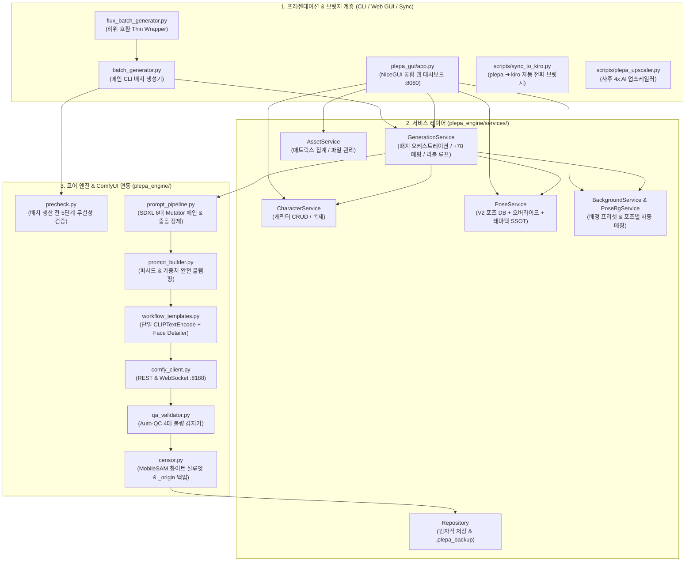

# ⚙️ 플에파(PLEPA) 통합 기능 명세 및 전체 파일 아키텍처 규격서 (V2 표준)

> **문서 목적**: ComfyUI 연동 **SDXL 단일 파이프라인**(`unholyDesireMixSinister_v90.safetensors`) 기반 캐릭터 에셋 배치 생성 엔진, 6대 프롬프트 Mutator 체인, Auto-QC 품질 검수기, 정밀 실루엣 검열기, NiceGUI 웹 대시보드 및 프로젝트 내 **모든 파일의 역할과 기술 규격**을 정의하는 단일 통합 명세서(SSOT)입니다.  
> **연계 핵심 문서**:  
> - 📘 마스터 인계 및 아키텍처 결정서(ADR) → [`docs/AI_HANDOVER_GUIDE.md`](AI_HANDOVER_GUIDE.md)  
> - 🛠️ 운영 및 장애 진단 통합 런북 → [`docs/RUNBOOK.md`](RUNBOOK.md)  
> - 🎨 캐릭터/포즈 제작 및 사전점검 규칙 → [`docs/캐릭터_포즈_제작_규칙.md`](캐릭터_포즈_제작_규칙.md)  
> - 📋 V2 포즈 카탈로그 (`000~200`) → [`docs/POSE_CATALOG.md`](POSE_CATALOG.md)  
> - 🔄 `plepa` ↔ `kiro` 동기화 리포트 → [`docs/KIRO_SYNC_REPORT.md`](KIRO_SYNC_REPORT.md)

---

## 1. 시스템 전체 아키텍처 및 데이터 흐름

플에파(PLEPA)는 **CLI([`batch_generator.py`](../batch_generator.py))**와 **웹 GUI([`plepa_gui/app.py`](../plepa_gui/app.py))**가 동일한 **비즈니스 서비스 레이어(`plepa_engine.services`)**와 **코어 엔진(`plepa_engine/`)**을 공유하는 3계층 아키텍처로 설계되어 있습니다.

---

## 2. 프로젝트 전체 파일 디렉토리 및 역할 명세

### 2.1 루트 진입점 및 유틸리티 (`/` & `scripts/`)
| 파일명 | 역할 및 주요 기능 |
| :--- | :--- |
| **[`batch_generator.py`](../batch_generator.py)** | **메인 CLI 진입점**. 인자 파싱, 캐릭터 목록(`-l`), 자가 진단(`--test`), 배치 생성, Auto-QC 리롤, 실루엣 검열(`--censor`, `--censor-only`) 실행. |
| **[`flux_batch_generator.py`](../flux_batch_generator.py)** | **하위 호환용 경량 래퍼(18줄)**. `batch_generator.py`로 모든 실행을 위임합니다. |
| **[`run_gui.bat`](../run_gui.bat)** | **웹 대시보드 런처**. `.venv` 활성화 후 NiceGUI 서버(`http://localhost:8080`)를 구동합니다. |
| **[`scripts/sync_to_kiro.py`](../scripts/sync_to_kiro.py)** | **`plepa` ➔ `kiro` 자동 전파 브릿지**. V2 포즈 DB, 오버라이드, 배경 매핑, `censor.py`, `qa_validator.py` 및 2-Pass 에셋 리네이머를 `kiro`에 무손실 동기화합니다. |
| **[`scripts/plepa_upscaler.py`](../scripts/plepa_upscaler.py)** | **독립형 사후 업스케일러 CLI**. 생성된 WebP 에셋들을 ComfyUI `4x-UltraSharp` 노드로 일괄 확대합니다. |

---

### 2.2 코어 엔진 패키지 (`plepa_engine/`)
| 파일명 | 역할 및 주요 기능 |
| :--- | :--- |
| **[`config.py`](../plepa_engine/config.py)** | 시스템 전역 상수, 기본 엔진(`DEFAULT_ENGINE = "sdxl"`), 해상도(`832x1216`), CFG(`5.0`), Steps(`28`), 경로 상수 관리. |
| **[`models.py`](../plepa_engine/models.py)** | 핵심 데이터클래스 정의 (`CharacterConfig`, `AppearanceConfig`, `PoseEntry`, `GenerationTarget`, `GenerationResult`). |
| **[`prompt_pipeline.py`](../plepa_engine/prompt_pipeline.py)** | **SDXL 6단계 프롬프트 미들웨어 파이프라인**: 1. `PoseTagPreparationMutator` (성별 분기, 일반 의상어 중화, 배경 매칭) 2. `PositiveAssemblyMutator` (품질 태그 중복 제거, `BREAK` 조립, 의상 슬롯 스왑) 3. `NegativeBaseMutator` (의상 보호 네거티브 스마트 필터링) 4. `DefectDefenseMutator` (기형/뷰파인더/의상 잔류 방어선 `[패치 A~E]` 주입) 5. `TwoPersonMobMutator` (2인 모브 `BREAK` 격리, 단독/여운 씬 남성 차단) 6. `SanitizerMutator` (모브 블록 제외 태그 충돌 자동 정제 및 가중치 클램핑) |
| **[`prompt_builder.py`](../plepa_engine/prompt_builder.py)** | **프롬프트 조립 퍼사드 & 가중치 클램핑**. `clamp_sdxl_weights()`(긍정 상한 `1.15`, 부정 상한 `1.25`, 다중 괄호 단일화) 및 `resolve_pose_outfit_slot()` 제공. |
| **[`workflow_templates.py`](../plepa_engine/workflow_templates.py)** | **ComfyUI 워크플로우 빌더**. 단일 `CLIPTextEncode` 노드 구조(이중 conditioning concatenation으로 인한 Color Burn 원천 차단), `dpmpp_2m` + `karras`, Face Detailer, 4x Upscale 그래프 생성. |
| **[`qa_validator.py`](../plepa_engine/qa_validator.py)** | **Auto-QC 4대 불량 감지기**. ① 색감 과포화(Color Burn), ② 남성 모브 분신(2명 이상), ③ 여운/단독 씬 남성 난입, ④ 9~10등신 기형 장신을 고속 판별합니다. |
| **[`censor.py`](../plepa_engine/censor.py)** | **정밀 외곽선 실루엣 검열 엔진**. `dghs-imgutils` 성기 감지(`penis`+`pussy`) + 고환 하단 35% 확장 + MobileSAM 외곽선 추출 + 멀티스케일 2x 타일 스캔 + 입술/혀 HSV 보호 & Hole Filling + `POSE_SAFE_ANCHORS` 안전 앵커 폴백 + `{char}_origin/` 무손실 백업. |
| **[`precheck.py`](../plepa_engine/precheck.py)** | **배치 생산 전 5단계 사전 점검기**. 포즈 DB 규칙, 캐릭터 JSON 무결성, 착의 의상 고정, H씬 알몸 전환(의상 잔류 0%), 테마 의상 스왑을 전수 시뮬레이션합니다. |
| **[`comfy_client.py`](../plepa_engine/comfy_client.py)** | **ComfyUI 비동기 클라이언트**. REST 큐 등록, WebSocket 실시간 진행률 수신, 이미지 다운로드 및 WebP 저장. |
| **[`reporter.py`](../plepa_engine/reporter.py)** | 하이브리드 파일명(`{prefix}_{code}_{label}.webp`) 생성 및 배치 완료 통계 리포터. |

---

### 2.3 비즈니스 서비스 레이어 (`plepa_engine/services/`)
| 파일명 | 역할 및 주요 기능 |
| :--- | :--- |
| **[`generation_service.py`](../plepa_engine/services/generation_service.py)** | **배치 생성 오케스트레이터**. 오토코노코 성인 씬 `+70` 오프셋(`080~130` ➔ `150~200`) 자동 매핑, Auto-QC 재시도 루프, `censor_file(..., pose_code=pose.code)` 연동, 스마트 스킵 제어. |
| **[`pose_service.py`](../plepa_engine/services/pose_service.py)** | [`data/sdxl_pose_database.json`](../data/sdxl_pose_database.json) + 로스터별 `pose_overrides.json` + `data/themes/*.json` 병합 로드 및 포즈 코드 해석기. |
| **[`pose_background_service.py`](../plepa_engine/services/pose_background_service.py)** | `projects/{roster}/pose_background_mapping.json` 기반 포즈별 최적 배경 프리셋 자동 매칭. |
| **[`character_service.py`](../plepa_engine/services/character_service.py)** | 로스터별 캐릭터 JSON 탐색, CRUD, 전역 `prefix` 중복 검증, 캐릭터 복제 마법사. |
| **[`repository.py`](../plepa_engine/services/repository.py)** | 모든 JSON 수정 전 `.plepa_backup/`에 타임스탬프 백업본을 생성하고 원자적 교체(`os.replace`) 수행. |

---

## 3. 데이터 스키마 규격 (Data Specifications)

### 3.1 포즈 DB 스키마 (`data/sdxl_pose_database.json`)
- **8대 섹션**: `emotions`(`000~019`), `poses`(`020~039`), `events`(`040~052`), `romance`(`060~063`), `h_scenes`(`080~130`), `scenes_otokonoko`(`150~200`), `spy_actions`(`S01~S10`), `wuxia_actions`(`C01~C10`).
- **필드 규격**:
  - `label`: 2~15자 한글 직관 명칭 (파일명 `{prefix}_{code}_{label}.webp`에 사용)
  - `description`: 카메라 앵글, 손동작, 표정, 상황 연출 설명
  - `required_outfit`: `"default"`, `"nude"`, `"underwear"`, `"swimsuit"`, `"maid"`, `"bunny"`, `"bdsm"`, `"combat"`, `"wedding"`
  - `prompt`: 기본 SDXL Danbooru 태그 프롬프트
  - `prompt_female` / `prompt_otokonoko`: (선택) 공용 코드(`014`, `033`, `034`, `060~063` 등)에서 성별에 따라 분기할 프롬프트
  - `negative_add`: (선택) 해당 포즈 전용 추가 네거티브 태그
