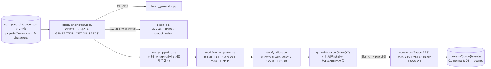

# 🏗️ 플에파(PLEPA) 기능 명세서 (System Architecture & API Spec — V3 표준)

> **문서 목적**: SDXL 단일 파이프라인의 데이터 흐름, 7단계 Mutator 체인, `Phase P2.5` 검열 엔진, GUI·REST API 계층과 핵심 모듈 공개 인터페이스를 정의하는 기술 명세서(SSOT)입니다.

---

## 1. 시스템 데이터 흐름도 (End-to-End Architecture)

---

## 2. `plepa_engine/` 핵심 모듈 및 공개 인터페이스

| 모듈 | 핵심 클래스 / 함수 | 역할 및 주요 불변식 |
| :--- | :--- | :--- |
| **[`config.py`](../plepa_engine/config.py)** | `SDXL_POSE_DB_PATH`, `DEFAULT_SDXL_*` | `CFG 4.0`, `Steps 28`, `dpmpp_2m / karras`, `CLIP Skip 2`, `832×1216` 기준 해상도, FLUX 경로 `legacy/` 격리 |
| **[`models.py`](../plepa_engine/models.py)** | `CharacterConfig`, `PoseEntry`, `GenerationTarget` | `signature_accessories`, `mob_tier`, `partner_pos`, `mob_shadow`, `is_two_person`, `is_interactive` 메타 모델 |
| **[`prompt_pipeline.py`](../plepa_engine/prompt_pipeline.py)** | `SDXLPromptPipeline`, `PromptContext`, `7대 Mutator` | ①`PoseTagPreparation` ➔ ②`PositiveAssembly` ➔ ③`NegativeBase` ➔ ④`DefectDefense` ➔ ⑤`TwoPersonMob` ➔ ⑥`CompositionAntiDrift` ➔ ⑦`Sanitizer` |
| **[`workflow_templates.py`](../plepa_engine/workflow_templates.py)** | `build_sdxl_workflow()`, `build_standalone_upscale_workflow()` | `WorkflowGraph` 기반 동적 노드 배선 (`FreeU`, `FaceDetailer`, `HandDetailer`, `IP-Adapter`, `4x-UltraSharp`) |
| **[`censor.py`](../plepa_engine/censor.py)** | `censor_image()`, `censor_file()`, `is_pose_censor_required()` | `Phase P2.5` (`ADR-99` 동결): DeepGHS + `models/censor_seg.pt` + `sam2.1_s.pt`, 11종 스타일(기본 `white_silhouette`), `oto` 전수 검열 |
| **[`qa_validator.py`](../plepa_engine/qa_validator.py)** | `validate_generated_image()`, `configure_qa_runtime()` | `detect_faces/heads/hands/person`, `_compute_color_burn_ratio`, `_check_closeup_aspect_drift`, Laplacian |
| **[`precheck.py`](../plepa_engine/precheck.py)** | `run_pregeneration_check()`, `check_pose_doc_sync()` | 포즈/캐릭터/착의/알몸/테마/배경매핑/문서동기화 **7단계 무결성 검증** (`--check-comfy` 선택) |
| **[`services/`](../plepa_engine/services)** | `GENERATION_OPTION_SPECS`, `GenerationService`, `CharacterService`, `PoseService`, `GenitExporter`, `HealthService`, `GlobalJobManager` | CLI·GUI 단일 진실 공급원 (`params > config > profile`), 무손실 캐릭터 저장, FIFO 큐, 10단계 자가진단, `1024×1536` Genit 패키징 |

---

## 3. V3 포즈 DB · 로스터 이벤트 · 메타데이터 스키마

1. **코어 DB ([`data/sdxl_pose_database.json`](../data/sdxl_pose_database.json), `175`키)**:
   - `emotions`(`000~019`, 20), `poses`(`020~050`, 31), `romance`(`060~079`, 20: 로맨스 + 공통 봉사), `h_scenes`(`080~127`, 47: 활성 35 + deprecated 12), `special_h`(`130~132`, 3), `scenes_otokonoko`(`150~197`, 48: 활성 39 + deprecated 9), `special_otokonoko`(`133~135` 활성 3 + `200~202` deprecated 3).
   - **주요 엔트리 필드**: `label`, `description`, `prompt`, `prompt_female`, `prompt_otokonoko`, `negative_add`, `required_outfit`, `section`, `mob_tier`(`0|1|2|3`), `partner_pos`, `mob_shadow`, `status`, `canonical_code`, `legacy_labels`.
2. **로스터 전용 이벤트 (`projects/{roster}/events.json`)**:
   - `daily_events` (`051~055`), `special_female_h` (`130~132`), `special_otokonoko_h` (`200~202`)를 세계관 전용 연출로 오버라이드하며, `pose_service.load_pose_db(roster=...)`에서 코어 DB에 자동 병합됩니다.
3. **에셋 배치 규약 (`01_normal` / `02_h_scenes`)**:
   - `000~059` ➔ `01_normal/`, `060~209+` ➔ `02_h_scenes/`, 무검열 원본 ➔ `{prefix}_origin/`, 하이브리드 파일명 `{prefix}_{code}_{label}.webp`.

---

## 4. `plepa_gui/` 및 REST API 명세 (`127.0.0.1:8080`)

* **8대 웹 페이지 ([`app.py`](../plepa_gui/app.py), [`header.py`](../plepa_gui/components/header.py))**: `/characters`, `/poses`, `/backgrounds`, `/pose-sets`, `/generate`, `/gallery`, `/mobile`(`m`), `/settings` (+ `/view_image`, `/otoko`, `/compare`).
* **공용 자산·리터치·대기열 API ([`api_routes.py`](../plepa_gui/api_routes.py))**:
  - `GET /api/assets/job-status`, `GET /api/assets/missing-summary`, `GET /api/mobile/gallery`
  - `POST /api/assets/reroll`, `POST /api/assets/fill-missing` (`GlobalJobManager` FIFO 큐)
  - `POST /api/assets/retouch` (`retouch_editor.py` 수동 터치 캔버스 저장, `_origin` 직접 덮어쓰기 403 차단)
  - `POST /api/assets/reapply-censor`, `POST /api/assets/restore-origin`, `POST /api/assets/delete`, `POST /api/assets/undo`
  - 원격 구동(`scripts/start_remote.py`) 시 `PLEPA_MOBILE_TOKEN` 쿠키·헤더·Origin 검증 자동 적용.
* **참고 (레거시 브릿지 차단)**: `scripts/sync_to_kiro.py`는 최신 `kiro` 보호를 위해 기본 실행이 차단(`--force-unsafe` 전용)되어 있습니다.
