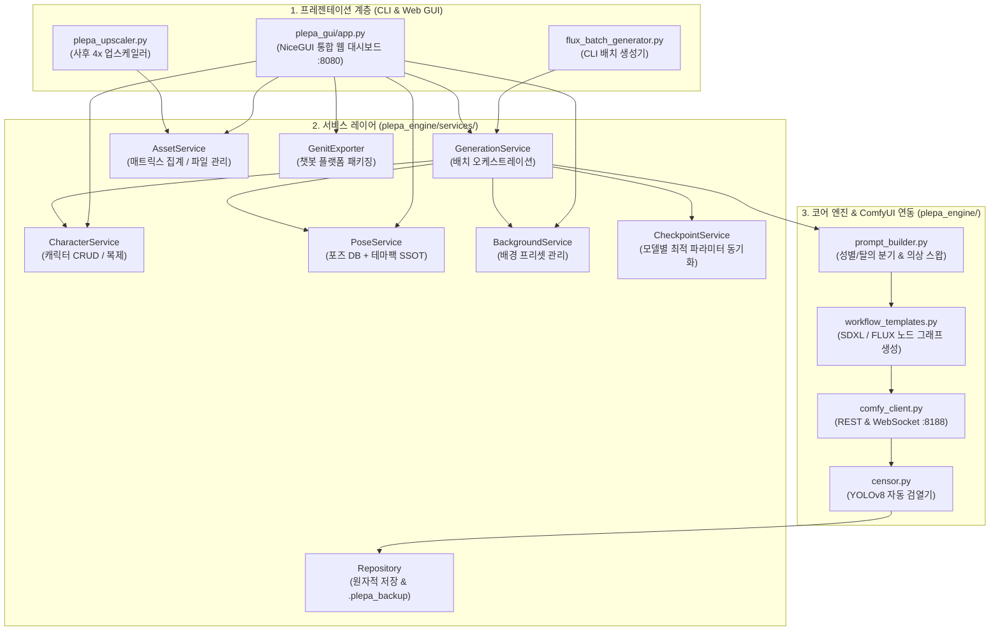

# 플에파(PLEPA) 통합 기능 명세 및 전체 파일 아키텍처 규격서

> **문서 목적**: ComfyUI 연동 듀얼 엔진(SDXL & FLUX.1 [dev]) 캐릭터 에셋 배치 생성 파이프라인, 서비스 레이어, NiceGUI 웹 대시보드, 테마 팩 시스템 및 프로젝트 내 **모든 파일의 역할과 기술 규격**을 정의하는 단일 통합 명세서(SSOT).  
> **대상 독자**: 프로젝트 관리자, 외부 AI 에이전트, 파이프라인 개발자.  
> **관련 문서 바로가기**:  
> - 📘 마스터 인계 및 아키텍처 결정서(ADR) → [`docs/AI_HANDOVER_GUIDE.md`](file:///c:/Users/rbsgh/plepa/docs/AI_HANDOVER_GUIDE.md)  
> - 📚 문서 관리 및 푸시 프로토콜 → [`docs/DOCUMENTATION_GUIDE.md`](file:///c:/Users/rbsgh/plepa/docs/DOCUMENTATION_GUIDE.md)  
> - 🛠️ 실전 CLI 운영 매뉴얼 → [`docs/RUNBOOK.md`](file:///c:/Users/rbsgh/plepa/docs/RUNBOOK.md)  
> - 🎨 캐릭터 외형/포즈/프롬프트 제작 규칙 → [`docs/캐릭터_포즈_제작_규칙.md`](file:///c:/Users/rbsgh/plepa/docs/캐릭터_포즈_제작_규칙.md)  
> - 👗 테마 팩 및 다이내믹 의상 스왑 가이드 → [`docs/THEME_PACK_GUIDE.md`](file:///c:/Users/rbsgh/plepa/docs/THEME_PACK_GUIDE.md)  
> - 📋 전체 포즈 카탈로그 → [`docs/POSE_CATALOG.md`](file:///c:/Users/rbsgh/plepa/docs/POSE_CATALOG.md)

---

## 📑 목차 (Table of Contents)

1. [1. 시스템 전체 아키텍처 및 데이터 흐름](#1-시스템-전체-아키텍처-및-데이터-흐름)
2. [2. 프로젝트 전체 파일 디렉토리 및 역할 명세](#2-프로젝트-전체-파일-디렉토리-및-역할-명세)
   - [2.1 루트 진입점 및 설정 파일](#21-루트-진입점-및-설정-파일)
   - [2.2 코어 엔진 패키지 (`plepa_engine/`)](#22-코어-엔진-패키지-plepa_engine)
   - [2.3 비즈니스 서비스 레이어 (`plepa_engine/services/`)](#23-비즈니스-서비스-레이어-plepa_engineservices)
   - [2.4 NiceGUI 웹 대시보드 (`plepa_gui/`)](#24-nicegui-웹-대시보드-plepa_gui)
   - [2.5 테마 팩 및 데이터베이스 (`themes/` & JSON)](#25-테마-팩-및-데이터베이스-themes--json)
   - [2.6 멀티 로스터 프로젝트 구조 (`projects/`)](#26-멀티-로스터-프로젝트-구조-projects)
   - [2.7 자동화 테스트 스위트 (`tests/`)](#27-자동화-테스트-스위트-tests)
   - [2.8 기술 문서 체계 (`*.md`, `*.txt`)](#28-기술-문서-체계-md-txt)
3. [3. 여성 캐릭터 vs 오토코노코(낭자애) 생성 워크플로우](#3-여성-캐릭터-vs-오토코노코낭자애-생성-워크플로우)
4. [4. 데이터 스키마 규격 (Data Specifications)](#4-데이터-스키마-규격-data-specifications)
5. [5. 프롬프트 조립 및 다이내믹 의상 스왑 메커니즘](#5-프롬프트-조립-및-다이내믹-의상-스왑-메커니즘)
6. [6. CLI 전체 옵션 규격 (`flux_batch_generator.py`)](#6-cli-전체-옵션-규격-flux_batch_generatorpy)
7. [7. ComfyUI 비동기 API 및 후처리 규격](#7-comfyui-비동기-api-및-후처리-규격)
8. [8. 저장소 안전성 및 원자적 백업 불변식](#8-저장소-안전성-및-원자적-백업-불변식)

---

## 1. 시스템 전체 아키텍처 및 데이터 흐름

플에파(PLEPA)는 **CLI(`flux_batch_generator.py`)**와 **웹 GUI(`plepa_gui/app.py`)**가 동일한 **비즈니스 서비스 레이어(`plepa_engine.services`)**를 공유하는 3계층(Presentation - Service - Core/Repository) 아키텍처로 설계되어 있습니다.



---

## 2. 프로젝트 전체 파일 디렉토리 및 역할 명세

### 2.1 루트 진입점 및 설정 파일
| 파일명 | 역할 및 주요 기능 |
| :--- | :--- |
| **[`flux_batch_generator.py`](file:///c:/Users/rbsgh/plepa/flux_batch_generator.py)** | **메인 CLI 진입점**. 명령줄 인자 파싱, 캐릭터 목록 출력(`-l`), 시스템 자가 진단(`--test`), 배치 생성 실행을 담당합니다. |
| **[`plepa_upscaler.py`](file:///c:/Users/rbsgh/plepa/plepa_upscaler.py)** | **독립형 사후 업스케일러 CLI**. 이미 생성된 WebP 에셋들을 ComfyUI 4x-UltraSharp 노드로 일괄 고해상도 확대합니다. |
| **[`run_gui.bat`](file:///c:/Users/rbsgh/plepa/run_gui.bat)** | **웹 대시보드 원클릭 런처**. 가상환경(`.venv`) 활성화 후 NiceGUI 서버(`http://localhost:8080`)를 구동합니다. |
| **[`requirements.txt`](file:///c:/Users/rbsgh/plepa/requirements.txt)** | Python 패키지 의존성 명세 (`nicegui`, `pydantic`, `websocket-client`, `Pillow`, `ultralytics` 등). |
| **[`.plepa_state/config.json`](file:///c:/Users/rbsgh/plepa/.plepa_state/config.json)** | 웹 GUI 및 엔진의 마지막 선택 상태(기본 로스터, 체크포인트, 해상도 등)를 영구 보존하는 런타임 설정 파일. |

---

### 2.2 코어 엔진 패키지 (`plepa_engine/`)
| 파일명 | 역할 및 주요 기능 |
| :--- | :--- |
| **[`config.py`](file:///c:/Users/rbsgh/plepa/plepa_engine/config.py)** | 시스템 전역 상수, ComfyUI 호스트(`127.0.0.1:8188`), 기본 해상도/샘플러/CFG, 표준 입출력 UTF-8 설정(`configure_stdio`) 관리. |
| **[`models.py`](file:///c:/Users/rbsgh/plepa/plepa_engine/models.py)** | 핵심 데이터클래스 정의 (`CharacterConfig`, `AppearanceConfig`, `PoseEntry`, `GenerationTarget`, `GenerationResult`). |
| **[`prompt_builder.py`](file:///c:/Users/rbsgh/plepa/plepa_engine/prompt_builder.py)** | **지능형 프롬프트 조립 엔진**. 성별(`female`/`male`) 분기, 착의/탈의(`nude`) 전환, 다이내믹 의상 스왑(`outfit_override`), 모브(`BREAK`) 토큰 격리, 배경 치환을 수행합니다. |
| **[`workflow_templates.py`](file:///c:/Users/rbsgh/plepa/plepa_engine/workflow_templates.py)** | **ComfyUI 노드 그래프 생성기**. `build_sdxl_workflow()` 및 `build_flux_workflow()`를 통해 KSampler, LoRA, IP-Adapter, Face Detailer, 4x Upscale 노드를 동적 조립합니다. |
| **[`comfy_client.py`](file:///c:/Users/rbsgh/plepa/plepa_engine/comfy_client.py)** | **ComfyUI 비동기 클라이언트**. `/prompt` 큐 등록, WebSocket(`/ws`) 실시간 스텝 진행률 수신, `/history` 및 `/view`를 통한 이미지 수신 및 원자적 WebP 저장을 담당합니다. |
| **[`checkpoint_service.py`](file:///c:/Users/rbsgh/plepa/plepa_engine/checkpoint_service.py)** | **모델 프로파일 매니저**. 체크포인트 파일명에 맞춰 최적의 CFG, Steps, Sampler, 품질 태그 프리셋을 자동 매칭합니다. |
| **[`checkpoint_profiles.json`](file:///c:/Users/rbsgh/plepa/plepa_engine/checkpoint_profiles.json)** | SDXL/Illustrious/Unholy 등 체크포인트별 권장 샘플링 파라미터 및 전용 품질 태그 DB. |
| **[`censor.py`](file:///c:/Users/rbsgh/plepa/plepa_engine/censor.py)** | **2D 성기 자동 검열 엔진**. YOLOv8 세그멘테이션 모델을 사용하여 `bar`(캡슐형 와이드 바), `slim_bar`, `shadow`, `mosaic` 스타일로 검열본(`_censored.webp`)을 자동 생성합니다. |
| **[`reporter.py`](file:///c:/Users/rbsgh/plepa/plepa_engine/reporter.py)** | 에셋 파일명 포매팅(`hybrid`, `code`, `label`), 콘솔 진행 상태 출력, 배치 완료 통계 리포트 출력. |

---

### 2.3 비즈니스 서비스 레이어 (`plepa_engine/services/`)
CLI와 GUI가 공통으로 호출하는 단일 진실 공급원(SSOT) 서비스 계층입니다.

| 파일명 | 역할 및 주요 기능 |
| :--- | :--- |
| **[`repository.py`](file:///c:/Users/rbsgh/plepa/plepa_engine/services/repository.py)** | **안전 파일 I/O 저장소**. 모든 JSON 수정 전 `.plepa_backup/`에 타임스탬프 백업본을 자동 생성하고, 임시 파일 기록 후 원자적 교체(`os.replace`)를 수행합니다. |
| **[`schemas.py`](file:///c:/Users/rbsgh/plepa/plepa_engine/services/schemas.py)** | Pydantic 기반 캐릭터/포즈/설정 데이터 유효성 검증 모델. |
| **[`character_service.py`](file:///c:/Users/rbsgh/plepa/plepa_engine/services/character_service.py)** | 로스터별 캐릭터 탐색, 생성/수정/삭제(CRUD), 전역 `prefix` 중복 검증, 캐릭터 복제 마법사(Clone Wizard) 제공. |
| **[`pose_service.py`](file:///c:/Users/rbsgh/plepa/plepa_engine/services/pose_service.py)** | 기본 포즈 DB + `themes/*.json` 테마 팩 자동 병합 로드. **메타데이터 주도형 카테고리/단축키 동적 레지스트리(ADR-47)**를 통해 GUI와 CLI에 포즈 그룹을 공급합니다. |
| **[`background_service.py`](file:///c:/Users/rbsgh/plepa/plepa_engine/services/background_service.py)** | `projects/{roster}/background.json`의 배경 프리셋 조회 및 편집 서비스. |
| **[`asset_service.py`](file:///c:/Users/rbsgh/plepa/plepa_engine/services/asset_service.py)** | 생성된 `.webp` 에셋 스캔, 캐릭터×포즈 매트릭스 달성률 계산, 고아 에셋 감지, 파일 삭제 처리. |
| **[`generation_service.py`](file:///c:/Users/rbsgh/plepa/plepa_engine/services/generation_service.py)** | **배치 생성 오케스트레이터**. 캐릭터 성별에 따른 포즈 자동 필터링, 스마트 스킵, 실시간 콜백(`on_progress`), 작업 중단(`is_cancelled`) 제어. |
| **[`job_manager.py`](file:///c:/Users/rbsgh/plepa/plepa_engine/services/job_manager.py)** | 웹 GUI에서 실행된 비동기 배치 작업의 스레드 생명주기, 실시간 로그 버퍼, 진행 상태 관리. |
| **[`upscale_service.py`](file:///c:/Users/rbsgh/plepa/plepa_engine/services/upscale_service.py)** | 단일 또는 다중 에셋에 대한 ComfyUI 4x 업스케일링 워크플로우 실행 서비스. |
| **[`genit_exporter.py`](file:///c:/Users/rbsgh/plepa/plepa_engine/services/genit_exporter.py)** | **제닛(Genit) 익스포터**. 생성된 에셋을 챗봇 플랫폼 업로드 규격(번호 매핑, ZIP 압축, 프롬프트 시트)으로 원클릭 패키징합니다. |
| **[`config_service.py`](file:///c:/Users/rbsgh/plepa/plepa_engine/services/config_service.py)** | 글로벌 환경설정(`.plepa_state/config.json`) 로드 및 저장 서비스. |

---

### 2.4 NiceGUI 웹 대시보드 (`plepa_gui/`)
브라우저(`http://localhost:8080`)에서 모든 기능을 시각적으로 제어하는 풀스택 웹 인터페이스입니다.

| 파일명 | URL 경로 | 역할 및 주요 기능 |
| :--- | :--- | :--- |
| **[`app.py`](file:///c:/Users/rbsgh/plepa/plepa_gui/app.py)** | `/` | NiceGUI 서버 초기화, 정적 에셋 라우팅, 페이지 등록 및 실행 진입점. |
| **[`components/header.py`](file:///c:/Users/rbsgh/plepa/plepa_gui/components/header.py)** | 공통 상단바 | 글로벌 로스터 선택기, 엔진/체크포인트 표시, ComfyUI 서버 실시간 헬스체크 LED, 탭 네비게이션. |
| **[`components/prompt_inspector.py`](file:///c:/Users/rbsgh/plepa/plepa_gui/components/prompt_inspector.py)** | 공통 모달/패널 | 캐릭터 + 포즈 + 배경이 결합된 최종 긍정/네거티브 프롬프트 조립 결과를 생성 전 실시간 검증. |
| **[`pages/characters.py`](file:///c:/Users/rbsgh/plepa/plepa_gui/pages/characters.py)** | `/characters` | 캐릭터 카드 목록, 외모/프롬프트/프로필 시각적 편집기, 캐릭터 복제 및 신규 생성 마법사. |
| **[`pages/poses.py`](file:///c:/Users/rbsgh/plepa/plepa_gui/pages/poses.py)** | `/poses` | 전체 포즈 및 테마 팩(`A`, `B`, `C`, `N`, `BN` 등) 동적 탭 필터링, 프롬프트 편집, 의상 스왑 옵션 설정. |
| **[`pages/pose_sets.py`](file:///c:/Users/rbsgh/plepa/plepa_gui/pages/pose_sets.py)** | `/pose-sets` | 자주 생성하는 포즈 묶음(`pose_sets.json`)을 체크박스로 구성하고 저장하는 세트 빌더. |
| **[`pages/backgrounds.py`](file:///c:/Users/rbsgh/plepa/plepa_gui/pages/backgrounds.py)** | `/backgrounds` | 로스터별 배경 프리셋(`background.json`) 추가/수정/삭제 관리. |
| **[`pages/generate.py`](file:///c:/Users/rbsgh/plepa/plepa_gui/pages/generate.py)** | `/generate` | **배치 생성 런처**. 대상 캐릭터, 포즈 단축 버튼(감정A, 행동B, 장르C, 성인N 등), 화풍/배경 오버라이드, 실시간 프로그레스 바 및 강제 중단 지원. |
| **[`pages/gallery.py`](file:///c:/Users/rbsgh/plepa/plepa_gui/pages/gallery.py)** | `/gallery` | **에셋 갤러리 & 매트릭스 뷰어**. 캐릭터×포즈 현황표, 고해상도 라이트박스 확대, 불량 에셋 즉시 재생성(원클릭 Reroll), 4x 업스케일, Genit ZIP 익스포트. |
| **[`pages/settings.py`](file:///c:/Users/rbsgh/plepa/plepa_gui/pages/settings.py)** | `/settings` | 기본 엔진(SDXL/FLUX), 체크포인트 모델 선택, 기본 해상도/스텝/CFG, 백업 복원 관리. |

---

### 2.5 테마 팩 및 데이터베이스 (`themes/` & JSON)
| 파일명 | 코드 대역 | 역할 및 주요 내용 |
| :--- | :--- | :--- |
| **[`sdxl_pose_database.json`](file:///c:/Users/rbsgh/plepa/sdxl_pose_database.json)** | `000`~`159` | SDXL 기반 기본 80종 포즈 DB (감정 20, 포즈 20, 여성 H씬 20, 오토코노코 H씬 20). |
| **[`flux_pose_database.json`](file:///c:/Users/rbsgh/plepa/flux_pose_database.json)** | `000`~`159` | FLUX.1 기반 영문 서술형 자연어 80종 포즈 DB. |
| **[`themes/genit_emotions.json`](file:///c:/Users/rbsgh/plepa/themes/genit_emotions.json)** | `A00`~`A09` | **감정/표정 핵심 10종 (A팩)**: 첫등장(`A00`), 미소, 폭소, 홍조, 유혹, 눈물, 분노, 놀람, 삐짐, 키스. |
| **[`themes/genit_actions.json`](file:///c:/Users/rbsgh/plepa/themes/genit_actions.json)** | `B01`~`B10` | **일상/스킨십 핵심 10종 (B팩)**: 식사, 음주, 독서, 수면, 포옹, 손잡기, 무릎베개, 벽쿵, 간호, 샤워타올. |
| **[`themes/wuxia_actions.json`](file:///c:/Users/rbsgh/plepa/themes/wuxia_actions.json)** | `C01`~`C10` | **장르 특화 액션 10종 (C팩)**: 전투, 부상, 잠입, 제압 등 세계관 맞춤 상황 10종. |
| **[`themes/adult.json`](file:///c:/Users/rbsgh/plepa/themes/adult.json)** | `N01`~`N32` | **성인/고수위 통합 32종 (N팩)**: 단계별 탈의, 애무, 봉사와 체위 시퀀스 32종. |
| **[`themes/bunny.json`](file:///c:/Users/rbsgh/plepa/themes/bunny.json)** | `BN01`~`BN10` | **바니걸 테마 팩**: 캐릭터 기본 의상을 바니걸 슈트로 자동 교체(`replace`)하는 전용 포즈 팩. |
| **[`themes/swimsuit.json`](file:///c:/Users/rbsgh/plepa/themes/swimsuit.json)** | `SW01`~`SW10` | **수영복 테마 팩**: 캐릭터 기본 의상을 비키니/수영복으로 자동 교체하는 전용 포즈 팩. |
| **[`themes/bdsm.json`](file:///c:/Users/rbsgh/plepa/themes/bdsm.json)** | `BD01`~`BD10` | **구속/조교 테마 팩**: 특수 속박 연출 및 소품 결합 포즈 팩. |
| **[`pose_sets.json`](file:///c:/Users/rbsgh/plepa/pose_sets.json)** | 프리셋 | 자주 쓰는 포즈 코드 묶음 정의 (예: `starter_pack`, `genit_essential_30` 등). |

---

### 2.6 멀티 로스터 프로젝트 구조 (`projects/`)
각 작품 세계관별로 캐릭터와 에셋이 완전히 독립 격리됩니다.

| 로스터 폴더 | 세계관 테마 | 소속 캐릭터 (`characters/*.json`) |
| :--- | :--- | :--- |
| **`projects/spy/`** | **1960s 냉전 비밀 살롱 & 스파이 (현재 주력)** | `srh`(사라), `vic`(빅토리아), `cla`(클라라), `viv`(비비안), `rvn`(레이븐), `scl`(스칼렛), `kzk`(코즈카), `chl`(클로에), `dom`(도미니카), `evl`(에블린) - 10인 |
| **`projects/murim/`** | 무협 강호록 (구 버전 보관) | `aa`~`jj` 무협 10인 및 `mob_cult`, `mob_nanman` |
| **`projects/maid/`** | 빅토리안 메이드 저택 | `aoi`, `cyo`, `han`, `mia`, `rei`, `ren`, `rub`, `sio`, `yua`, `yuk` - 10인 |
| **`projects/don/`** | 현대 로맨스 드라마 | `bjh`, `eunha`, `hay`, `jhy`, `ksn`, `oes`, `sce`, `shn`, `sia`, `ykn` 외 다중 프로필 |
| **`projects/man/`** | 사내 오피스 로맨스 | `cyr`, `hsh`, `kma`, `sja`, `yca` - 5인 |
| **`projects/hey/`** | 학원 판타지 | `har`, `her`, `mal` - 3인 |
| **`projects/ykn/`** | 캠퍼스 만화동아리 | `hay`, `ser`, `sia`, `yua` - 4인 |

---

### 2.7 자동화 테스트 스위트 (`tests/`)
| 파일명 | 검증 대상 |
| :--- | :--- |
| **[`test_gui_all_features.py`](file:///c:/Users/rbsgh/plepa/tests/test_gui_all_features.py)** | GUI 7대 페이지 및 SSOT 메타데이터 레지스트리(포즈 카테고리, 단축 버튼) 무결성 통합 테스트. |
| **[`test_gender_prompt_split.py`](file:///c:/Users/rbsgh/plepa/tests/test_gender_prompt_split.py)** | 여성(`female`) vs 오토코노코(`male`) 성별 분기 및 탈의 프롬프트 격리 검증. |
| **[`test_outfit_swap.py`](file:///c:/Users/rbsgh/plepa/tests/test_outfit_swap.py)** | 테마 팩 의상 교체(`keep`, `replace`, `nude`) 동작 검증. |
| **[`test_checkpoint_service.py`](file:///c:/Users/rbsgh/plepa/tests/test_checkpoint_service.py)** | 체크포인트별 프로파일 매칭 및 CLI 오버라이드 우선순위 검증. |
| **[`test_genit_exporter.py`](file:///c:/Users/rbsgh/plepa/tests/test_genit_exporter.py)** | Genit 플랫폼 익스포트 패키징 무결성 검증. |
| **[`test_upscale.py`](file:///c:/Users/rbsgh/plepa/tests/test_upscale.py)** | 4x AI 업스케일 워크플로우 생성 및 처리 검증. |
| **[`snapshot_prompts.py`](file:///c:/Users/rbsgh/plepa/tests/snapshot_prompts.py)** | 프롬프트 조립 로직 변경 시 의도치 않은 회귀(Regression)를 감지하는 스냅샷 비교 도구. |

---

### 2.8 기술 문서 체계 (`*.md`, `*.txt`)
* **[`GEMINI.md`](file:///c:/Users/rbsgh/plepa/GEMINI.md)**: AI 에이전트 최상위 행동 수칙 (한국어 소통, 커밋 민감어 배제, 인계 프로토콜).
* **[`AI_HANDOVER_GUIDE.md`](file:///c:/Users/rbsgh/plepa/AI_HANDOVER_GUIDE.md)**: 시스템 아키텍처 결정 기록(ADR-1 ~ ADR-48) 및 하드웨어 최적화 불변식.
* **[`DOCUMENTATION_GUIDE.md`](file:///c:/Users/rbsgh/plepa/DOCUMENTATION_GUIDE.md)**: 문서 동기화 매트릭스 및 깃 푸시 5단계 표준 운영 절차(SOP).
* **[`개발일지.md`](file:///c:/Users/rbsgh/plepa/개발일지.md)**: 일자별 작업 목표, 트러블슈팅, 산출물 기록부.
* **[`RUNBOOK.md`](file:///c:/Users/rbsgh/plepa/RUNBOOK.md)** & **[`사용법.txt`](file:///c:/Users/rbsgh/plepa/사용법.txt)**: 실전 CLI 명령어 치트시트 및 서버 구동 매뉴얼.
* **[`TROUBLESHOOTING_CHECKLIST.md`](file:///c:/Users/rbsgh/plepa/TROUBLESHOOTING_CHECKLIST.md)**: 6대 계층별 장애 진단 체크리스트.
* **[`제닛_캐릭터챗봇_제작법.md`](file:///c:/Users/rbsgh/plepa/제닛_캐릭터챗봇_제작법.md)**: 생성된 에셋을 활용한 캐릭터 챗봇 구축 가이드.

---

## 3. 여성 캐릭터 vs 오토코노코(낭자애) 생성 워크플로우

플에파는 캐릭터 JSON의 `"gender"` 및 `"default_mode"` 설정에 따라 **포즈 필터링부터 신체 프롬프트 조립까지 전 과정을 자동으로 분기**합니다.

| 단계 | 여성 캐릭터 (`gender: "female"`) | 오토코노코 캐릭터 (`gender: "male"` / `otokonoko`) |
| :--- | :--- | :--- |
| **1. 포즈 DB 필터링** | 기본 감정/행동(A, B, C) + **여성 전용 성인 포즈(`040`~`059`, `N01`~`N32`)** 자동 할당 | 기본 감정/행동(A, B, C) + **오토코노코 전용 포즈(`140`~`159`)** 자동 할당 |
| **2. 기본 본체 태그** | `1girl, solo, feminine curves` + 캐릭터 고유 체형(거유/슬렌더/단신 등) | `1boy, otokonoko, solo, androgynous cute face, slender feminine body, flat chest` |
| **3. 착의 씬 조립** | `sdxl_positive`의 기본 외모 + 지정 의상 유지 | `sdxl_positive`의 미소녀풍 외모 + 여장/보이시 의상 유지 + 여성 가슴 생성 억제 |
| **4. 탈의(Nude) 조립** | 의상 태그 전면 제거 ➔ `sdxl_nude_positive`의 여성 신체 묘사 주입 | 의상 태그 전면 제거 ➔ `sdxl_nude_positive`의 평평한 가슴(`flat chest`) 및 소년 신체 구조 주입 |
| **5. 네거티브 방어** | `1boy, muscular` 및 캐릭터 체형 반대 태그(예: 거유 캐릭터의 경우 `flat chest`) 차단 | `female breasts, cleavage, large breasts, muscular man, beard, facial hair` 강력 차단 |

---

## 4. 데이터 스키마 규격 (Data Specifications)

### 4.1 캐릭터 JSON (`projects/{roster}/characters/{prefix}.json`)
```json
{
  "prefix": "srh",
  "name": "Sarah (사라 / 주인공 파견 파트너 요원)",
  "gender": "female",
  "faction": "state_intelligence_partner",
  "role": "주인공과 함께 잠입 파견된 수석 파트너 바니걸 요원",
  "appearance": {
    "face_and_hair": "sleek jet-black hair in high ponytail, center-parted natural bangs...",
    "physique": "slender toned athletic body, long slender legs, perky firm medium breasts",
    "outfit": "luxury black velvet bunny girl suit with cropped bolero jacket..."
  },
  "sdxl_positive": "art by raita, long slender limbs, sharp seductive gaze, clean smooth forehead...",
  "sdxl_negative": "forehead mark, forehead jewel, keyhole, worst quality, low quality...",
  "sdxl_nude_positive": "masterpiece, best quality, absurdres, 1girl, solo, sarah..."
}
```

### 4.2 테마 팩 포즈 JSON (`themes/*.json`)
```json
{
  "meta": {
    "id": "genit_emotions",
    "name": "감정/표정 팩 (A)",
    "prefix": "A",
    "shortcut_label": "감정 10종 (A00~A09)",
    "order": 10
  },
  "poses": {
    "A00": {
      "label": "첫등장",
      "description": "캐릭터의 기본 매력과 복장을 가장 잘 보여주는 대표 프로필 스탠딩 포즈.",
      "outfit_mode": "keep",
      "prompt": "standing, looking at viewer, confident alluring posture, cowboy shot"
    }
  }
}
```
* **`meta` 블록 (ADR-47 SSOT)**: 테마 팩 JSON 상단에 `meta` 정보를 정의하면, 웹 GUI의 `/poses`, `/generate`, `/gallery` 페이지가 코드 수정 없이 탭과 단축 선택 버튼을 자동 생성합니다.

---

## 5. 프롬프트 조립 및 다이내믹 의상 스왑 메커니즘

`plepa_engine/prompt_builder.py`는 각 포즈의 `outfit_mode` 설정에 따라 캐릭터의 의상을 3가지 모드로 동적 처리합니다:

1. **`outfit_mode: "keep"` (기본값 - 일상/감정/전투 씬)**:
   - 캐릭터 JSON에 정의된 고유 의상(`appearance.outfit` / `sdxl_positive`)을 그대로 유지한 채 포즈와 배경만 결합합니다.
2. **`outfit_mode: "replace"` (테마 팩 - 바니걸/수영복 등)**:
   - 캐릭터의 고유 얼굴·헤어·체형은 100% 보존하면서, 기존 의상만 제거하고 테마 팩 포즈의 `outfit_override` 의상으로 즉시 갈아입힙니다.
3. **`outfit_mode: "nude"` (성인/탈의 씬 - 40번대, N팩)**:
   - 모든 의상 태그를 스트리핑하고 `sdxl_nude_positive`의 순수 본체 외형과 포즈 프롬프트를 결합합니다.

---

## 6. CLI 전체 옵션 규격 (`flux_batch_generator.py`)

| 옵션 | 기본값 | 설명 |
| :--- | :--- | :--- |
| `-c, --character` | `all` | 대상 캐릭터 식별자 (`srh`, `srh,vic`, `all` 등) |
| `-p, --pose` | `all` | 포즈 코드/범위 (`A00`, `A00..A09`, `emotions`, `all` 등) |
| `-r, --roster` | `default` | 대상 프로젝트 로스터 폴더 (`spy`, `maid`, `don` 등) |
| `-l, --list` | False | 해당 로스터의 캐릭터 목록 및 의상 요약 테이블 출력 |
| `--engine` | `sdxl` | 생성 엔진 선택 (`sdxl` 또는 `flux`) |
| `--ckpt` | `unholyDesireMix...` | SDXL 체크포인트 모델 파일명 지정 |
| `--ckpt-tag` | None | 비교 테스트용 서브폴더 태그 (`assets/{prefix}/ckpt_{tag}/`에 격리 저장) |
| `--custom_pos` | None | 추가 긍정 프롬프트 또는 작가 화풍 태그 즉석 주입 (예: `"art by raita"`) |
| `--custom_neg` | None | 추가 네거티브 태그 즉석 결합 |
| `--bg` / `--bg-preset` | `default` | 배경 프롬프트 직접 주입 또는 `background.json` 프리셋 키 선택 |
| `--overwrite, -f` | False | 기존 에셋 파일이 존재해도 강제로 덮어쓰기 (리롤/업데이트용) |
| `--face-detailer` | False | YOLO 기반 얼굴 자동 검출 및 2차 고해상도 인페인팅 보정 |
| `--upscale` | False | 4x-UltraSharp 모델을 통한 초고해상도 업스케일 |
| `--censor` | False | YOLOv8 기반 2D 성기 자동 검열본(`_censored.webp`) 동시 생성 |
| `--mock` / `--dry-run` | False | ComfyUI 호출 없이 더미 이미지 생성(`--mock`) 또는 프롬프트만 점검(`--dry-run`) |
| `--test` | False | 듀얼 엔진 파이프라인 8대 무결성 자가 진단 실행 |

---

## 7. ComfyUI 비동기 API 및 후처리 규격

1. **체크포인트 프로파일 자동 동기화 (`CheckpointService`)**:
   - 현재 기본 모델인 `unholyDesireMixSinister_v90.safetensors` 가동 시 최적값인 **해상도 `1024x1536`, 스텝 `30`, CFG `4.5`, 샘플러 `euler / normal`**이 자동 세팅됩니다.
2. **REST & WebSocket 하이브리드 통신**:
   - `POST /prompt`로 워크플로우를 큐잉한 뒤, WebSocket으로 진행률을 실시간 추적하고 완료 시 무손실 고품질 WebP(Quality 95)로 저장합니다.

---

## 8. 저장소 안전성 및 원자적 백업 불변식

1. **자동 백업 (`.plepa_backup/`)**:
   - `Repository` 계층을 통해 캐릭터 JSON이나 설정 파일을 수정할 때마다 `.plepa_backup/{파일명}_{YYYYMMDD_HHMMSS}.bak` 백업이 자동 생성되어 데이터 유실을 원천 방지합니다.
2. **원자적 저장 (Atomic Save)**:
   - 모든 에셋과 JSON은 `.tmp` / `.part` 파일에 완전히 기록된 후 `os.replace()`로 교체되어, 생성 중 강제 종료되더라도 손상된 파일이 남지 않습니다.
